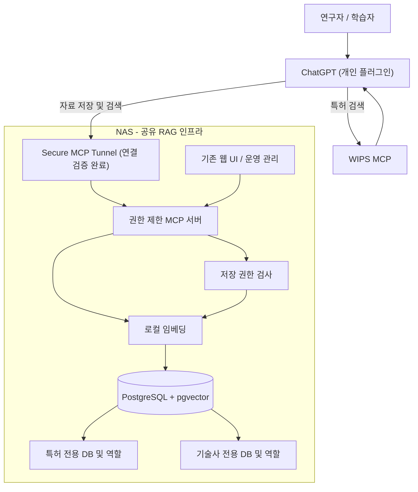

# Patent RAG Agent

ChatGPT에서 짧은 질문으로 특허를 검색하고, 허가된 문헌을 NAS에 저장하여 재사용하는 개인 PoC.

## 단순화한 목표 설계 (2026-11-19)

- ChatGPT: 질의 확장·개인화·비교 및 분석. WIPS MCP: 외부 특허 검색 및 조회.
- NAS MCP: 허가된 저장·조회·검색 및 중복 방지. 기존 기술사 RAG의 PostgreSQL/pgvector 엔진과 로컬 임베딩 자산 재사용을 우선 검토하되 DB와 역할은 분리한다.
- 기존 웹 화면은 관리 및 시연에 활용한다. 별도 LLM 생성 API는 우선 필수 아님. Tunnel 인증용 Platform 키와 모델 API 과금은 구별한다.
- 현재: ChatGPT 개인 MCP의 신규 문서 저장·조회·벡터 검색 E2E PASS. 공유 DB 격리/동시 검색/복원 사전 시험 PASS. 실제 기술사 영속 DB 공동 운영은 미전환이며 WIPS 원문·임베딩 저장은 이용 권한 확보 전 차단. 상세: [현재 상태](CURRENT_STATE.md), [공동 운영 실측](docs/16-shared-db-coexistence.md).

## 시작점
- [문서 목차](DOC_INDEX.md)
- [아키텍처](docs/02-architecture.md)
- [현재 상태](CURRENT_STATE.md) / [할 일](TASKS.md)
- [AI 작업 규칙](AGENTS.md)

## 화면 시안

`preview/index.html` 또는 `python preview/serve.py`. 가상 문헌을 사용하며 실제 API/DB 연동 없음. 사용자/관리자 설명서는 구현 완료 후 추가한다.
