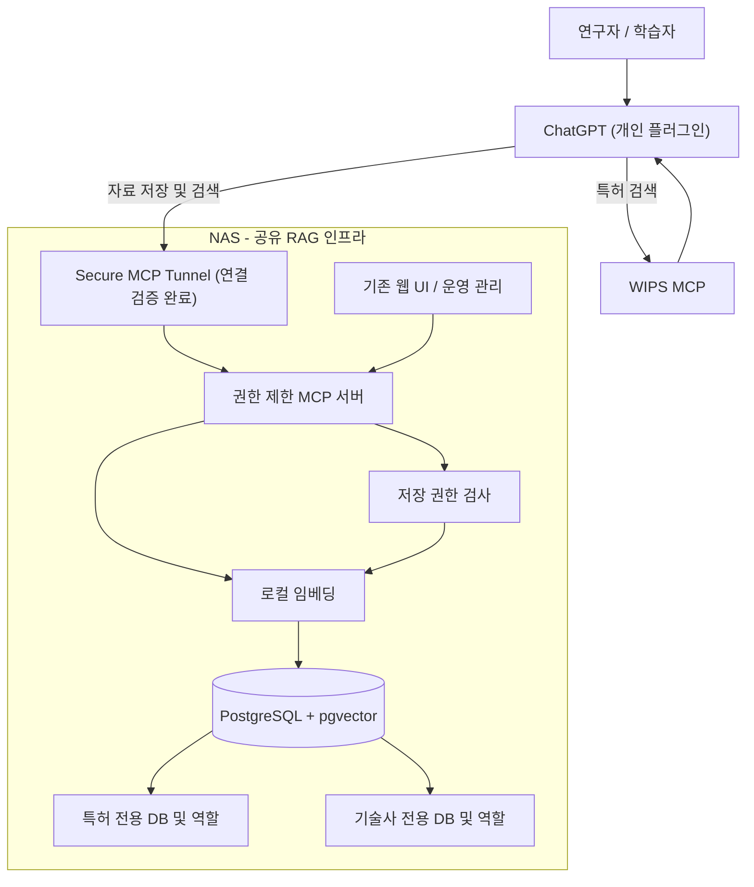
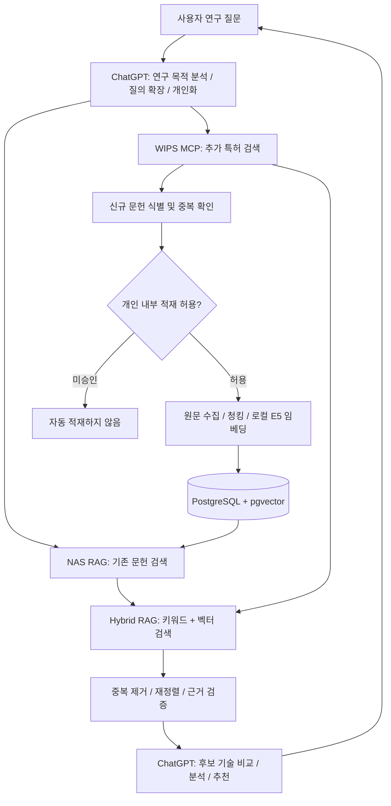

# Patent RAG Agent

ChatGPT에서 짧은 질문으로 특허를 검색하고, 허가된 문헌을 NAS에 저장하여 재사용하는 개인 PoC.

## 단순화한 목표 설계 (2026-11-19)

- ChatGPT: 질의 확장·개인화·비교 및 분석. WIPS MCP: 외부 특허 검색 및 조회.
- NAS MCP: 허가된 저장·조회·검색 및 중복 방지. 기존 기술사 RAG의 PostgreSQL/pgvector 엔진과 로컬 임베딩 자산 재사용을 우선 검토하되 DB와 역할은 분리한다.
- 기존 웹 화면은 관리 및 시연에 활용한다. 별도 LLM 생성 API는 우선 필수 아님. Tunnel 인증용 Platform 키와 모델 API 과금은 구별한다.
- 현재: ChatGPT 개인 MCP의 신규 문서 저장·조회·벡터 검색 E2E PASS. 공유 DB 격리/동시 검색/복원 사전 시험 PASS. 실제 특허 5건의 개인 NAS 비공개 저장·임베딩 검증 완료(4건 상세설명/전체 청구항 보강, 총 401청크). 실제 기술사 영속 DB 공동 운영은 미전환이며 자료의 확장 사용 및 재배포는 별도 검토. 상세: [현재 상태](CURRENT_STATE.md), [공동 운영 실측](docs/16-shared-db-coexistence.md).

## 목표 서비스 흐름 — 연구 질문에서 후보 기술 추천까지

사용자가 특허번호나 검색식을 미리 준비할 필요는 없다. 자연어로 연구 목적을 설명하면 ChatGPT가 검색·수집·분석을 오케스트레이션한다.

예시: "해저 케이블의 구리 도체를 대체할 수 있는 소재를 찾아줘." 검색어 확장, 저장 자료 검색, 신규 특허 검색 및 허용된 자료 적재, 후보 기술 비교를 하나의 작업 흐름으로 연결한다. 검색 결과는 관련성 후보이며 법적 권리·실제 적용 가능성은 별도 검토한다.

이 도식은 **목표 흐름**이다. 현재 실제 특허 5건(4건 상세 보강)의 개인 NAS 비공개 적재/로컬 벡터 검색 및 두 MCP의 개별 호출을 검증했으며, 실제 특허 통합 MCP 운영 배포 완료(56/56, API만 재시작); 기존 개인 플러그인의 신규 도구 Refresh 및 ChatGPT 실제 문헌 호출, 검색·수집 흐름 운영 자동 연계(한정 실제 검색/수집·재사용 PASS, 정책 21/21), Hybrid RAG/재정렬, 비교·추천의 통합 검증은 [현재 상태](CURRENT_STATE.md)에서 확인한다. 공급자 자료를 공개 저장소에 올리거나 다른 사용자에게 제공하지 않는다.

## 현재 개발 우선순위 — 개인용 MVP

개인 ChatGPT에서 연구 질문을 입력하고, 저장 특허 검색과 WIPS 추가 검색, 허용 문헌 증분 적재, 출처를 표시한 후보 비교·추천 및 재사용까지 검증한다. MVP에서는 ChatGPT를 사용자 인터페이스로 사용한다. 고급 Hybrid RAG/Reranking, 별도 웹 Agent·관리자 화면, 공용 DB 운영 전환, 자동화된 운영 확장 및 기업 구축은 MVP 이후 순차 추가한다. 기존 재기동 보류 및 권한 경계는 유지한다. 상세 실행 순서와 인수 기준: [TASKS.md — MVP 우선 실행 계획](TASKS.md).

## 시작점
- [문서 목차](DOC_INDEX.md)
- [아키텍처](docs/02-architecture.md)
- [현재 상태](CURRENT_STATE.md) / [할 일](TASKS.md)
- [AI 작업 규칙](AGENTS.md)

## 기업용 구축 및 운영 (MVP 이후, 백로그)

- [기업용 ChatGPT Business/Enterprise·Azure OpenAI 구분 및 방화벽 신청표·SSH 운영 가이드](docs/21-enterprise-connectivity-firewall-ssh.md)
- 기업망의 MCP는 Secure MCP Tunnel outbound HTTPS 우선. 운영 제어는 RAG와 분리한 관리 전용 MCP/내부 SSH로 설계한다. 회사 실제 네트워크·계정값은 사내 승인 문서에서 확인하고 기업 배포 전 별도 검증한다.

## 화면 시안

`preview/index.html` 또는 `python preview/serve.py`. 가상 문헌을 사용하며 실제 API/DB 연동 없음. 사용자/관리자 설명서는 구현 완료 후 추가한다.
