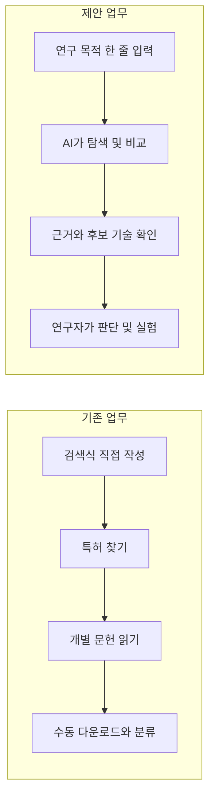
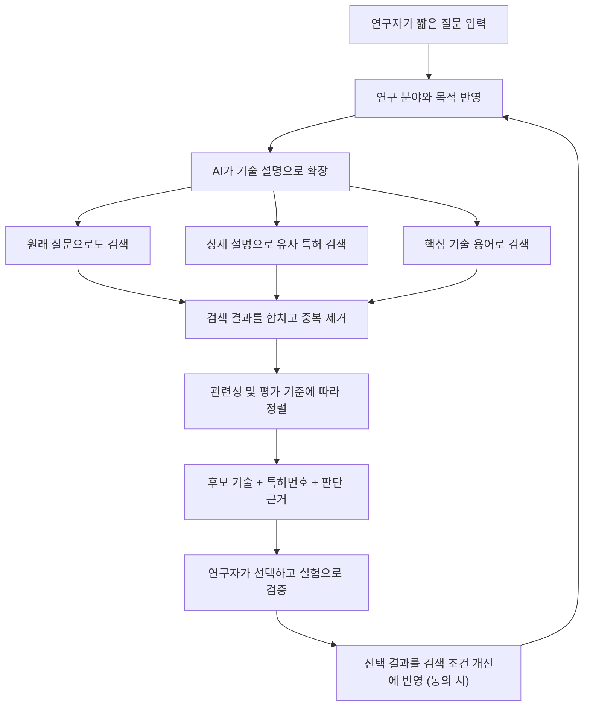
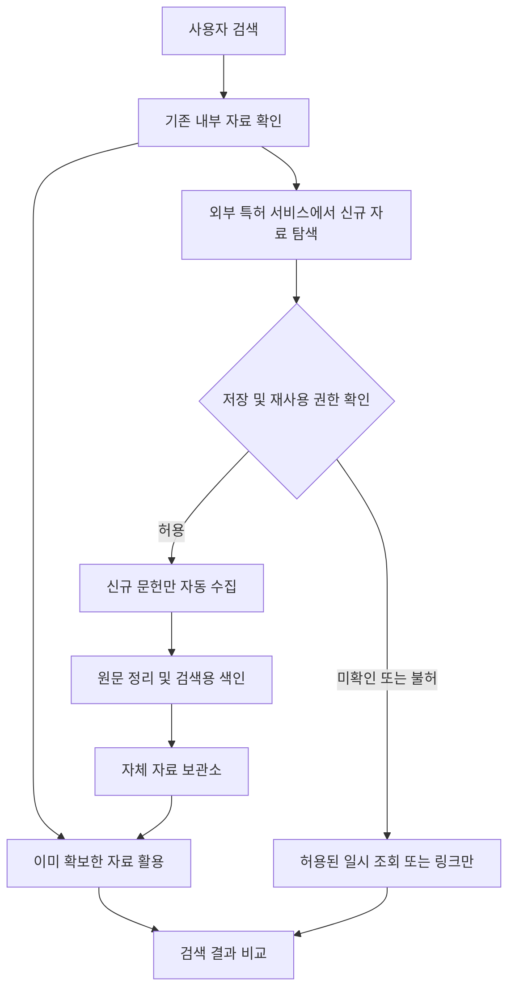
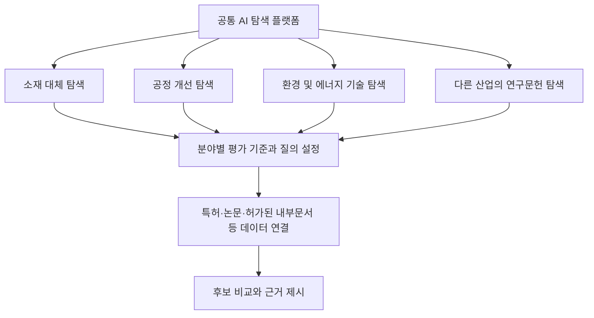

# 그림으로 이해하는 AI 기술문헌 탐색 서비스

**대상:** 화학·소재·공정 연구자, 사업 기획 담당자 (IT 지식 불필요)  
**상태:** 개인 PoC 제안 설계. 그림은 목표 기능이며 구현 실적이 아니다. 예시는 공개 가능한 가상의 연구 과제이다.

## 1. 무엇이 달라지는가?

기존에는 연구자가 검색 조건을 직접 만들고, 특허를 하나씩 열어 읽고, 파일을 저장해 다시 분류한다. 목표는 연구자가 연구 목적과 물성 조건에 집중하고 AI가 반복적인 탐색·정리 업무를 돕는 것이다.

## 2. 사용자 질문부터 결과까지

예: 연구자가 **전선용 구리 대체 소재**라고 입력한다. 전력 케이블 연구인지, 자동차용 경량 도체 연구인지 구분하면 동일한 질문도 적합한 문헌의 순서가 달라질 수 있다.

| 연구자가 알려줄 정보 | AI가 반영할 관점 |
|---|---|
| 전력 케이블 | 전도도, 저항, 가공성 |
| 자동차용 도체 | 중량, 강도, 내열성 |
| 해양 환경용 재료 | 부식, 환경 내구성 |
| 제조 공정 | 생산성, 공정 조건, 제조원가 |

300자 이상은 자동으로 만드는 검색용 설명의 실험 기준이다. 연구자는 300자를 직접 쓰지 않아도 된다. 알려지지 않은 물성 수치를 AI가 임의로 만들어서는 안 된다.

## 3. 결과 화면 예시 (가상)

| 후보 기술 | 확인할 항목 | 추가 확인 |
|---|---|---|
| 알루미늄 합금 | 전도성·경량화 | 치수, 접속 및 내구성 |
| 동복 알루미늄 | 구리 사용량·복합 구조 | 접합 계면, 제조비용 |
| 그래핀 복합 도체 | 코팅 및 전기적 특성 | 실측 전도도, 양산성 |

각 항목에는 특허번호·문헌 링크·근거 문단·확인되지 않은 항목을 표시한다. 위 표는 예시이며 실제 추천·성능 우위를 뜻하지 않는다. 특허의 기재 내용과 실제 실험으로 입증된 물성은 구분한다.

## 4. 자료가 자동으로 쌓이는 방식

자료 보관소는 팀이 이용할 수 있는 내부 기술 도서관에 비유할 수 있다. 사용자가 매번 파일을 저장할 필요는 없도록 설계하되 자료별 계약이 허용하는 범위만 저장한다. 저장된 자료가 늘면 동일 문헌의 반복 조회를 줄일 수 있지만 새 특허 검색은 계속 필요하다. 비용 절감 폭은 측정 전에는 확정하지 않는다.

## 5. 다른 연구 및 사업에 재사용하는 방법

공통 개발 부분은 검색, AI 보조 분석, 자료 관리, 결과 화면이다. 사업마다 바꾸는 부분은 연구 분야, 데이터 제공처, 평가 항목, 보안·계약이다. 논문/내부 문서 연동은 확장 설계이며 현재 구현 기능이 아니다.

## 6. 사업 단계 및 검증 기준

| 단계 | 연구/사업 담당자가 확인할 것 |
|---|---|
| 작은 PoC | 1줄 질문으로 원하는 분야의 실제 특허가 찾히는가 |
| 검색 품질 | 직접 찾은 문헌과 AI 결과 비교, 놓친 중요 문헌 확인 |
| 자료 관리 | 허가된 신규 자료가 자동 저장되고 중복 조회가 감소하는가 |
| 시범 운영 | 간편한 사용, 응답시간, 오류, 이용 비용 확인 |
| 확대 적용 | 데이터 권리, 기밀 보호, 인수 기준 충족 여부 |

**역할:** 연구 담당자는 목적·물성 조건·관련성 판단을 제공한다. AI는 탐색·정리·근거 제시를 보조한다. 운영자는 데이터 계약, 계정·예산·보안을 관리한다. 최종 기술 적합성 판단과 실험은 연구자의 책임이다.

기술 상세는 [아키텍처](02-architecture.md), 비용·계약은 [연동 정책](06-provider-policy.md), 검증은 [품질 평가](04-evaluation.md) 참조.
