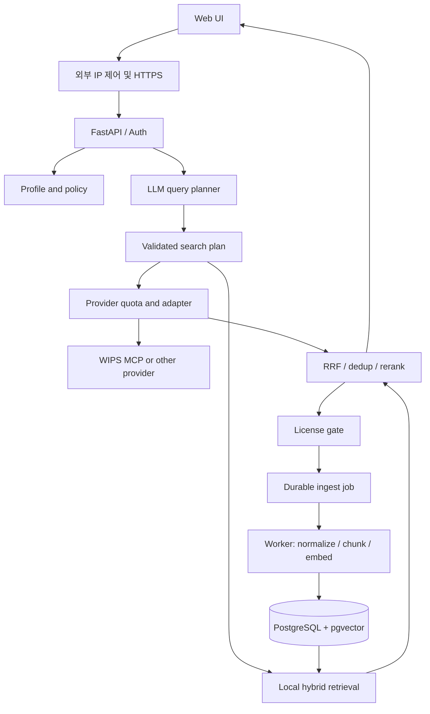

# 기술 아키텍처 — 초안

- 검색 계획은 JSON schema 검증; 원문 보존. profile의 명시 조건만 hard filter. 모델에 임의 shell/SQL/URL 권한 없음.
- 제공자별 기본 순차 호출, timeout, quota, bounded retry. 동시성 적용 범위는 실제 공급자 규칙 검증 후 확정.
- 국가/문헌번호/종류코드 및 출원/패밀리로 중복 제거. RRF로 점수 단위 차이 완화, 근거로 rerank.
- 반환과 적재 분리: 결과 먼저, 허가된 문헌만 durable worker 수집. 실패/부분 결과 명시. 허가 없으면 원문/벡터 영구 보존 금지.
- 자체 corpus의 범위/최신성 표시. 신규·누락 자료는 외부에서 탐색. 캐시의 수명과 이용 범위 준수.
- 모듈: api/auth/profile/search/providers/policy/ingestion/evaluation/ui. 최초 단일 worker 및 DB lease; 다중 인스턴스는 추가 검증.
