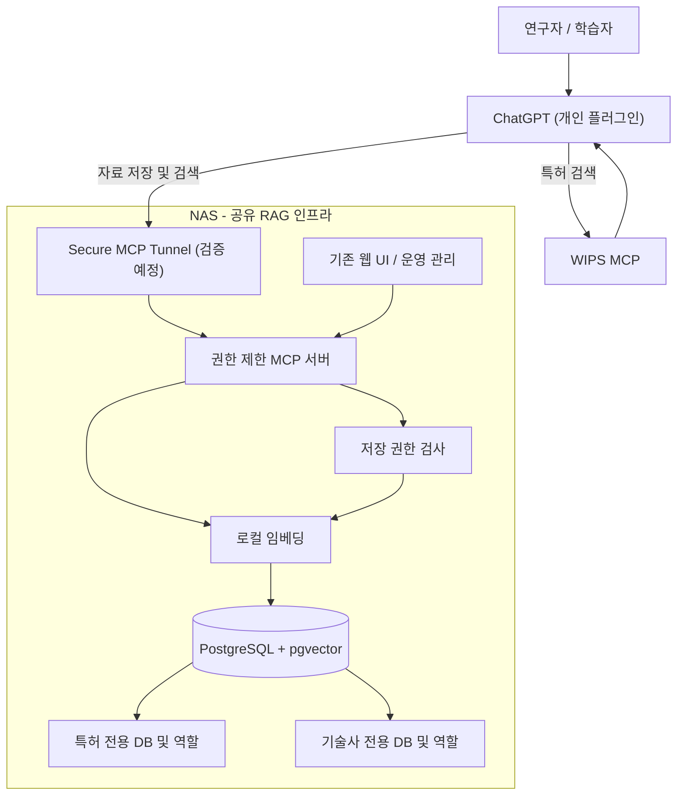
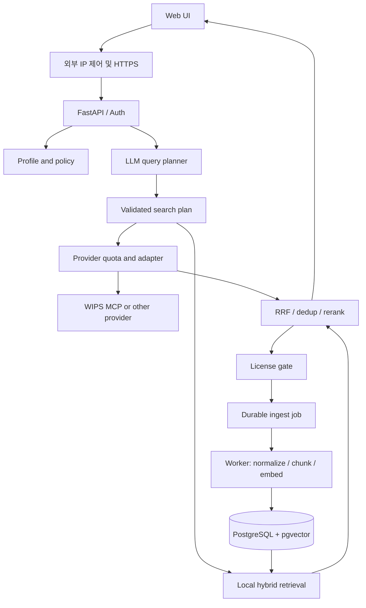

# 기술 아키텍처 — 2026-11-19 변경

## 우선 검증: ChatGPT 중심

공유 대상은 DB 엔진, 임베딩 모델 파일 및 공통 라이브러리다. 특허 전용 DB/역할/권한과 기술사 DB/역할/권한은 분리한다. 운영 중인 기술사 데이터 또는 개발 volume을 변경하지 않는다. 초기 synthetic-only MCP 도구: save_document/get_document/search_documents; 외부 임의 SQL/파일/URL/쉘 도구 금지. 임베딩은 NAS의 기존 E5-small 384D 후보를 재사용하되 실제 도메인 평가 후 확정. Secure MCP Tunnel: personal Platform org, tunnel_id, Tunnels Read+Use runtime credential, ChatGPT 권한 및 실제 도구 호출 검증 필요. Tailscale-only 웹 주소를 직접 등록할 수 있다고 가정하지 않는다. WIPS 원문/벡터 적재 권리 미확인 상태에서 차단. ChatGPT 읽기/쓰기와 모바일 지원은 계정 실증 전 미확정. 기존 독립 웹 Agent는 대체 경로로 보존한다.

## 기존 독립 웹 서비스 설계 (대체안, 현재 우선순위 아님)

- 검색 계획은 JSON schema 검증; 원문 보존. profile의 명시 조건만 hard filter. 모델에 임의 shell/SQL/URL 권한 없음.
- 제공자별 기본 순차 호출, timeout, quota, bounded retry. 동시성 적용 범위는 실제 공급자 규칙 검증 후 확정.
- 국가/문헌번호/종류코드 및 출원/패밀리로 중복 제거. RRF로 점수 단위 차이 완화, 근거로 rerank.
- 반환과 적재 분리: 결과 먼저, 허가된 문헌만 durable worker 수집. 실패/부분 결과 명시. 허가 없으면 원문/벡터 영구 보존 금지.
- 자체 corpus의 범위/최신성 표시. 신규·누락 자료는 외부에서 탐색. 캐시의 수명과 이용 범위 준수.
- 모듈: api/auth/profile/search/providers/policy/ingestion/evaluation/ui. 최초 단일 worker 및 DB lease; 다중 인스턴스는 추가 검증.
