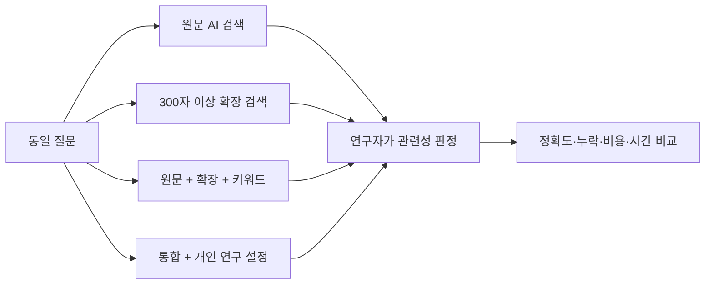

# 품질 평가 — 초기 확장 구상(현 MVP 평가 기준은 최신 문서 우선)

A/B/C/D를 같은 국가, K=10, 동일 평가 기준으로 비교한다. 문헌별 0 무관/1 간접/2 직접 label; 20개 이상 공개 또는 합성 과제, 가능한 독립 연구자 2인 평가. Precision@10, nDCG@10, MRR, 주요 정답 누락, 중복, p50/p95 latency, 호출수 및 비용. 정답 전체 집합 불명확 시 recall을 확정하지 않는다. 검색 유사도는 실제 정확도 확률이 아니다. 목표 수치는 baseline 측정 후 확정. 연구자 profile on/off 비교; 물성 실측과 특허 서술 구분. 단일 실험만으로 일반화하지 않는다.

> **2026-11-20 후속 정본:** 본 문서의 K=10/20문항·4안 비교는 **미래 확장용 초기 초안**이다. 지금 MVP 1차 사업성 판단은 [DECISION-01](44-mvp-evaluation-decision-criteria.md), [EVAL-01](45-search-quality-comparison-plan.md), [EVAL-02](46-reuse-value-verification-plan.md), [평가 인덱스](evaluation/INDEX.md)를 우선한다. 현재 운영 NAS 검색은 단일 source 기본3, 통합 후보 최대6이며 **동일 K와 후보 집합 크기를 구분**한다.
