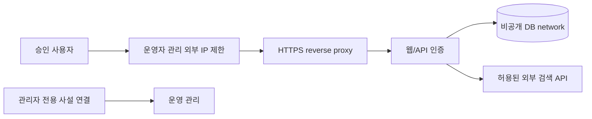
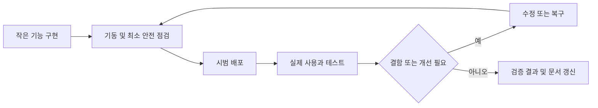

# 보안 및 NAS 배포 — 초안

외부 IP 제어는 별도 L3/네트워크 장비에서 담당. NAS 앱 IP allowlist는 요구하지 않음. HTTPS만 외부 서비스에 사용하며 사용자 인증·권한 유지. DB/API 내부 포트, DSM/SSH는 외부 공개하지 않는다. 기존 공유기/네트워크 정책은 임의 변경 금지. 신뢰되는 proxy header만 사용; secure cookie, CSRF, rate limit, audit metadata, credential 비공개 환경변수/secret. Docker Compose isolated network/volume, 최소 권한, health check, backup/restore 및 이미지/DB migration rollback. 실제 장비·도메인·IP·credential은 공개 repo 밖에서 관리. staging→연동→승인된 경로 배포→허용/차단 외부 클라이언트 실측. 현재 배포 NOT RUN.

## 반복 배포 정책 (사용자 승인)

독립 AI 검토 및 전체 사전 테스트를 기다리지 않는다. 최소 점검 통과 후 격리된 시범 서비스부터 배포한다. 외부 공개 전 보안·계약 게이트 별도 확인. 배포 후 기능/성능/사용성·실제 허용 및 비허용 접근을 시험하고 증거와 결함을 남긴다. 중대 장애는 복구 또는 시범 경로 차단 후 수정한다. AGY/Gemini 호출 금지. 미검증 배포는 완료라고 보고하지 않는다.
