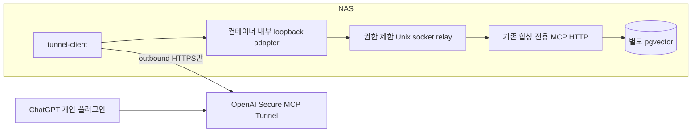

# Secure MCP Tunnel 연결 준비 — 2026-11-19

## 판정
NAS 측 연결, OpenAI 터널 실인증 및 polling PASS. 사용자 설치 및 ChatGPT 실제 신규 저장·조회·검색까지 PASS — [후속 실측](14-chatgpt-plugin-e2e.md). 아래 초기 준비 기록은 시간순 이력이다.

## 실측 증거
- 사전 검사 Gateway job `job_01M7S2EZFM002MC02XHEE8WGCY` succeeded: 기존 DB/API running, portbindings=0, 실제 HTTP 회귀 16/16. Linux x86_64. 기존 개인 플러그인 목록은 WIPS만 확인. Tunnel 이름의 Gateway 저장 credential 없음.
- [릴레이](../poc/tunnel_unix_relay.py), [실제 소켓 시험](../poc/tunnel_unix_smoke.py), commit `6efb7f35ae469fd2212cd1b8a91f43ca7ccefef2`. Gateway `job_01M7S2JJF300E87WZ3R7YVXH5R` succeeded: 14/14 LOCAL_UNIX_MCP_PASS, LOCAL_RELAY_RUNNING_NO_PUBLISHED_PORTS.
- 기존 network-none DB namespace에 신규 전용 relay container 1개, read-only root, 비root, cap-drop ALL, no-new-privileges, memory64MiB, 새 socket 디렉터리만 쓰기 mount. 외부 TCP listener/포트 없음. owner-only directory 0700/socket 0600, 고정 loopback 목적지, 최대 동시 4 및 연결 시간/byte cap, 비밀 파일·Docker socket 미마운트. 기존 guard의 bearer/Host/Origin/size 검사 유지. relay는 HTTP bytes를 중계하며 권한을 부여하지 않는다.
- 시험 14개: socket owner/mode, dir mode, missing/invalid bearer, invalid Host/Origin, oversize, initialize, tools/list, 실제 get, idempotent save, nonfixture denial, foreign ID 불가, E5 벡터 검색. 기존 저장된 합성 문헌 재사용; 신규 임의 자료 저장 없음.
- 공식 [v0.0.21 릴리스](https://github.com/openai/tunnel-client/releases/tag/v0.0.21)의 linux-amd64 전체 ZIP(29,572,642 bytes), GitHub Releases API digest와 일치: SHA256 `9e91a539e3ae1c436d499f216a1d7514b3c86cc7779032f41b2a05821d74b03a`. 신규 전용 폴더만 설치, 허용한 binary 2개 추출. Gateway `job_01M7S2KS3900QZ3RERXFEZ05PH` succeeded: RELEASE_SHA256_PASS, CLI version 0.0.21+714f2d67844b660af25754f1d19b0360b346b13b, help quickstart. 전역 PATH/패키지/네트워크 변경 및 실제 daemon 실행 없음. 서명/공급망 독립 감사와 CVE 검사 NOT RUN.
- Gateway `job_01M7S2MVE100XY75GTGNXTWTQ4` succeeded: 실제 CLI 도움말에서 unix-socket, file/env extra headers, oauth-discovery disabled, loopback health 확인. [프로필 예시](../poc/tunnel-profile.example.yaml) 작성. 실제 tunnel 인증이 없어 profile parsing/doctor 및 polling NOT RUN. OAuth discovery disabled는 합성 개인 PoC 목적의 후보일 뿐 운영 사용자 인증의 대체가 아님.

## 사용자 인증 및 다음 실행
1. [개인 Platform Tunnels](https://platform.openai.com/settings/organization/tunnels)에서 대상 개인 조직의 터널 생성/조회 및 ChatGPT 개인 컨텍스트 연결을 확인한다. 관리에는 Tunnels Read+Manage, 런타임 및 사용에는 Read+Use 필요. 실제 계정 기능/권한 미확인.
2. [Runtime API keys](https://platform.openai.com/settings/organization/api-keys)에서 최소 Tunnels Read+Use 제한 key를 만든다. admin key나 전권 key 금지. Gateway의 전용 secure value 입력으로 저장하도록 요청 완료(값 없음); 공개 repo에는 비공개 설정 URL, 실제 tunnel ID, 키를 기록하지 않는다. 중앙 private USER ACTION #24 참고.
3. 사용자 확인 후 제한 키를 NAS 전용 0600 파일에 저장. 프로필의 placeholder를 NAS 로컬에서만 채우고 기존 local bearer를 헤더용 파일 참조로 설정(Authorization: Bearer ...). 실제 ID와 키 출력 금지. 개인 계정 연결 범위, local-only 인증의 적용 한계를 확인한다. `tunnel-client doctor --profile-file <private-profile> --explain` → 필요한 수정 후 `run` 및 /readyz, active polling 확인. tunnel-client에 Docker socket/DB credential/운영 문헌 접근 부여 금지. public inbound port 미개방.
4. ChatGPT Plugins → Add custom MCP server → Tunnel 선택. [공식 등록 문서](https://developers.openai.com/api/docs/guides/custom-mcp-server)의 인증 옵션 확인. 별도 사용자 OAuth 없는 합성 한정 개인 PoC만 허용되며 실제 자료 및 multiuser 운영은 재설계 필요. 사용자 설치/승인 후 실제 save/get/search/denial 검증. 개인 터널에 존재하는 credential 및 인증 스코프 확인 전 외부 연결 성공 주장 금지.

## 운영 경계
[공식 Tunnel 안내](https://developers.openai.com/api/docs/guides/secure-mcp-tunnels), [클라이언트 설정](https://github.com/openai/tunnel-client/blob/master/docs/configuration.md) 기준. 현 stage의 DB, API, relay는 실행 중. NAS 전체 재부팅 및 자동 기동 미검증. 이전부터의 DB backup/restore 결과는 동일 클러스터 합성 시험. 롤백은 새 relay만 정지 후 socket 존재 확인(실행 중 소켓 unlink 금지); 기존 DB/API 및 preview 유지. WIPS 저장권/실제 공동 기술사 DB/운영 OAuth/부하 및 터널 연결 미검증.

## 2026-11-19 사용자 인증 진행 갱신
- 사용자가 API Keys에서 런타임 키 생성 및 Gateway 저장을 보고함. Gateway metadata 재조회: 목적 file, saved, personal scope, 만료 없음, 미사용. 비밀값 조회/출력/복사 없음. Tunnels Read+Use 설정과 연결 대상 조직, 유효성은 아직 실증하지 않음.
- 현재 남은 사용자 단계: [Platform Tunnels](https://platform.openai.com/settings/organization/tunnels) → 개인 Platform 조직 선택(API key 생성 조직과 동일) → Create tunnel → Name(예: NAS RAG) / Description 입력 → 조직 연결은 본인 Platform 조직, ChatGPT workspace 선택지가 있으면 본인 Personal 컨텍스트만 연결 → Create → 생성된 Tunnel ID 확인. 타 조직/워크스페이스와 공유하지 않음. 개인 조직에는 별도 workspace 선택지가 없을 수 있음; 실제 화면 미조회. Create 버튼/메뉴 부재 시 조직 역할 Tunnels Read+Manage 및 계정 기능 확인. 키 권한은 Restricted Tunnels Read+Use로 점검. 참고: [공식 사용 가이드](https://github.com/openai/tunnel-client/blob/master/docs/end-user-guide.md), [공식 Secure MCP Tunnel](https://developers.openai.com/api/docs/guides/secure-mcp-tunnels).
- 사용자에게는 비밀이 아닌 tunnel_id만 요청. 실제 tunnel ID 생성 이후 개인 컨텍스트 확인, 승인된 Gateway secret-file 쓰기(0600), doctor 및 polling, ChatGPT 등록/호출 검증. 이번에는 NAS 파일이나 권한, 네트워크 및 daemon을 변경하지 않음. 중앙 private Issue #24 OPEN.

## 2026-11-19 실제 Secure MCP Tunnel 연결
- 사용자가 개인 터널 ID 전달. 실제 값 및 비밀은 공개 저장소 미기록. Gateway preflight `job_01M7S3BXC1005HSNKSHST6K245` succeeded: 기존 DB/API/relay running; portbindings=0. Gateway secret_file.ensure `job_01M7S3CVP100NPX2B6Q4DNZRGV` succeeded, 전용 0600 파일 저장. 키 실제 값 미조회/출력 없음. 제한 권한 전체 설정은 직접 확인하지 않았으나 실인증 성공으로 필요한 연결 권한은 확인.
- 최초 `doctor` `job_01M7S3EG7X00QY4AW9F4DAVQYD` config/secret PASS, MCP reachability FAIL: v0.0.21 doctor가 Unix socket 대신 TCP loopback을 probe하여 connection refused. [loopback adapter](../poc/tunnel_loopback_adapter.py), commit `d5b8361df5e06421957b0514c0cf7adaef44d795`: 전용 tunnel container의 127.0.0.1:8765에서 기존 owner-only Unix socket으로 중계, 동시 4/byte cap/30s 연결 제한, 인증 header를 자체 삽입하지 않음. 기존 DB network none 및 guard 보존. 공식 CLI 버전 도움말 및 해당 버전 configuration.md 확인.
- 재검사 `job_01M7S3H1MN00FETNENMCVXZ108` succeeded: doctor RESULT ok/exit0, 미인증 probe 401은 정상 도달로 판정. 실제 tunnel-client 시작 `job_01M7S3JB9000GW7TXWEE5VCZS1` succeeded: OpenAI tunnel metadata fetched (사용자가 지정한 이름), 실제 MCP session initialized protocol 2025-11-25, /readyz 200. 별도 outbound bridge container, nonroot, read-only root, cap-drop ALL, no-new-privileges, memory256MiB, isolated read-only binary/socket/config/개별 credential mount, Docker socket/DB 암호/기술사 DB 미마운트, 외부 port publish=0. 개인 합성 PoC에 한해 정적 MCP bearer를 터널 클라이언트에서 로컬 upstream에 전달. 사용자별 OAuth 미구현.
- Health `job_01M7S3KHVZ0053BA9BMF9A9DKC` /healthz /readyz HTTP200; 초기 polling timestamp 0. 짧은 polling 관측 `job_01M7S3MH7E00V3SXCRJ8N9960K` deadline으로 FAIL(30초 long poll 완료 전 관측). 후속 `job_01M7S3P4NT006YFJTDPJYCGKHV` succeeded: health/ready/metrics 200, poll cycles 4, last successful timestamp >0, completed poll latency count3, error 없음(출력 범위 내). **OpenAI 제어면 연결 및 polling 실증 PASS.** ChatGPT 플러그인의 discovery/save/get/search E2E는 아직 NOT RUN.
- 다음 사용자 조치: ChatGPT 웹 Plugins → + → Add custom MCP server → Connection Tunnel → 본인 personal tunnel 선택 또는 ID 붙여넣기 → Authentication: No authentication (합성 전용 개인 터널의 로컬 upstream bearer는 유지; 사용자별 OAuth 대체 아님) → 위험 안내 확인 → Create as a plugin → 개인 설치. 터널이 개인 조직/컨텍스트에만 연결된 경우에 한함; 공유·외부 공개 금지. 실제 tool discovery 및 read/write 검증 후 완료 판정. 사용자 승인/설치는 직접 수행해야 하며 이번 계정 UI는 미검증. [공식 절차](https://developers.openai.com/api/docs/guides/custom-mcp-server), [터널 문서](https://developers.openai.com/api/docs/guides/secure-mcp-tunnels). 중앙 private Issue #24는 plugin E2E 대기로 OPEN 유지. 자동 기동/daemon reboot 미검증. 이 단계에 모델 API 호출이나 WIPS 자료 저장은 없음.

- 후속 확정: 사용자 개인 등록 완료 및 USER/PRIVATE 확인. 실제 ChatGPT 호출과 신규 INSERT/384D/검색 검증은 [14 E2E](14-chatgpt-plugin-e2e.md) 참조. 기존 대기 문구는 과거 기록이며 중앙 #24 완료 조건 충족.
