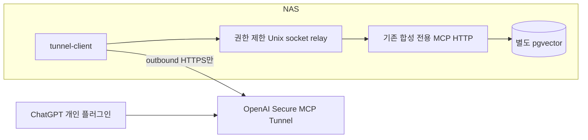

# Secure MCP Tunnel 연결 준비 — 2026-11-19

## 판정
NAS 측 연결 경로 및 공식 클라이언트 준비 PASS. OpenAI 터널 등록/인증/실제 ChatGPT 호출은 BLOCKED — 계정의 tunnel_id와 제한 runtime key 필요.

## 실측 증거
- 사전 검사 Gateway job `job_01M7S2EZFM002MC02XHEE8WGCY` succeeded: 기존 DB/API running, portbindings=0, 실제 HTTP 회귀 16/16. Linux x86_64. 기존 개인 플러그인 목록은 WIPS만 확인. Tunnel 이름의 Gateway 저장 credential 없음.
- [릴레이](../poc/tunnel_unix_relay.py), [실제 소켓 시험](../poc/tunnel_unix_smoke.py), commit `6efb7f35ae469fd2212cd1b8a91f43ca7ccefef2`. Gateway `job_01M7S2JJF300E87WZ3R7YVXH5R` succeeded: 14/14 LOCAL_UNIX_MCP_PASS, LOCAL_RELAY_RUNNING_NO_PUBLISHED_PORTS.
- 기존 network-none DB namespace에 신규 전용 relay container 1개, read-only root, 비root, cap-drop ALL, no-new-privileges, memory64MiB, 새 socket 디렉터리만 쓰기 mount. 외부 TCP listener/포트 없음. owner-only directory 0700/socket 0600, 고정 loopback 목적지, 최대 동시 4 및 연결 시간/byte cap, 비밀 파일·Docker socket 미마운트. 기존 guard의 bearer/Host/Origin/size 검사 유지. relay는 HTTP bytes를 중계하며 권한을 부여하지 않는다.
- 시험 14개: socket owner/mode, dir mode, missing/invalid bearer, invalid Host/Origin, oversize, initialize, tools/list, 실제 get, idempotent save, nonfixture denial, foreign ID 불가, E5 벡터 검색. 기존 저장된 합성 문헌 재사용; 신규 임의 자료 저장 없음.
- 공식 [v0.0.21 릴리스](https://github.com/openai/tunnel-client/releases/tag/v0.0.21)의 linux-amd64 전체 ZIP(29,572,642 bytes), GitHub Releases API digest와 일치: SHA256 `9e91a539e3ae1c436d499f216a1d7514b3c86cc7779032f41b2a05821d74b03a`. 신규 전용 폴더만 설치, 허용한 binary 2개 추출. Gateway `job_01M7S2KS3900QZ3RERXFEZ05PH` succeeded: RELEASE_SHA256_PASS, CLI version 0.0.21+714f2d67844b660af25754f1d19b0360b346b13b, help quickstart. 전역 PATH/패키지/네트워크 변경 및 실제 daemon 실행 없음. 서명/공급망 독립 감사와 CVE 검사 NOT RUN.
- Gateway `job_01M7S2MVE100XY75GTGNXTWTQ4` succeeded: 실제 CLI 도움말에서 unix-socket, file/env extra headers, oauth-discovery disabled, loopback health 확인. [프로필 예시](../poc/tunnel-profile.example.yaml) 작성. 실제 tunnel 인증이 없어 profile parsing/doctor 및 polling NOT RUN. OAuth discovery disabled는 합성 개인 PoC 목적의 후보일 뿐 운영 사용자 인증의 대체가 아님.

## 사용자 인증 및 다음 실행
1. [개인 Platform Tunnels](https://platform.openai.com/settings/organization/tunnels)에서 대상 개인 조직의 터널 생성/조회 및 ChatGPT 개인 컨텍스트 연결을 확인한다. 관리에는 Tunnels Read+Manage, 런타임 및 사용에는 Read+Use 필요. 실제 계정 기능/권한 미확인.
2. [Runtime API keys](https://platform.openai.com/settings/organization/api-keys)에서 최소 Tunnels Read+Use 제한 key를 만든다. admin key나 전권 key 금지. Gateway의 전용 secure value 입력으로 저장하도록 요청 완료(값 없음); 공개 repo에는 비공개 설정 URL, 실제 tunnel ID, 키를 기록하지 않는다. 중앙 private USER ACTION #24 참고.
3. 사용자 확인 후 제한 키를 NAS 전용 0600 파일에 저장. 프로필의 placeholder를 NAS 로컬에서만 채우고 기존 local bearer를 헤더용 파일 참조로 설정(Authorization: Bearer ...). 실제 ID와 키 출력 금지. 개인 계정 연결 범위, local-only 인증의 적용 한계를 확인한다. `tunnel-client doctor --profile-file <private-profile> --explain` → 필요한 수정 후 `run` 및 /readyz, active polling 확인. tunnel-client에 Docker socket/DB credential/운영 문헌 접근 부여 금지. public inbound port 미개방.
4. ChatGPT Plugins → Add custom MCP server → Tunnel 선택. [공식 등록 문서](https://developers.openai.com/api/docs/guides/custom-mcp-server)의 인증 옵션 확인. 별도 사용자 OAuth 없는 합성 한정 개인 PoC만 허용되며 실제 자료 및 multiuser 운영은 재설계 필요. 사용자 설치/승인 후 실제 save/get/search/denial 검증. 개인 터널에 존재하는 credential 및 인증 스코프 확인 전 외부 연결 성공 주장 금지.

## 운영 경계
[공식 Tunnel 안내](https://developers.openai.com/api/docs/guides/secure-mcp-tunnels), [클라이언트 설정](https://github.com/openai/tunnel-client/blob/master/docs/configuration.md) 기준. 현 stage의 DB, API, relay는 실행 중. NAS 전체 재부팅 및 자동 기동 미검증. 이전부터의 DB backup/restore 결과는 동일 클러스터 합성 시험. 롤백은 새 relay만 정지 후 socket 존재 확인(실행 중 소켓 unlink 금지); 기존 DB/API 및 preview 유지. WIPS 저장권/실제 공동 기술사 DB/운영 OAuth/부하 및 터널 연결 미검증.
