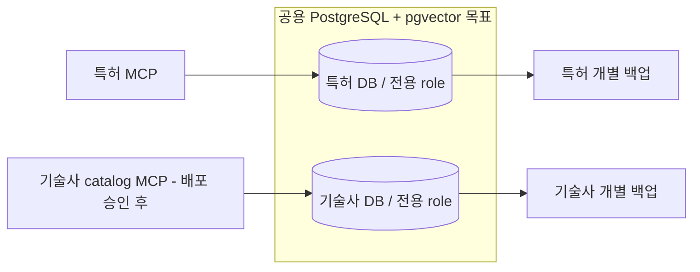

# 공용 PostgreSQL/pgvector 공동 운영 사전 검증 — 2026-11-19

## 판정
**격리 공동 운영 리허설 PASS 24/24, 동시 SQL 검색 400/400.** 실제 영속 DB 통합/운영 전환은 NOT RUN. 기존 기술사 영속 catalog 배포 차단과 자유질의 품질 gate는 유지한다. 사용자 지시로 기존 서비스 재기동 및 자동 기동 등록 금지.

공유 대상은 PostgreSQL 인스턴스와 모델 자산이다. 원문·DB 계정·권한·검색 결과는 분리한다. 현재 운영 중인 특허 PoC 및 기술사 개발 볼륨을 변경하지 않았다.

## 실측
- [시험 코드](../poc/shared_db_coexistence.sh) commit `554683398e6f698a4a8160aedeeb159bd6901ea4`, Gateway job `job_01M7S57BVD00E6Y3QF6TKZE2YX` terminal succeeded.
- 최신 합성 특허 dump SHA256과 일치하는 복제본만 read-only mount. 새로운 network-none 일회성 PostgreSQL 16/pgvector 0.8.7 컨테이너, postgres nonroot, read-only root, cap-drop ALL, no-new-privileges, memory 512MiB, CPU shares128, tmpfs. 기존 기술사 DB/원자료/secret 및 실제 WIPS 자료 미마운트. 합성 특허 P1~P4 복원, 별도 512개 생성 벡터/도메인(실제 E5 추론 아님), 기술사 모사 schema/view 및 비공개 sentinel 구성.
- 서로 다른 로그인 역할의 SCRAM, 교차 DB 접근 차단, 허용 view SELECT만, private/base table 및 UPDATE/DDL 차단, 특허 DELETE 차단, wrong password, 각 DB nearest-neighbor Top1 및 384D 확인.
- 두 pgbench 프로세스, 각각 2 clients/2 threads/100 transactions per client, synthetic 벡터 512개씩. 양 도메인 동시 실행, 특허 200/200 (평균 2.130ms, 938.989 TPS), 학습 모사 200/200 (평균 2.210ms, 905.047 TPS), 실패 0. 단일 소규모 SQL 벤치마크이며 임베딩·MCP·ChatGPT 지연/운영 SLA/대규모 처리량으로 일반화하지 않는다.
- 각 DB 별도 dump→별도 recovery DB 복원, 원본/복원 row fingerprint, 테이블/view ACL 및 HNSW 확인. 복원 대상 DB의 PUBLIC CONNECT 제거 확인은 생성 SQL에 의함; 실제 운영 계정 비밀번호 및 전체 cluster globals, recovery DB 로그인 CONNECT 부여/접속은 이번 시험 범위 아님. 운영 기술사 실제 corpus/migration 검증 아님.
- SHARED_DB_COEXISTENCE_PASS checks=24, EXISTING_START_TIMES_BACKUP_AND_CLEANUP_PASS. 원본 dump 해시, 기존 모든 container StartedAt 동일, 이번 임시 컨테이너 0. 기존 서비스 stop/restart나 NAS 자동 시작 등록 없음.

## 다음 단계
1. 기술사 영속 catalog 배포 차단의 정식 해결 및 보안/권리 검토 완료 후 실제 공용 DB migration 계획(별도 DB·role, 운영 credentials, DB별 복원 및 rollback) 검증. 기존 348/348 로컬 검증과 자유질의 gate를 실제 운영 승인으로 바꾸지 않는다.
2. 기존 서비스 재기동 없이 할 수 있는 WIPS/NAS MCP 흐름의 저장 정책 및 합성 후보 연계 검증부터 계속 진행. WIPS 원문·외부 전송 및 embedding 권리 확인 전 실제 적재 금지.
3. 자동 기동/실제 재기동은 사용자 별도 승인일까지 HOLD. 공유 모델 런타임 및 운영 부하/장애복구는 별도 시험.

참조: [초기 공유 SQL](10-shared-vector-smoke.md), [ChatGPT E2E](14-chatgpt-plugin-e2e.md), [온라인 백업](15-online-backup-startup-plan.md).
