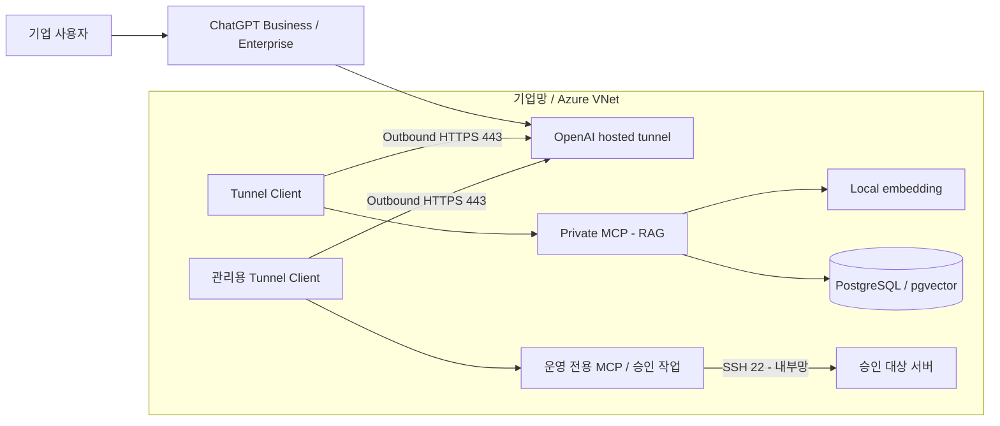

# 기업용 ChatGPT Business/Enterprise 연결 및 방화벽·SSH 운영 가이드

- 상태: 2026-11-19 공식 문서 기반 설계/방화벽 신청 초안. 개인 NAS PoC의 E2E 근거는 [13](13-secure-tunnel-preflight.md), [14](14-chatgpt-plugin-e2e.md), [20](20-unified-mcp-candidate.md). 실제 기업 테넌트/방화벽/프록시/SSH 검증 및 변경 NOT RUN.
- 대상: 기업 보안·네트워크·클라우드·시스템 운영자. 회사 실제 FQDN, IP, 계정, 내부 문서, 접속 비밀은 비공개 승인 문서에만 작성한다.
- 이번 사용자 요청: 기업 ChatGPT에서 동일 RAG 구축, Src Name/Src Port/Dst Name/Dst Port/Protocol 방화벽 신청 규격, ChatGPT를 이용한 SSH 제어 가이드. 기업에서는 개인 키/터널/구매 문헌/계정을 재사용하지 않는다.

## 1. 제품 구분 및 최종 제안

| 환경 | 적용 |
|---|---|
| OpenAI ChatGPT Business (chatgpt.com의 기업 workspace) | 회사 Platform 조직과 workspace에 Secure MCP Tunnel 연결, 관리자 승인 custom MCP 사용. Azure VM에 MCP 서버를 배치해도 동일한 OpenAI 제어면 통신. |
| OpenAI ChatGPT Enterprise/Edu | 같은 터널 방식 + 사용 가능 RBAC/감사/보존/계약 옵션 별도 확인. |
| Microsoft Azure OpenAI / Microsoft Foundry (Azure 구독의 자체 챗봇) | 모델 API, 사내 애플리케이션/Agent Service가 MCP를 호출. Azure 자원 endpoint, VNet/Private Endpoint/관리 ID 기준 별도 정책. OpenAI ChatGPT Business 구독 및 터널이 자동 제공되는 것은 아님. |

Azure 인프라가 OpenAI 서비스에 사용될 수 있다는 사실과 고객이 구독한 제품을 구분한다. 회사의 로그인 URL, 계약/청구 주체, ChatGPT workspace ID, Azure resource 종류와 VNet을 기업 담당자가 확인한 후 유형을 결정한다. 개인 PoC와 같은 경로의 우선안은 ChatGPT Business/Enterprise + Secure MCP Tunnel. 구독과 OpenAI Platform API의 사용량·청구는 별도이다.

화살표는 세션 시작 방향 또는 논리 의존성을 나타낸다. OpenAI hosted tunnel에서 기업망으로 새 TCP 연결을 시작하지 않는다. 데이터 평면/권한과 운영 평면을 서로 분리한다.

## 2. 방화벽 신청표 — 권장 Secure MCP Tunnel (A)

공식 기본 transport는 TCP/HTTPS 443의 outbound long-poll 및 응답 게시이다. 목적지 경로를 제한할 수 있으면 /v1/tunnel/* 허용. 별도 Cloudflare Tunnel/QUIC나 TCP/UDP 7844를 기본 요건으로 신청하지 않는다. 아래 이름은 방화벽 객체용 예시. Src Port Any는 클라이언트의 OS ephemeral source port를 의미하며 모든 목적지 포트 허용이 아니다. Stateful firewall 반환 트래픽은 established 세션으로 허용한다. 소스 실제 IP는 NAT 후 IP/서브넷/VM NIC 기준으로 등록한다.

| Src Name | Src Port | Dst Name | Dst Port | Protocol | 구분/목적 |
|---|---|---|---:|---|---|
| CORP_MCP_TUNNEL_CLIENT | Any (ephemeral) | api.openai.com | 443 | TCP/HTTPS | 필수, 기본 터널 제어면 |
| CORP_MCP_TUNNEL_CLIENT | Any (ephemeral) | mtls.api.openai.com | 443 | TCP/HTTPS + mTLS | 기본 대신 mTLS 제어면을 선택한 경우 |
| CORP_MCP_TUNNEL_CLIENT | Any (ephemeral) | CORP_MCP_APP | 8765 (설정값) | TCP/HTTP 또는 HTTPS | 내부, 별도 호스트에서 실행 시; 기업 별도 서버는 TLS 권장 |
| CORP_MCP_APP | Any (ephemeral) | CORP_PGVECTOR_DB | 5432 (설정값) | TCP/PostgreSQL TLS | 내부, DB 전용 |
| CORP_MCP_APP | Any (ephemeral) | CORP_EMBEDDING_SERVICE | 8000 (설정값) | TCP/HTTPS | 임베딩 별도 서비스인 경우만; in-process local 모델은 불필요 |
| CORP_MCP_TUNNEL_CLIENT / CORP_MCP_APP | Any (ephemeral) | CORP_DNS_RESOLVER | 53 | UDP/TCP DNS | 이름 해석 필요 시. 기업 지정 DNS만 |
| CORP_MCP_TUNNEL_CLIENT / CORP_MCP_APP | Any (ephemeral) | CORP_NTP | 123 | UDP/NTP | 호스트 시간 동기화 필요 시, 기존 별도 시간 정책 활용 |
| CORP_ADMIN_PC | Any (ephemeral) | platform.openai.com | 443 | TCP/HTTPS | 터널 생성·권한/설정, 운영 서버에 일괄 허용 불필요 |
| CORP_USER_PC | Any (ephemeral) | chatgpt.com 및 승인된 공식 ChatGPT UI 도메인 | 443 | TCP/HTTPS (필요 시 WSS) | 기존 ChatGPT 웹 접속 정책, [공식 사용자 allowlist](https://help.openai.com/en/articles/9247338-network-recommendations-for-chatgpt-errors-on-web-and-apps) 참조, MCP 서버 통신과 분리 |
| CORP_MCP_TUNNEL_CLIENT | Any (ephemeral) | CORP_EGRESS_PROXY | 기업 프록시 설정값 | TCP/HTTP CONNECT 또는 HTTPS | 명시 프록시일 때 direct row 대신 사용 |
| CORP_EGRESS_PROXY | Any (ephemeral) | api.openai.com 또는 mtls.api.openai.com | 443 | TCP/HTTPS | 프록시 경유 구간. TLS/mTLS·CA 및 장시간 polling 호환 검증 |

한 호스트 배치라면 tunnel-client → MCP를 loopback/Unix socket으로, DB를 loopback 또는 격리 컨테이너 network로 구성하여 해당 외부 NIC rule 자체를 생략할 수 있다. 현재 개인 PoC의 private DB는 55432/loopback이고 API는 8765/loopback이며 호스트 publish 없음; 위 5432는 기업 제안 포트. 443 외부 inbound, 22 외부 inbound, DB 외부 inbound는 A안의 필수 요건이 아님. Admin UI/metrics는 loopback 유지. 방화벽 FQDN 객체를 지원하면 FQDN을 사용하고, 미지원 시 기업 DNS 기반 동적 갱신/승인 프록시를 사용. Azure 전체 CIDR, 임의 CDN 주소, Internet Any→서버 허용 금지.

OAuth를 사용할 경우 인증 서버가 브라우저, token-exchange 수행 OpenAI 서비스 및 필요 시 tunnel-client에서 도달 가능한지 별도로 검토. OAuth discovery는 터널을 통과할 수 있어도 인증 서버 전체가 자동으로 터널링되는 것은 아니다. 예: CORP_USER_PC → 승인된 IDP FQDN TCP443, 인증 수행 주체 → 승인된 token endpoint TCP443, MCP_APP → 승인된 JWKS endpoint TCP443 (필요한 구성만). 실제 IdP 도메인, 콜백 URI, 토큰/issuer/audience/scope 검증은 기업 tenant별 확인. 공인 CA/TLS를 사용하고 SSL inspection으로 mTLS가 깨지면 보안 담당 승인 예외를 사용하며 검증을 끄지 않는다. 직접 외부 모델 API/외부 임베딩 서비스는 현재 설계 필수 아님. 패키지/이미지 설치는 승인된 내부 mirror/registry를 별도 신청하고 런타임 allowlist와 분리한다.

## 3. 대체 연결 — 공개 HTTPS MCP (B), Azure 자체 앱 (C)

A안을 우선. B안은 기업 정책상 불가피할 때만 DMZ API Gateway / WAF를 두고 공인 HTTPS, mTLS(OAI client 검증, [공식 인증](https://developers.openai.com/plugins/build/auth)), OAuth 2.1 사용자 인증, 요청 제한, 백엔드 접근 통제를 적용한다.

| Src Name | Src Port | Dst Name | Dst Port | Protocol | 조건 |
|---|---|---|---:|---|---|
| OPENAI_CHATGPT_CONNECTORS_EGRESS | Any (ephemeral) | CORP_DMZ_MCP_FQDN | 443 | TCP/HTTPS | B안만; [공식 제품별 IP 범위](https://developers.openai.com/api/docs/guides/ip-addresses)의 ChatGPT connectors JSON CIDR을 신청 시 조회 및 주기 갱신 |
| CORP_DMZ_MCP_PROXY | Any (ephemeral) | CORP_MCP_APP | 8765 (설정값) | TCP/HTTPS | B안 내부 전달; 인증 우회 금지 |
| CORP_AZURE_CHAT_OR_AGENT | Any (ephemeral) | 회사 Azure OpenAI 리소스의 실제 FQDN (예: RESOURCE.openai.azure.com) | 443 | TCP/HTTPS | C안, Azure Private Endpoint 우선 |
| CORP_AZURE_CHAT_OR_AGENT | Any (ephemeral) | CORP_MCP_APP | 8765 (설정값) | TCP/HTTPS | C안, Private Network 내부, 실제 실행 주체/VNet과 라우팅 확인 |
| CORP_AZURE_CHAT_OR_AGENT | Any (ephemeral) | 기업 Entra 토큰 endpoint / 승인 IDP | 443 | TCP/HTTPS | C안 인증 방식상 필요 시 |
| CORP_AZURE_CHAT_OR_AGENT | Any (ephemeral) | CORP_DNS_RESOLVER | 53 | TCP/UDP DNS | private endpoint DNS, privatelink.openai.azure.com 또는 실제 Foundry endpoint에 맞는 zone |

B안 IP 목록은 사용자/회사 인증을 대체하지 않으며 고정값을 공개 repo에 복제하지 않는다. C안은 [Azure Private Endpoint DNS](https://learn.microsoft.com/en-us/azure/private-link/private-endpoint-dns) 및 [Foundry reference architecture](https://learn.microsoft.com/en-us/azure/architecture/ai-ml/architecture/baseline-microsoft-foundry-chat)에 맞춰 NSG/Azure Firewall/Private Link/승인된 VPN·ExpressRoute 경로를 설계한다. 정확한 FQDN은 Azure 포털에서 확인. C안에서 OpenAI api.openai.com 방화벽을 자동으로 추가하지 않는다.

## 4. ChatGPT를 통한 SSH 제어 (별도 운영 평면)

ChatGPT 자체는 일반 SSH 클라이언트가 아니다. 22번 포트를 OpenAI ChatGPT IP에 열어 주는 것만으로 SSH 기능이 생기지 않는다. Secure MCP Tunnel은 MCP/제한 HTTP 요청 transport이지 범용 SSH 포워딩이 아니다.

### 4.1 권장: 회사 관리용 MCP → SSH (외부 SSH 인바운드 없음)

별도 관리용 MCP 서버를 기업 관리 subnet에 배치하고 별도 회사 tunnel 및 키로 연결. RAG 플러그인에는 운영 명령을 넣지 않는다. 운영 앱은 승인된 target alias 및 작업만 제공: get_health, inspect_service, inspect_logs (비밀 마스킹/라인 수 제한), validate_config, deploy_approved_release. 일반 shell/cmd 임의 입력·root 계정·비밀 평문 반환·환경변수 덤프·sudo 무제한·Docker socket 직접 접근은 기본 차단. 실행 대상/정해진 명령/최대 실행 시간/출력/동시성/작업 ID/승인/rollback 검증을 서버에서 강제. 변경(재시작, 배포 등)은 별도 사람 승인 및 변경관리 티켓. SSH key/인증서는 기업 비밀관리 시스템, host key pinning 및 키 회전·철회 정책. 관리자가 비상 중지할 수 있게 별도 계정과 별도 tunnel, 관리용 도구 비활성화 및 감사 로그.

| Src Name | Src Port | Dst Name | Dst Port | Protocol | 구분 |
|---|---|---|---:|---|---|
| CORP_OPS_TUNNEL_CLIENT | Any (ephemeral) | api.openai.com | 443 | TCP/HTTPS | 필수 (운영 plane) |
| CORP_OPS_TUNNEL_CLIENT | Any (ephemeral) | mtls.api.openai.com | 443 | TCP/HTTPS + mTLS | mTLS 사용 시 대체 |
| CORP_OPS_TUNNEL_CLIENT | Any (ephemeral) | CORP_OPS_MCP | 8768 (설정값) | TCP/HTTPS | 내부, 동일 host는 loopback |
| CORP_OPS_MCP | Any (ephemeral) | 승인된 CORP_SSH_TARGETS | 22 (설정값) | TCP/SSH | 내부 관리 전용, 대상별 IP/FQDN 제한; 점프서버 사용 시 다음 hop 별도 신청 |
| CORP_OPS_MCP | Any (ephemeral) | CORP_SECRET_MANAGER / CORP_AUDIT_COLLECTOR | 443 (제품별 설정) | TCP/HTTPS | 선택, 기업 정책상 필요한 실제 endpoint 확인 |

SSH 운영 계정은 non-root 전용 계정, 키 인증, 대상별 최소 권한, 필요한 경우 allowlisted 명령 wrapper/forced-command 및 SSH forwarding 제한; 필요한 sudo 작업은 승인된 좁은 범위의 별도 사용자/명령만. Audit: 누가/언제/어떤 환경/대상/작업/승인 ID/결과/변경 전후 검증/rollback 기록. 사용자당 authorization은 OAuth와 서버-side IAM으로 검증. 모델의 지시나 도구 annotation만으로 허용하지 않는다. CLI·SSH 출력을 신뢰할 수 없는 입력으로 취급한다.

### 4.2 대안: 승인된 외부 SSH 브로커 (Gateway)

현재 개인 NAS 운영에서 사용 중인 유형. Gateway는 승인된 서버 대상 SSH를 실제 수행하는 별도 서비스다. 기업에서 사용하려면 공급업체 보안·계약·감사·데이터 처리·키 보관 검토 및 ChatGPT 관리자 승인 필요. 외부 주소에서 접근할 수 없는 기업망에는 Gateway 직접 접근을 가정하지 않는다. 회사가 정책상 외부 SSH를 금지한다면 4.1 사용. 보안 심사를 피하기 위한 NAT/포트 포워딩 금지.

| Src Name | Src Port | Dst Name | Dst Port | Protocol | 조건 |
|---|---|---|---:|---|---|
| ChatGPT 승인된 MCP 연결 실행 주체 | Any (ephemeral) | trygateway.sh | 443 | TCP/HTTPS | 서비스 경로, 회사망 인바운드 아님 |
| CORP_ADMIN_PC | Any (ephemeral) | trygateway.sh | 443 | TCP/HTTPS | 계정/서버/권한 승인 UI |
| GATEWAY_APPROVED_REGION_EGRESS_IPS | Any (ephemeral) | CORP_APPROVED_SSH_INGRESS (DMZ 관리 접점) | 22 (합의한 SSH port) | TCP/SSH | 외부 인바운드, 회사 승인 시만. Gateway 지역 조회 결과의 정확한 공급자 IP/CIDR 또는 전용 static IP 사용 |
| CORP_APPROVED_SSH_INGRESS | Any (ephemeral) | CORP_SSH_TARGET | 22 (설정값) | TCP/SSH | 승인된 내부 브로커/점프 설계가 실제 지원되고 명시 승인된 경우만 |

문서화 절차: Gateway 사이트에서 기업 계정/팀 구성 → 회사 관리 대상 등록(name, hostname, port, non-root SSH username, region) → 서비스가 발급한 해당 서버 전용 공개키 등록 방식 우선 → host key 검증 및 지역 egress IP 확인(`list_regions`/`inspect_region`, [공식 Docs](https://trygateway.sh/docs/)) → 네트워크팀 정확한 source IP로 방화벽 승인 → ChatGPT 회사 workspace에서 관리자 승인 Gateway 플러그인 연결(지원 여부 확인) → 연결 대상/권한/승인 정책 검토 → 읽기 전용 상태 조회 및 거부 시험 → 감사 기록을 확인한 후 제한된 관리 작업. 공유 IP는 바뀔 수 있으므로 공급자 최신 목록 및 전용 IP 옵션을 확인한다. 실제 IP, SSH 도메인, 키 및 기업 장비 식별자는 사내 문서에만 저장. 이용자 승인 기능이나 외부 브로커의 감사 로그만으로 기업 자체 감사·승인 정책을 대체하지 않는다. Azure VM의 경우 Azure Bastion을 별도 승인된 관리자 경로로 사용할 수 있으나 ChatGPT가 Bastion에 자동 SSH할 수 있다는 의미는 아니다 ([Azure Bastion SSH](https://learn.microsoft.com/en-us/azure/bastion/bastion-connect-vm-ssh-linux)).

## 5. 기업 workspace 구축 절차 및 확인

1. 실제 제품과 조직/테넌트 확인, 계약·데이터 반출/개인정보·연구 보안 승인. 기업별 OpenAI Platform org와 ChatGPT workspace 연결, 사용자·서버 least privilege.
2. 기업 네트워크팀 A안 승인표의 객체명/IP/설정 포트, 프록시, 출발지 NAT, 목적지 FQDN, TLS/CA, 기간 및 업무 목적 확정. 회사 고유 값으로 신청.
3. 승인된 서버에 별도 전용 service 계정, 격리된 MCP/DB, 기업 비밀관리. [Platform Tunnels](https://platform.openai.com/settings/organization/tunnels)에서 회사 터널 생성(관리자 Tunnels Read+Manage); 운영용 인증키는 필요한 Read+Use, API key/회사 조직/플랫폼 정책 확인. 실제 기업 workspace 연관 설정. 개인 터널/키 공유 금지.
4. 공식 tunnel-client 해시 검증 및 최소권한으로 설치. DNS/TCP443/TLS/프록시 reachability, upstream 인증 MCP initialize, doctor, ready/health/metrics polling 확인. 회사 데이터 없이 synthetic smoke 먼저. 터널 키/토큰과 모델 API 사용량을 구분.
5. 회사 workspace 관리자 권한으로 ChatGPT Plugins → + → Add custom MCP server → Tunnel → 회사 tunnel 선택 → 기업 OAuth/인가 정책 → 위험 확인 → 도구 검토 및 workspace 게시/승인. Business 관리자/소유자, Enterprise/Edu RBAC 기능과 실제 UI 확인. 기존 도구 확장 시 관리 페이지에서 Refresh/검토·게시(자동 변경으로 가정하지 않음). 개인 계정 예제의 no-auth를 기업 다중 사용자 기본값으로 쓰지 않는다.
6. 사내 RAG 허용 사용자/거부 사용자, 읽기/쓰기 분리, 금지 corpus, cross-db deny, 회복 및 latency, proxy/network deny에서 fail-closed 확인. 기업의 training opt-out 기본 정책과 기능별 retention/데이터 residency/외부 provider 계약은 별개. Business에서 Enterprise Compliance Platform/RBAC의 전 기능을 가정하지 말 것.
7. SSH 경로는 별도 보안 심사 후 synthetic/test host에서 승인/미승인 명령, SSH target scope, host key mismatch, 감사 및 revoke 시험; 실제 회사 서버 변경은 별도 승인.
8. 사내 실제 배포 전에 방화벽 표의 모든 placeholder를 사내 change ticket에 확정하고 회귀/rollback/비상 차단 절차 검증.

## 6. 검증 요청/할 일
- [ ] 기업 환경이 ChatGPT Business/Enterprise인지 Azure OpenAI 자체 앱인지 구매/계약 담당자 확인.
- [ ] 기업 workspace/Platform org/tunnel 관리 권한, 승인된 DNS/proxy/IdP/허용 도메인, 사내 대상 IP·port 확정.
- [ ] 방화벽 신청서 승인 및 outbound TLS/long polling/부정 접근/실제 기업 RAG E2E.
- [ ] 운영용 MCP 별도 구현 및 SSH read-only/guard/감사·승인 테스트.
- [ ] 외부 Gateway 방안은 회사 승인, 현재 egress IP, 실제 접근 가능성과 계약 검증 후에만 선택.
- [ ] 실제 회사 서버 설치·연결·방화벽 변경 NOT RUN. 기존 개인 서버 재기동 HOLD 및 실제 특허 scope 제한 유지.

## 공식 참고 (2026-11-19 확인)
- [OpenAI Secure MCP Tunnel / Network requirements](https://developers.openai.com/api/docs/guides/secure-mcp-tunnels)
- [OpenAI Connecting custom MCP servers in ChatGPT](https://help.openai.com/en/articles/12584461-connecting-custom-mcp-servers-in-chatgpt)
- [OpenAI Admin controls](https://help.openai.com/en/articles/11509118-admin-controls-security-and-compliance-for-plugins-and-apps)
- [OpenAI ChatGPT Business overview](https://help.openai.com/en/articles/8792828-chatgpt-business-overview)
- [OpenAI IP egress ranges](https://developers.openai.com/api/docs/guides/ip-addresses)
- [Microsoft Azure Foundry production reference](https://learn.microsoft.com/en-us/azure/architecture/ai-ml/architecture/baseline-microsoft-foundry-chat)
- [Gateway Docs / Firewalls and connection addresses](https://trygateway.sh/docs/)
