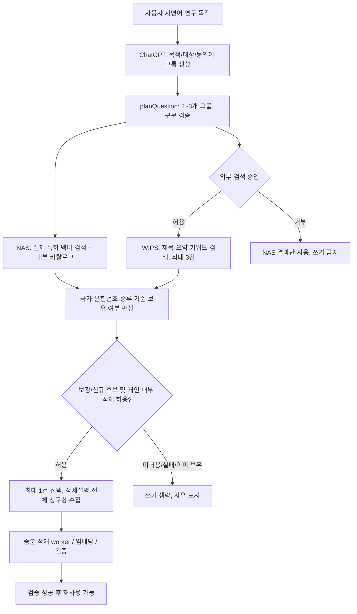

# MVP-03 — 자연어 연구 질의·자동 검색/수집 오케스트레이션

2026-11-19 | 개인 NAS RAG MVP, 기존 컨테이너 재기동 금지 및 기존 플러그인 보존.
 
## 흐름과 역할

- ChatGPT가 질문을 이해하고 용어 그룹을 만든다. 독립 별도 LLM API 사용 없음. 검증기는 LLM이 아니며 일반 질의에서 동의어를 스스로 생성하는 사전 기반 검색기도 아니다.
- [오케스트레이션 모듈](../poc/mvp03_research_flow.mjs) 및 [정책 테스트](../poc/mvp03_research_flow.test.mjs). NAS 검색을 먼저 실행, WIPS 호출은 외부 검색 정책 통과 후. 그룹 안 OR, 그룹 간 AND; 제목·요약 필드. 괄호/필드명/연산자 등 임의 구문 불가, 그룹 2~3, 각 1~4개 토큰, 한 번 WIPS 최대 3건.
- [로컬 조회 probe](../poc/mvp03_local_probe.py)는 기존 구매 특허 reader의 실제 E5/pgvector 검색과 허용된 뷰의 전체 소규모 카탈로그(최대1000)를 사용한다. 결과는 문헌 식별정보·거리·상세 보강 여부만 반환. 원문/본문은 오케스트레이터 로그에 포함하지 않는다. 카탈로그는 외부 WIPS 질의로 전달하지 않는다.
- 외부 검색 및 개인 로컬 쓰기 허용은 trusted operator adapter가 판정. 질문/모델/공급자 응답의 self-asserted 권한은 인정하지 않음. 사내 기밀·NAS 원문을 WIPS로 전달하지 않음. 오류/응답 검증 실패/권한 불명 시 적재하지 않음. 이미 상세 보강한 동일 문헌은 재수집 대상에서 제외하고, 부분 보유 문헌 보강 우선, 신규는 그 다음. 한 번 최대 1개 문헌. 별도 허용 없이 전체 컬렉션 자동 수집, 백그라운드 반복, 외부 공개 금지.
- 적재는 [MVP-02 worker](../poc/private_patent_increment.py) 재사용. 신규 메타데이터와 상세 섹션은 별도 트랜잭션이므로 중간 실패 시 부분 적재 가능; 기존 해시/PK/충돌 방지 및 재개 시 중복 방지를 활용한다. STAGED_PENDING_VERIFICATION은 저장 성공이 아니다. 독립 검증 후에만 PASS. 상세·청구항은 제공자 응답 범위. 독립 리뷰 NOT RUN(선택).

## 회귀 시험
- 최종 모듈 commit `589b9e0f919bc79f38f11b84c314e35909fa45ae`, test commit `48c2e290f828c9744a2ddf03d84bcb0f23c71795`.
- 커밋 소스와 테스트 본문을 JS 격리 실행 환경에서 로드하여 실행(ES module import/export만 제거, assert.ok/throws 대체). **21/21 PASS**: 검색식 검증, 연산자/구문 삽입 및 과도한 범위 차단, 문헌 식별자 정규화/종류 분리, 부분 보강 우선, 순차 호출/한 건 상한, 기존 자료 재사용/미쓰기, 신규 한 건, 저장 정책 거부, 로컬/공급자 실패, 동일 식별자 충돌, 미검증 쓰기, 합성 scope 차단, 응답 상한, staged/commit 구분, 외부 검색 거부 및 정책 오류 fail closed. 네이티브 Node CLI 실행은 NOT RUN. 재현: Node 환경에서 `node poc/mvp03_research_flow.test.mjs`.

## 실제 소량 연계 시험
- ChatGPT가 테스트용 공개 일반 연구 질문 "태양광 모듈의 투명 봉지재에서 습기 침투를 줄이고 내구성을 높이는 소재를 찾아줘" 및 용어 그룹을 직접 선정. 실제 WIPS 검색식: `(태양광 태양전지).ti,ab. AND (봉지재 봉지 밀봉재).ti,ab.`. 기밀이나 실제 NAS 문서의 내용에 기초해 외부 질의를 만들지 않음.
- `job_01M7SAH4GK00WPT67F8QXDMY28` succeeded: 실제 로컬 E5/pgvector 검색 후보 3건, 카탈로그 4건, 기존 컨테이너 StartedAt 불변, 임시 worker 종료.
- 실제 WIPS 3건 검색, 카탈로그와 비교 결과 미보유 3건. 오케스트레이션 모듈이 한 건만 선택하여 실제 상세 설명 98,067자, 전체 청구항 5개를 조회, 개인 NAS 권한 제한 임시 파일로 전달. 저장 검증 전 trace는 FAIL/검증대기였음; 이후 staged 상태 분리 및 외부 검색 경계 명시 패치(최종 mock 시험 21/21). 실제 외부 조회는 기존 사용자 승인 범위 개인 일반 연구질의에 한정. 실제 문헌 식별자/본문/개인 장비 주소/키는 공개 repo에 기록하지 않음.
- `job_01M7SARVWG00KF38SA0YCWJQ08` 진행 중 확인: metadata 1건 및 청크3개 신규 적재, 중복0, 충돌 거부, 누적 5건/6섹션/170청크. 상세 섹션 결과/최종 fingerprint/백업은 terminal status 확인 후 별도 기록한다.

## 남은 범위
- 실제 ChatGPT 플러그인에 통합된 read/write 도구는 아직 미배포(MVP-01 HOLD). 이번은 ChatGPT가 도구 adapter를 직접 연결한 한정된 실제 시험 + 참조 모듈 검증. 상시 자동 실행/사용자 임의 질의의 완전 E2E를 완료로 표시하지 않는다. 동일 질문 재사용과 상세 적재 최종 확인 이후 MVP-04 기본 검색 통합 및 근거 기반 비교·추천 검증.
- 공급 계약 확장/대량 수집·외부 공개 금지, 기존 재기동 금지 유지. 운영 서비스, 기술사 데이터 및 기업 환경 변경 없음.
