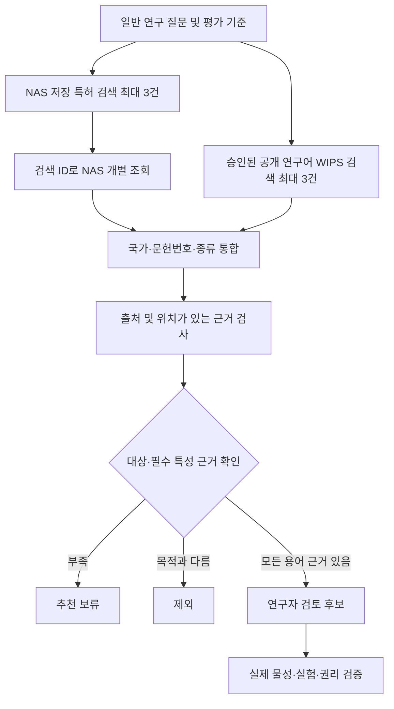

# MVP-04 — 기본 검색 통합 및 근거 기반 후보 비교

2026-11-19 | 개인 ChatGPT MVP, 읽기 전용 참조 구현 및 한정 실제 소스 검증.

## 목적 및 실행 흐름

- [통합 모듈](../poc/mvp04_candidate_compare.mjs) / [합성 테스트](../poc/mvp04_candidate_compare.test.mjs). 외부 호출/저장/모델 추론이 없는 순수 함수. ChatGPT가 사용자 연구 질문으로 대상·필수 특성별 동의어·명시 제외어를 선정하고, 실제 도구 응답을 호출자 경계에서 전달한다. NAS 자료를 WIPS 검색식으로 보내지 않는다. 검색 정책은 [MVP-03](23-mvp03-research-flow.md) 유지.
- 국가/문헌번호/종류로 통합; ASCII 번호의 공백·마침표·슬래시·하이픈만 정규화. 서로 다른 국가·종류는 유지. 동일 소스 내 중복/잘못된 식별자/범위 초과/응답 오류는 예외로 차단. NAS detail은 검색 ID·문헌 키·제목·provider·source hash 일치 검증. NAS 순번과 cosine distance, WIPS 반환 순번은 별도이며 순위 점수 통합·정확도 환산 없음.
- NAS는 섹션/offset/source 및 chunk SHA-256을 보존. WIPS는 SKEY 및 ABK/CLK 필드별 300자까지의 발췌 위치(코드포인트 기준; 절단 여부)를 사용. 원본 해시 재계산 아님. 표기를 위한 태그 제거와 공백 정리는 용어 매칭에만 사용하며 원본 evidence는 변경하지 않는다. 반환 문자열은 실행 가능한 HTML/명령이 아님; 향후 UI에서는 escaped text 렌더링 필요.
- 필수 특성은 발췌 내 동의어 단순 포함 검사. EXCLUDE(제목 제외어/대상 근거 없음), HOLD(필수 특성 부족 또는 소스 미완전), REVIEW_CANDIDATE(모든 필수 특성 용어와 두 소스 정상; 연구자 검토 전용). 기술 성능·정량 실측·인과·부정 표현·권리 유효성 입증 아님. 한 문헌의 근거 여러 개는 독립적 연구 검증이 아니다. 사용자가 지정한 기준을 대신 확정하지 않는다.
- 잘못된 응답은 fail closed; 호출자는 오류 상태를 표시하고 정상 소스만 별도 부분 결과로 표시할 수 있다. null 소스는 NOT_RUN으로 표현(호출 실패/정책 차단 원인은 외부 trace에 별도 보존). 일부 소스만 있을 때 REVIEW_CANDIDATE 없음. 빈 근거/절단 정보는 추가 조회를 요청할 판단 기준이며 추천을 만들어내지 않는다.

## 실측
- 합성 체크 27/27 PASS. 동일 문헌 병합, 국가/종류 분리, 출처별 순위, 근거 중복 제거, 비교 후보/보류/제외, 부분 소스/빈 결과, 300자 상한, 악성 번호 및 잘못된 scope/응답/중복/해시 불일치/순위 검증 등. 최초 직접 V8 실행 후 GitHub blob의 동일 소스와 테스트를 재조회하여 격리 JS에서 모듈 import/export 및 console 출력 wrapper만 제거하여 27/27 재실행. 네이티브 Node CLI NOT RUN. 재현: `node poc/mvp04_candidate_compare.test.mjs`.
- 공개 일반 테스트 연구 질문: 태양광 모듈 봉지재의 내습성과 광투과율. NAS `search_patents(limit=3)` + 결과 3개 `get_patent` 실제 직접 호출, WIPS `(태양광 태양전지).ti,ab. AND (봉지재 봉지 밀봉재).ti,ab.` 3건 실제 직접 호출. 중간 재호출 WIPS 응답 검증 BAD_WIPS로 실패(근본 원인 미확정); 후속 실제 호출 정상 응답, 실제 검색·조회 및 저장된 코드 실행으로 재검증 성공. 신규 적재·상세 대량 수집 없음.
- 3 NAS + 3 WIPS = 6 검색 결과, overlap 1, unique 5. 근거 18개(문헌별 4/6/4/2/2). 필수 특성 내습/광투과: 내습 직접 용어 발췌 0건; 광 관련 용어가 있는 NAS 후보 2건(성능 입증 아님). 결과: HOLD 3, EXCLUDE 2(재활용/컬러 목적), REVIEW_CANDIDATE 0. 실제 사용자 연구에 두 성능을 동시에 입증하는 후보는 추천 보류. 실패 소스 모사(null WIPS)에서 추천 후보 0 확인.
- 기술 관점: 봉지재 소재·저온 밀봉재·박막 공정은 추가 검토 방향이지 추천 확정이 아니다. 한정 발췌와 검색 상위 3건만으로 문헌 전체에 근거가 없다고 단정하지 않는다. 정량 WVTR/광투과율/시험 환경을 추가 조회하여 확인 필요. 실물 평가, 정답셋, P1 Hybrid/RRF/rerank 및 고급 의미 검증은 별도.
- 이번 실행은 개인 ChatGPT에서 두 설치된 MCP 도구와 격리 JS 코드 실행으로 검증. 상시 서버 배포/새 MCP 도구 등록/새 대화 자동 orchestration, 실제 DB 쓰기·백업·복원·rollback NOT RUN. 재시작/설정 변경 없음. 독립 AI 리뷰 NOT RUN(owner-approved optional). 실제 특허 식별자/명칭/원문, 해시와 접속 정보를 공개 repo에 저장하지 않는다.

## 다음 실행
MVP-03 승인된 자동 적재 adapter와 MVP-05 실제 자료 dump 격리 복원 및 정상/재사용/신규/근거부족/실패 인수 시험. MVP-04 기본 읽기 비교 및 근거부족 보류 참조 구현 PASS; 별도 상시 웹/서버 추천 서비스는 MVP 범위 밖. 사용자 피드백 후 고급 평가를 P1에서 진행한다.
