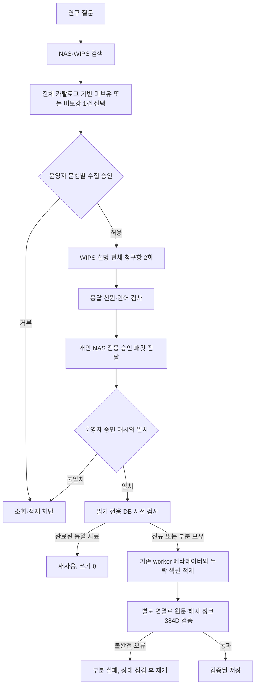

# MVP-03 — 승인된 특허 증분 적재 어댑터
2026-11-19 | 개인 MVP | 코드 및 합성 실행 PASS, 실제 신규 쓰기/운영 자동 연결 NOT RUN.

## 구성

- [JS 연구 흐름](../poc/mvp03_research_flow.mjs)의 makeIngestOne: 기존 research의 단건 후보 선정 및 외부 검색 정책을 재사용. 운영자가 별도로 후보 문헌의 상세 수집을 허용한 뒤 dtl_desc/all_claim만 순차 호출. 문헌번호·국가·SKEY(상세설명)·섹션·언어 확인, 정확한 두 섹션의 packet을 trusted private transport에 넘김. 승인 누락/응답 오류/추가 자료/미검증 쓰기 fail closed. 재사용 0 writes 및 부분 섹션 재개 결과를 별도 처리.
- [Python 로컬 어댑터](../poc/mvp03_ingest_adapter.py): 기존 private_patent_ingest.validate, private_patent_increment.sections와 worker 재사용. 단일 row 및 정확히 두 section, 900000-byte cap, 고정 정책 및 canonical UTF-8 JSON SHA-256에 바인딩된 운영자 승인(mode=new/enrich), 문헌 identity/section/language 일치 검증. 본문은 그대로 보존. 사전/사후 snapshot은 별도 read-only DB 연결, 일치하는 원본/section payload·hash, chunk 본문/offset/hash/coverage/model/vector dimension 확인. 동일 문헌/번호 formatting alias 및 metadata/section 충돌 차단. 완전 동일 자료는 쓰지 않고 반환; 일부만 존재하면 누락된 섹션만 worker에 전달. 기존 immutable INSERT 정책 유지. 실제 최초 저장과 후검증은 트랜잭션이 여러 개여서 실패 시 부분 커밋 가능; FAILED_OR_PARTIAL로 보고하고 자동 재시도하지 않는다.
- 로컬 snapshot은 384차원과 chunk/본문 무결성을 검사하지만 임베딩 수치 자체의 재계산·정확도를 보장하지 않는다. production reader는 계속 bounded read-only. 외부 MCP API에는 실제 쓰기 도구 및 writer credential을 추가하지 않는다.

## 운영 연결 절차 — 설치/실제 apply 전 조건
1. 공급자 권리와 구매/개인 내부 사용 범위가 확인된 **한 문헌**에 한해 operator가 상세 수집 및 저장을 승인한다. 단순 검색 결과·모델 답변은 구매/적재 승인 근거가 아니다.
2. trusted transport는 파일/데이터 stdin으로 packet을 기존 개인 NAS 일회성 worker 격리 경계에 전달한다. 공개 저장소·로그·GitHub Actions 입력·일반 출력에 특허 본문/식별자/개별 hash/credential 금지. 고정 기존 writer 역할 및 기존 모델/worker만 사용한다.
3. 운영자가 별도 보관하는 /auth/ingest_approval.json을 read-only로 마운트한다. 0600 일반 파일, symlink 거부. 필드: policy=owner-attested-paid-material-private-v1, packet_sha256=canonical(packet)의 SHA-256(소문자 hex), mode=new 또는 enrich. 실제 승인 해시는 공개 기록하지 않는다. 모델이 작성/제공한 승인 파일은 허용하지 않는다. 운영자가 승인한 자료와 일치하는 정확한 패킷만 적용. 인증 파일과 worker는 별도 격리 경계에서 접근하고 MCP reader에 writer 권한을 부여하지 않는다. 같은 승인 재실행은 데이터 동일성 검증 후 no-op.
4. 기존 worker 실행 전용 환경에서 코드/승인 파일/secret을 제한적으로 마운트하고, 운영자가 모든 writer 실행을 직렬화하며 단건씩 실행한다. 이 어댑터 자체는 다중 프로세스 공통 lock/DB advisory lock을 구현하지 않았다. 동시 자동 실행·외부 writable endpoint 금지. 실제 적용 전 운영 직렬화, 파일 ACL, backup, 공급자 범위 및 기존 데이터 보존을 다시 검사한다.
5. 먼저 `python mvp03_ingest_adapter.py --check < approved-packet.json` (DB 읽기 전용, 쓰기 0), 이후 별도 승인된 apply에서 `python mvp03_ingest_adapter.py --apply < approved-packet.json`. 원본/승인 파일은 private context에서만 사용. 결과 PASS/REUSED_VERIFIED와 DB 별도 검사, ChatGPT 검색 재사용을 확인한다. 실패/부분 상태는 원인 확인 및 같은 승인된 입력으로 수동 재개. 승인 후보의 실제 운영 테스트 및 transport wiring은 미완료.

## 실측
- NAS native Python 3.8.15, 비승격 Gateway 임시 디렉터리에 새 어댑터/테스트 및 기존 exact source worker 두 파일을 전달(합성 코드만), 임시 디렉터리 자동 삭제. `python3 -m unittest -v test_mvp03_ingest_adapter`: **23/23 PASS**, job `job_01M7SDNG5V00Q2D9SQ3CZMHWNR`, exit 0. 신규/부분 보강/재사용/반복/승인 hash 변조/권리 불명/잘못된 section identity/언어/claim count/worker 실패/false success 및 dry-run 분기. Fake backend + 실제 기존 입력 검증 함수 사용; 실제 LocalBackend PostgreSQL snapshot/apply는 NOT RUN.
- 기존 JS 정책 21 + 신규 8 = **29/29 PASS** (격리 JS 실제 실행, native Node CLI NOT RUN). 문헌 단위 권한 거부 시 상세·전송 0, 두 섹션 수집/packet, 응답 identity 오류 차단, verified no-op 및 부분 재개, 미검증 transport 차단. 테스트는 synthetic callback이며 WIPS 상세 실호출/production transport는 NOT RUN.
- 실제 운영 DB 읽기 전용 집계: 기존 API의 Python dependency path를 명시한 reader role read-only 조회, job `job_01M7SDS89C006D9BH7KWR1RK07` 성공, 5 documents·401 evidence chunks·4 상세/전체청구항 보강 완료·384/384 dimension·transaction_read_only=on. 최초 probe는 dependency path 미지정으로 psycopg import 실패, 실제 기동 명령 확인 후 PYTHONPATH만 지정하여 성공. 새로운 패키지 설치나 권한 변경 없음. 현재 값은 기존 실측과 일치, 별도 원본 fingerprint/복원은 미실행.
- 실제 신규 구매 문헌 수집/DB INSERT, private transport 연결, 실제 LocalBackend 실행, 새 쓰기 MCP 등록, 실제 승인 파일 생성·운영 배포, DB 복원/rollback은 NOT RUN. 실제 자료/개별 hash/secret의 공개 기록 없음. NAS/기존 서비스 재기동 및 설정 변경 없음. 독립 AI 검토 NOT RUN (owner-approved optional).

## 잔여 범위
MVP-03은 구현·합성 검증 PASS, 운영 자동 적재와 실제 신규 자료 E2E 미완료. 운영자 확인된 신규 구매 문헌 1건 및 허용 범위, 제한된 로컬 transport와 직렬화가 준비돼야 실제 쓰기 시험 가능. 다음 비파괴 작업은 MVP-05 실제 자료 온라인 dump 격리 복원/권한/무결성 시험. 기존 NAS/DB/relay/tunnel 재기동 금지와 기술사·기업 작업 경계 유지.

## 후속 실측 갱신
[실제 DB 엔진 격리 시험](32-mvp03-isolated-backend-test.md) 17/17 PASS — 실제 LocalBackend 및 worker, 가상 자료 신설/재사용/누락 복구·권한 검증 완료. 최초 종료1 이후 최종 exit0, 운영 DB·기존 컨테이너 불변. 실제 운영 private transport 및 실제 신규 구매 특허 적재는 NOT RUN.
