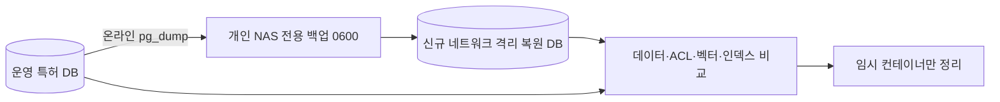

# MVP-05 — 실제 특허 DB 백업·격리 복원
2026-11-19 | 개인 MVP | 실제 DB 논리 복원 PASS; 전체 운영 인수는 부분 완료.

## 시험 경계

- 기존 운영 DB PostgreSQL 16.16 / pgvector 0.8.7, 공식 [pg_dump 16](https://www.postgresql.org/docs/16/app-pgdump.html) 및 [pg_restore 16](https://www.postgresql.org/docs/16/app-pgrestore.html) 확인. 논리 dump는 DB별이며 cluster 글로벌 로그인/암호 복제는 별도 절차.
- [실행 스크립트](../poc/private_backup_restore.sh): 기존 DB 온라인 custom-format backup, 원본의 전체 3개 테이블 row fingerprint(원문·해시·embedding 포함) 전후 대조. 새 동일 이미지의 network-none/read-only-root/nonroot/cap-drop ALL/no-new-privileges, RAM 512 MiB, tmpfs 256 MiB, 실제 서비스/secret mount 없이 격리 복원. 테스트용 NOLOGIN 역할만 재생성, pg_restore --create --exit-on-error; 원본에 restore하지 않는다. 역할 및 인덱스 정의 비교. 기존 서비스 stop/restart 없음.
- 실제 자료와 backup SHA-256 값, 식별자, 경로, credential은 공개 repo에 저장하지 않는다. 백업 파일은 NAS 내부 0600, 최종 archive의 SHA-256 sidecar도 NAS에만 저장.

## 실제 실행 증거
| 항목 | 결과 |
|---|---|
| 백업 | 1,037,393 bytes, mode 0600 |
| 복원 | 특허 5건 / 상세 섹션 8개 / 청크 401개 |
| 전체 row fingerprint | 운영 원본 / 복원본 일치 |
| 원본 fingerprint·ACL·index | 전후 일치 |
| 벡터 | 384D min/max, HNSW 1개, 상세 섹션 청크 존재 |
| 저장 벡터 기준 문헌 Top3 | 원본/복원 동일 |
| 복원 ACL | 원본과 동일 (DB·schema·table/view ACL) |
| reader 역할 | SET ROLE 허용 뷰 count 조회, 원본 테이블 3개 SELECT 실제 거부, INSERT 권한 없음 |
| writer 역할 | SELECT/INSERT 가능, UPDATE/DELETE 권한 없음 (ACL 검사) |
| DB CONNECT | PUBLIC 및 합성 app 역할 거부, private reader/writer 역할 허용 (ACL 검사) |
| 기존 컨테이너 | 전후 ID/StartedAt/Running 일치 |
| 정리 | 시험용 label의 임시 컨테이너 0, 최종 dump SHA-256 sidecar 검증 PASS |

- Gateway preflight job `job_01M7SEEQE600Y0PK9HWM76V12R` 성공. 본 실행 첫 `job_01M7SEM70H0060TH8RXEHHTEZN` DB 복원 및 ACL/벡터 PASS 후 종료 1, 두 번째 `job_01M7SEPCFT00EXCGH0NMHF4EY3`에서 원본과 기존 컨테이너 불변 PASS까지 확인했으나 역시 종료 1. 이후 read-only 점검에서 시험 컨테이너 0, 백업 2개 0600이며 sidecar 미생성 확인. 종료 직후 Docker --rm 비동기 정리 race로 추정(확정 원인 아님); bounded cleanup polling 추가.
- 최종 `job_01M7SERDK900WESSAVV5X7NPM7` **succeeded exit=0**, sh -n 및 실제 실행 PASS; ONLINE_BACKUP_PASS, RESTORED_ALL_TABLE_FINGERPRINT_PASS, ACL_AND_INDEX_DEFINITION_PASS, VECTOR_TOP3_EQUAL_PASS, DIMENSION_HNSW_SECTION_COVERAGE_PASS, READER_VIEW_BASE_DENIED_WRITER_APPEND_ONLY_DB_ACL_PASS, SOURCE_FINGERPRINT_UNCHANGED, SOURCE_ACL_INDEX_UNCHANGED, EXISTING_CONTAINER_STATES_UNCHANGED, TEMP_CONTAINER_CLEANUP_PASS, LOCAL_BACKUP_SHA256_PASS, PRODUCTION_UNCHANGED_AND_TEMP_CLEANUP_PASS. 최초 두 백업은 임의 삭제하지 않음. 최종 백업/sidecar만 최종 검증 완료 판정.
- 최종 실행 이후 개인 ChatGPT의 실제 NAS RAG search_patents 3건, 동일 질의 순위 재현, get_patent 3/3 및 식별자·source hash 일치, 미존재 found=false, 기존 합성 get_document PASS. 신규 적재 없이 운영 읽기 정상 확인.

## 한계 및 후속
- Top3는 동일한 저장 embedding을 질의로 사용한 SQL 비교로, 신규 모델 추론·복원본 MCP 전체 배포 검증은 아님. 실제 운영 역할 암호/SCRAM 재인증, 다른 계정 거부, 교차 DB 실제 접속 및 writer UPDATE/DELETE 시도는 이번에는 NOT RUN(ACL/SET ROLE 검증과 구분). 운영 DB 실제 덮어쓰기 또는 rollback 재배포, NAS 재기동, 자동 백업/자동 기동, 외부 장치의 disaster recovery는 NOT RUN. 별도 승인 및 격리 경계 유지.
- 실제 신규 구매 특허 자동 적재 및 운영 private transport 연결은 [MVP-03 adapter](26-mvp03-approved-ingest-adapter.md)의 권리/운영 승인 및 직렬화 조건 충족 후 실시. MVP-05 전체 인수 5개 시나리오 및 rollback 리허설은 남음. 다음 작업은 운영 변경 없는 격리 rollback 리허설과 인수 시나리오 정리·검증. 독립 AI 검토 NOT RUN(owner-approved optional).
