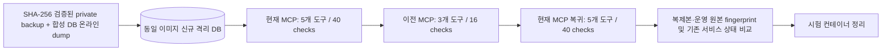

# MVP-05 — 격리 API rollback 및 인수 시나리오 검증
2026-11-19 | 개인 MVP | 격리 rollback PASS 96/96, 인수 4/5 시나리오 PASS(읽기 및 안전 차단 범위), 실제 신규 쓰기 BLOCKED.

## 격리 rollback 리허설

- [롤백 리허설 스크립트](../poc/private_rollback_drill.sh). 실제 NAS의 보존된 이전 코드 및 현 운영 코드, 두 테스트 파일을 GitHub 정본([stage_service](../poc/stage_service.py), [unified production](../poc/unified_mcp_production.py), [legacy test](../poc/unified_legacy_prod_test.py), [reader test](../poc/unified_reader_prod_test.py))과 읽기 전용 비교: 4/4 동일. 이전 도구 목록의 기대값만 3개로 조정한 일회성 테스트.
- 검증된 private archive 1,037,393 bytes 및 온라인 synthetic dump를 동일 DB 이미지의 새 network-none, nonroot, read-only root, 512 MiB tmpfs 클러스터에 복원. 임시 random login 역할/암호와 MCP 인증 토큰만 사용, 운영 credential 및 DB 볼륨 미마운트. 실제 원본과 두 복원 DB fingerprint 일치. API는 동일 기존 이미지, 독립 네트워크 namespace, read-only root, cap-drop ALL, no-new-privileges, 3 GiB 제한, 기존 모델/오프라인 wheel 읽기 전용. 외부 포트 없음.
- Gateway `job_01M7SGJATP00PTG2PRQKM8DRA5` terminal succeeded exit=0. 실제 HTTP: CURRENT_BEFORE 16+24=40/40, LEGACY_ROLLBACK 16/16, CURRENT_RECOVERED 16+24=40/40. 합계 96/96(반복·중복 항목 포함). 각 API process 종료 시 Terminated는 의도된 SIGTERM이며 다음 단계 정상 실행. 이전 버전에서 3개 합성 도구만 노출, 현재 버전에서 실제 patent reader 포함 5개 복귀. 현재 버전 reader의 새 임시 SCRAM 로그인 및 cross-domain 실제 거부, raw base/section 직접 조회와 UPDATE 거부, Host/Origin/bearer/oversize 및 잘못된 입력 차단 포함. 실제 운영 암호는 시험하지 않음.
- CLONE_DATA_UNCHANGED, PRODUCTION_DATA_AND_CONTAINER_STATES_UNCHANGED, ROLLBACK_DRILL_AND_CLEANUP_PASS. 실제 private 5/8/401 및 합성 4건 fingerprint 동일, 기존 실행 컨테이너 ID/StartedAt/Running 일치, 시험 컨테이너 label 0, 임시 코드/secret 경로 cleanup trap. 운영 API/DB/relay/tunnel/NAS 재시작이나 실제 운영 코드 교체는 하지 않음. 실제 운영 rollback 재배포 및 외부 터널/다른 사용자 계정 시험 NOT RUN(별도 승인 경계).

## 개인 ChatGPT 인수 시나리오
| 시나리오 | 기대 결과 | 이번 실측 판정 |
|---|---|---|
| 1. 정상 연구 질의(일반 공개 태양광 봉지재·내습/광투과) | 실제 NAS/WIPS 검색 및 상세조회, 문헌 키 통합/근거 표시 | PASS — 각각 3건, NAS 상세 3/3, 중복1/unique5, HOLD3/EXCLUDE2/REVIEW_CANDIDATE0. 커밋된 비교 함수 사용 |
| 2. 동일 질의 재사용 | 같은 NAS 저장 corpus 및 순위, 신규 쓰기 없음 | PASS (읽기 재사용) — 3개 ID 순서 재현. 새 수집 쓰기 adapter 미호출; 전체 카탈로그 기반 자동 적재 중복 차단 운영 E2E는 3번과 함께 남음 |
| 3. 신규 적재 | 승인된 실제 미보유 구매 문헌 1건 수집, 적재, 재조회, 중복 0 | BLOCKED — 실제 신규 구매/저장 범위 및 운영자 승인 패킷 필요. 현재 adapter 구현·합성 29 JS/23 Python PASS와 기존 로컬 신규 1건 증거는 별도. 실제 신규 쓰기/transport NOT RUN. [사용자 조치 #30](https://github.com/son1004007/ai-agent-workflow-playbook/issues/30) |
| 4. 근거 부족 | 필수 특성 확인 안 되면 추천 금지 | PASS — 실제 6개 검색 결과를 비교, 의도적으로 없는 정량 근거 marker 기준으로 HOLD3/EXCLUDE2, 추천0. 정상 시험에서도 추천0. lexical term gate이지 정량 성능 입증 아님 |
| 5. 오류/거부 | 실패 시 무근거 추천/쓰기 금지 | PASS (읽기 및 차단) — 실제 NAS 미존재 found=false, 잘못된 query/limit 거부 확인, 실제 결과에 WIPS 미제공 모사에서 추천0. 실제 양 소스 장애 유발 및 운영 신규 쓰기 거부 E2E는 NOT RUN. 격리 실제 HTTP 인증/ACL 거부 위 96 checks 포함 |

개인 ChatGPT에서 실제 MCP 도구 직접 순차 호출, 결과는 커밋된 JS 비교 모듈을 격리 실행해 확인. 특정 문헌 식별자/명칭/본문/개별 hash와 장비 정보는 공개 저장소에 미기록. 실제 신규 자료 구매/수집 및 신규 쓰기 없음. 별도 ChatGPT 자동 transport/상시 Agent를 배포한 것은 아니다.

## 남은 인수 및 운영
- 실제 신규 쓰기 gate는 사용자/운영자의 권리·승인 범위 확인에 의존하며 중앙 #30으로 추적. 사용자 확인 전 권한 확대/자료 구매 또는 적재 금지. 이 작업 외에는 사용법·복구 안내 준비 및 별도 승인된 비파괴 검증을 계속할 수 있다.
- 실제 운영 rollback/재기동은 별도 사용자 승인 전 HOLD; 이번은 격리 리허설이며 운영 환경 rollback 성공으로 표시하지 않는다. 기존 운영 인증 및 DB 복원 증거는 [24](24-mvp01-production-cutover.md), [27](27-mvp05-private-backup-restore.md) 참조. 외부 독립 AI 검토 NOT RUN(owner-approved optional). 다음 MVP-06 최소 사용자/운영 설명서 및 사용자 실제 연구 질의 확인 준비, 승인 후 MVP-03/05 실제 신규 쓰기 인수.
