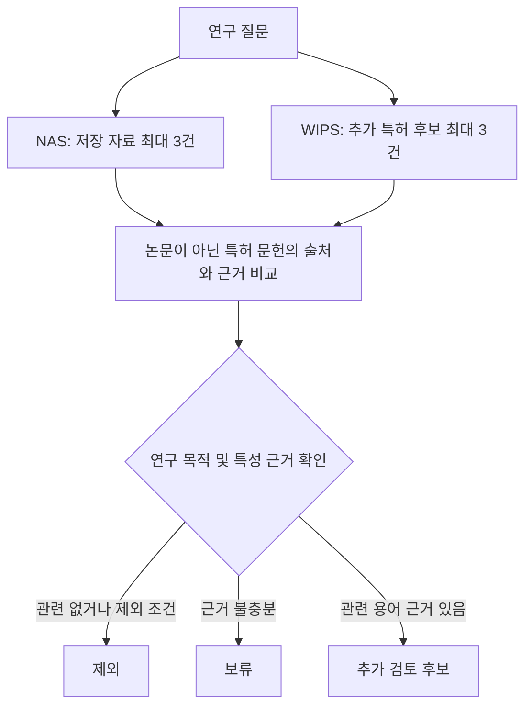

# 사용자 설명서 — ChatGPT 특허 검색 및 비교
2026-11-19 | 개인용 MVP | 대상: 연구자 및 개인 사용자. 별도 웹 화면 설치 없이 기존 개인 플러그인을 사용한다.

## 1. 무엇을 할 수 있나요?
- NAS RAG: 개인 NAS에 이미 보관된 허용 특허에서 관련 문헌 검색 및 근거 발췌 조회.
- WIPS: 일반 연구 키워드로 외부 특허 후보 검색.
- ChatGPT: 두 검색의 후보를 통합하고 중복을 제거하여, 연구 목적과 필요한 특성에 따른 비교 및 보류 이유를 제시.
- 실제 특허 신규 자동 저장은 아직 운영 연결·인수 대기. 검색 결과라고 곧바로 구매·저장 가능한 것은 아니다. 기존 save_document는 정확히 정해진 합성 시험 자료만 저장하며 실제 특허 저장에 사용하지 않는다.
- 현재는 소량 연구 탐색용이며 모든 특허를 찾아내거나 실험 성능·신규성·침해 여부를 보증하지 않는다.

## 2. 처음 사용하기
1. 개인 ChatGPT에서 이미 연결한 NAS RAG 및 WIPS를 사용할 수 있는 새 대화를 연다. 필요하면 대화의 플러그인 선택 메뉴에서 해당 플러그인을 선택한다.
2. NAS에 저장한 실제 특허 도구(search_patents, get_patent)가 나타나는지 확인한다. 보이지 않을 때는 [기존 연결 Refresh 안내](24-mvp01-production-cutover.md)를 따른다. 정상 연결을 삭제하거나 새 터널을 만들 필요는 없다. UI 명칭은 환경에 따라 다를 수 있다.
3. 공개 가능한 연구 목적과 대상 기술, 필요한 특성을 한두 문장으로 입력한다. 고객 기밀·미공개 연구 조성·원문·비밀번호는 입력하지 않는다. NAS의 원문/추출 근거를 외부 WIPS 검색 입력에 재사용하지 않는다.
4. 아래 프롬프트로 읽기 시험을 시작한다.

## 3. 바로 사용하는 질문 예시
### A. NAS 저장 특허만 확인
```text
NAS RAG의 search_patents로 태양광 모듈 봉지재의 내습성과 광투과율에 관련된 저장 특허를 최대 3건 검색해줘. 각 문헌을 get_patent로 조회하고, 근거가 나온 섹션과 확인 가능한 특성을 정리해줘. WIPS와 웹 검색, 새로운 저장은 하지 마.
```

### B. 두 검색 출처를 통합 비교
```text
태양광 모듈 봉지재의 수분 차단과 저온 공정에 관련된 기술을 찾아줘.
NAS RAG와 WIPS를 각각 최대 3건 검색하고, NAS 결과는 get_patent로 조회해줘.
WIPS 검색에는 일반 공개 키워드만 사용하고, NAS 반환 자료를 보내지 마.
국가·문헌번호·종류가 같은 특허는 하나로 묶고, 각 출처와 근거 섹션을 표시해줘.
수분 차단과 저온 공정의 근거를 각각 확인하고, 근거가 부족하면 추천을 보류해줘.
이번에는 신규 자료를 구매하거나 저장하지 마.
```

### C. 저장 자료 재사용
```text
이전과 동일한 연구 질문으로 NAS RAG만 다시 검색해줘.
실제 검색 도구를 호출하고, 이전 결과와 비교해 중복과 순위 변경 여부를 알려줘.
새로운 자료 수집·구매·저장은 하지 마.
```

## 4. 결과 읽기

| 결과 | 의미 | 다음 행동 |
|---|---|---|
| NAS / WIPS / 양쪽 | 발견된 출처 | 원문 출처 확인 |
| REVIEW_CANDIDATE | 제한된 텍스트에서 필수 특성 관련 용어가 확인된 후보 | 정량 수치, 실시예, 독립 실험 등 추가 검토 |
| HOLD | 주제 관련 가능성이 있지만 필수 근거 미확인 또는 출처 누락 | 필요한 근거를 더 조사 |
| EXCLUDE | 대상이나 제외 조건에 맞지 않음 | 필요하면 검색 조건 조정 |
| 거리(distance) | NAS 벡터 검색 거리. 작을수록 벡터 가까움 | 정확도 확률·물성 성능으로 해석 금지 |

특허 번호와 국가·종류·제목, 출처, 근거 섹션 및 제한된 발췌, 확인된 특성과 미확인 사항을 구분해 요청하면 좋다. NAS 발췌는 최대 300자, 상세 조회는 최대 3개 근거이며 전체 명세서 공개 도구가 아니다. 화면에서 근거가 부족하면 '미확인'으로 기록한다. WIPS 검색 결과에는 별도의 권리 및 이용 범위가 적용된다. 중복 제거는 문헌 단위이며 특허 패밀리 전체 통합이 아니다. [실제 시험 사례](31-mvp06-user-trial.md) 참조.

## 5. 문제가 생기면
| 증상 | 대응 |
|---|---|
| NAS 도구가 없다 | 기존 플러그인 Refresh 및 새 대화. 합성 search_documents와 실제 search_patents 구분 |
| NAS 또는 WIPS 오류 | 해당 출처를 FAILED 또는 NOT_RUN으로 표시하게 요청. 오류를 '검색 결과 없음'으로 간주하지 않음 |
| 결과가 모두 보류 | 관련성 후보 및 부족한 근거 확인; 보류를 실패로 보지 않음 |
| 답변에 출처가 없다 | 도구 실호출 여부·문헌별 근거와 출처 표시 재요청 |
| 신규 저장을 원한다 | 구매 및 사용 권리, 개인 NAS 저장과 임베딩 범위를 확인한 한 문헌만 운영자에게 요청. 운영 연결이 완료되기 전 저장 성공으로 간주하지 않음 |

## 6. 사용 평가
실제 질문 하나로 결과를 검토하여 ① 관련성, ② 근거 확인 가능성, ③ 이해 용이성을 OK/개선 필요로 알려준다. 실제 연구 내용은 허용된 개인 환경에서만 확인하고 공개 Issue에는 집계와 일반화된 개선사항만 기록한다. [관리자 설명서](30-mvp06-operator-guide.md), [현재 상태](../CURRENT_STATE.md).
