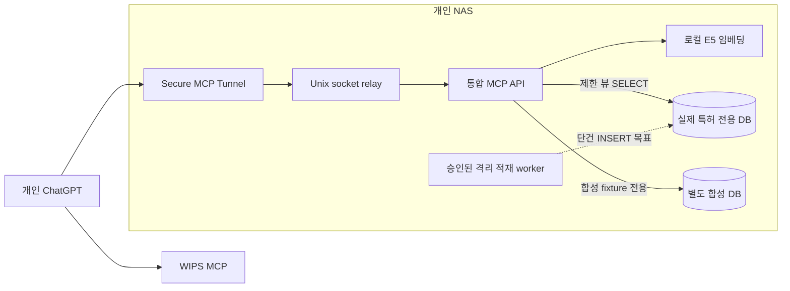

# 관리자 설명서 — 개인 NAS MCP 운영 및 복구
2026-11-19 | 개인 MVP | 대상: 소유자·운영자. 실제 운영 설정을 변경하는 문서가 아니다. 동작은 [현재 상태](../CURRENT_STATE.md)와 최신 [작업 원장](../TASKS.md) 우선.

## 1. 운영 구성

- 기존 개인 USER/PRIVATE 플러그인. tunnel outbound HTTPS, DB/API/relay 외부 포트 publish 없음. NAS 내부 인증/Host/Origin/요청 크기 제한 유지. 포트·계정·비밀·실제 장비 경로는 비공개 운영 환경에서 관리.
- PostgreSQL 16.16/pgvector 0.8.7 및 로컬 multilingual E5-small 384D(실측 시점). NAS API용 실제 특허 reader는 bounded view SELECT만 허용. 별도 writer는 승인된 로컬 작업을 위한 SELECT/INSERT 역할이며 reader·tunnel과 공유하지 않는다. 합성 자료 역할은 실제 특허 DB 접근 금지.
- [실제 운영 코드](../poc/unified_mcp_production.py), [읽기 설계](19-private-patent-reader-mcp.md), [배포 및 회귀](24-mvp01-production-cutover.md). 실제 특허 자동 적재 transport 미연결. 공용 기술사 DB 영속 전환, 기업 배포, 관리자 UI는 범위 외.

## 2. 정상 상태 점검
1. 기존 DB/API/relay/tunnel Running, 외부 port binding 0, DB network none, API/relay DB namespace, tunnel 기존 outbound 연결 확인. [stage_start_order.sh](../poc/stage_start_order.sh)는 승인된 stage root로 --check만 실행한다.
2. DB readiness 및 API local HTTP 인증/도구 목록 5개, relay socket 소유권/mode, tunnel readiness/polling을 단계별 확인한다. [터널 연결 검증](13-secure-tunnel-preflight.md) 및 [통합 전환](24-mvp01-production-cutover.md) 참고. 운영 credential 출력·복사 금지.
3. ChatGPT에서 NAS 실제 특허 search_patents(1~3건) 및 get_patent, 합성 get_document를 읽기 전용 검사한다. save_document는 실제 문헌 시험 금지. 이전 합성 stage_http_test 등 3개 도구만 기대하는 코드는 통합 운영 회귀의 전부를 검증하지 못하므로 현재 통합 테스트를 확인한다.
4. 이상이면 오류 발생 구간, 시각, 상태/종료코드, 승인된 commit, 테스트 집계를 기록한다. 원문·전체 로그·토큰·개별 문헌 hash는 공개 GitHub로 전송하지 않는다.

## 3. 장애 진단 및 복구
| 현상 | 우선 점검 | 조치 |
|---|---|---|
| ChatGPT 도구 미노출 | 연결 상태·Refresh·새 채팅 | 기존 연결 갱신; 무단 신규 연결/노출 금지 |
| ChatGPT 호출 불가, local 정상 | relay socket, tunnel readiness/polling | 기존 인증/연결 설정 확인; 키 재발급은 소유자 승인 |
| API 실패 | DB readiness, API 상태·승인 코드 버전, 모델 마운트 | 기존 실행 상태 유지하고 원인 진단; 승인된 API 재배포만 |
| DB 장애·데이터 불일치 | 원본 read-only 점검, backup SHA-256 | 새 격리 클러스터로 복원하여 확인; 원본 덮어쓰기 금지 |
| 적재 결과 FAILED_OR_PARTIAL | 실제 커밋 여부, 문헌/섹션 fingerprint | 자동 retry 금지, 같은 승인 입력과 누락 섹션 판단 후 수동 재개 |
| 권한/네트워크 차단 | ACL·인증·기존 보안 설정 | 전권 role 부여·외부 DB 포트 개방·인증 해제 금지 |

기동 순서는 DB → API → relay → tunnel → ChatGPT 실제 호출. [기동 점검](15-online-backup-startup-plan.md)은 --check 검증만 완료된 상태다. --start-stopped는 별도 승인 및 통합 버전에 맞는 회귀 테스트 갱신/재확인 후에만 사용한다. NAS/DB/relay/tunnel/기존 컨테이너 재기동·자동 시작 등록은 HOLD. 이전 API 단독 전환 승인을 향후 모든 재기동 승인으로 해석하지 않는다. stale socket을 강제로 삭제하지 않는다.

## 4. 백업 및 롤백
- [실제 DB 백업/복원 스크립트](../poc/private_backup_restore.sh), [실측](27-mvp05-private-backup-restore.md): 운영 데이터 온라인 논리 dump → 0600 백업 및 로컬 SHA-256 sidecar → 새 네트워크 격리 DB 복원 → 전체 3테이블 fingerprint/ACL/HNSW/384D/Top3 비교 → 시험 컨테이너만 정리. 실제 자료 5건·8섹션·401청크 및 원본 불변 실측 PASS. 승인된 전용 NAS 경로에서만 실행하고 용량/부하/파일 권한과 현재 이미지/정본 확인 후 사용한다.
- [격리 롤백 스크립트](../poc/private_rollback_drill.sh), [실측](28-mvp05-rollback-acceptance.md): 이전 코드와 현재 코드 GitHub 정본 비교, 실제 자료 검증된 백업+합성 DB 복제, 신규 격리 컨테이너 현재40→이전16→현재40 HTTP 체크 후 fingerprint 및 정리 확인. 96/96 통과. 임시 자격증명만 사용. 실제 운영 API를 교체하지 않았으므로 운영 롤백 성공으로 간주하지 않는다.
- 운영 복구에는 현재 원본 백업, 버전 pin, 기존 코드 및 권한 보존, 변경 범위·중단 영향에 대한 소유자 승인, 실패 시 격리 경로 검증과 회귀 증거가 필요하다. DB 글로벌 role/암호, tunnel 설정, 플랫폼 키, 외부 장치 장애 복구는 DB 논리 dump만으로 복구되지 않는다. 자동 백업·보존/폐기 및 자동 기동 정책 미구성.

## 5. 신규 적재 승인 절차 (아직 미연결)
[승인된 단건 어댑터](26-mvp03-approved-ingest-adapter.md)의 운영 전 조건을 먼저 충족해야 한다.
- 소유자가 구매 및 저장/로컬 임베딩 범위를 확인한 단건 후보 지정, 별도 외부 반환/LLM 처리 범위 확인. 검색 후보만으로 자동 승인하지 않는다.
- 전체 로컬 카탈로그로 신규 여부/누락 섹션 확인. 제한된 private transport와 기존 격리 worker를 준비하고 모든 writer를 직렬화한다. 승인 파일은 운영자가 digest를 확인한 뒤 0600, read-only mount로 제공한다. 개발자 또는 모델이 임의 생성하지 않는다.
- --check로 dry-run, 승인된 --apply로 단건만 실행, 별도 DB read/해시/벡터 및 실제 ChatGPT 재조회/중복 방지 검증. 모든 결과 기록 전 실제 운영 쓰기 완료로 표시 금지. reader MCP 쓰기 권한을 확대하지 않는다.
- 신규 자료 적재 인수는 [중앙 #30](https://github.com/son1004007/ai-agent-workflow-playbook/issues/30)에서 추적한다.

## 6. 운영 인수 및 보류 사항
| 항목 | 근거 |
|---|---|
| 실제 MCP 배포·읽기 | [56/56 및 직접 호출](24-mvp01-production-cutover.md) |
| 실제 데이터 격리 복원 | [backup/restore](27-mvp05-private-backup-restore.md) |
| 실제 격리 HTTP 롤백 및 보안 | [96/96](28-mvp05-rollback-acceptance.md), 운영 롤백 아님 |
| 실제 연구 질의 사용 | [사용자 시험](31-mvp06-user-trial.md), 소유자 평가 대기 |
| 신규 적재/운영 transport | 승인 대기, 실제 신규 쓰기 미검증 |
| 실제 다른 계정·운영 롤백 및 재기동 | NOT RUN, 별도 승인 |

장비 정보·비밀을 공개 문서에 추가하지 않는다. 기술사·기업 서비스의 권한/보안 기준 및 운영 상태는 그대로 유지한다. 독립 AI 검토 NOT RUN(사용자 승인 선택 사항).
