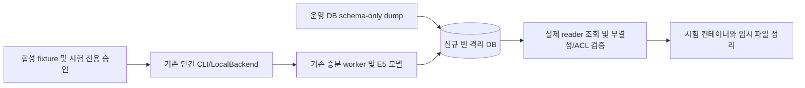

# MVP-03 — 실제 DB 엔진 기반 격리 적재 시험
2026-11-19 | 개인 MVP | 실제 PostgreSQL/pgvector/로컬 임베딩을 이용한 합성 단건 적재 PASS 17/17. 실제 구매 특허 신규 운영 적재는 BLOCKED.

## 시험 경계

- [시험 실행 스크립트](../poc/mvp03_isolated_backend_test.sh), [실제 DB 통합 테스트](../poc/test_mvp03_real_backend.py). 기존 adapter/worker·합성 fixture는 GitHub 정본 그대로. 별도 pytest mock가 아닌 실제 고정 CLI와 LocalBackend 및 worker subprocess를 수행했다.
- PostgreSQL 16.16, 기존 pgvector/DB 및 Python 이미지 pin, 기존 E5 모델·offline wheel cache 읽기 전용. 운영에서 가져온 것은 --schema-only dump와 기존 자산이며 실제 특허 행·원문·운영 secret/승인 파일·DB volume을 시험 환경에 복제하지 않았다. 전용 network-none DB와 해당 namespace worker, 외부 포트 0, nonroot/read-only root/cap-drop/no-new-privileges. 임시 SCRAM role/암호, 테스트 fixture 전용 0600 승인 파일은 임시 디렉터리에만 생성. 실제 자료에 대한 소유자 승인으로 간주하지 않는다.
- 빈 DB, 신규 가상 문헌, 부분 보강 가상 문헌 각 1건. CLI --check/--apply 및 고정 approval 파일, 두 번째 문헌은 별도의 합성 test-only 직접 execute 호출로 누락 섹션 복구를 실증. 실제 신규 자료 구매와 WIPS 호출·production private transport·운영 승인 파일 생성/권한 변경 없음.

## 검증 결과
| 항목 | 실제 실행 |
|---|---|
| 빈 격리 DB / dry-run / 승인 패킷 변조 | 3/3 |
| 실제 신규 INSERT / 건수 / 동일 CLI 재실행 무쓰기 | 3/3 |
| 부분 seed / 실제 snapshot / 누락 섹션만 보강 / 건수 / 재실행 무쓰기 | 5/5 |
| 변경된 메타데이터 / 변경된 섹션 충돌 | 2/2 |
| reader 기본 read-only / 제한 뷰 조회 / 384D 실제 벡터 / writer UPDATE·DELETE 거부 | 4/4 |
| 합계 | 17/17 |
| 최종 합성 DB | 2건 / 4섹션 / 10청크 / 384D |
| 실제 운영 DB 전체 row fingerprint 및 기존 컨테이너 ID/StartedAt/Running | 전후 일치 |
| 시험용 컨테이너 | label 0, cleanup PASS |

- Preflight Gateway job `job_01M7SHJWDA00DD2WM56VHFZMEV` exit 0, 운영 5/8/401.
- 첫 실행 `job_01M7SHPVWQ00TS3ZZE1A7EV164`의 17개 검사와 ISOLATED_INGEST_PASS 성공, 뒤의 결합 운영 상태 검사에서 exit=1. 정확한 차이 원인은 확인되지 않았다. 후속 읽기 전용 점검에서 운영 특허 5/8/401, 특허 컨테이너 실행, 시험 label 0 및 scratch 디렉터리 0 확인. 첫 실행의 전체 불변성 성공은 주장하지 않는다.
- 스크립트에 전용 scratch 경로 제한 및 운영 데이터/특허 컨테이너/전체 기존 컨테이너 상태 검사를 분리 적용. 최종 Gateway `job_01M7SHW7MH001E4HFT6PTJGBVH` succeeded exit=0, 17/17 및 SOURCE_FINGERPRINT_UNCHANGED, PATENT_CONTAINERS_UNCHANGED, ALL_EXISTING_CONTAINERS_UNCHANGED, ISOLATED_TEST_CLEANUP_PASS. 기존 코드·서비스 재배포/재기동 없음.
- worker의 기존 내부 중복 및 변경 충돌 검사도 실행됨. 집계는 외부 harness 17개만 산정. 모델 물성 검색 정확도나 실제 공급 데이터의 품질을 보증하지 않는다.

## 남은 조건
실제 운영 LocalBackend 신규 쓰기·private transport, 운영자 직렬화, 사용자 권리·개별 승인 확인 및 재조회 인수는 [#30](https://github.com/son1004007/ai-agent-workflow-playbook/issues/30) 해소 후. [#31](https://github.com/son1004007/ai-agent-workflow-playbook/issues/31) 사용자 평가 별도. 이번 가상 적재 시험은 실제 구매 데이터 운영 쓰기 인수 대체 불가. 기존 read-only MCP 역할 보호 및 P1/P2/P3 선행 금지. 독립 AI 리뷰 NOT RUN(owner-approved optional).
