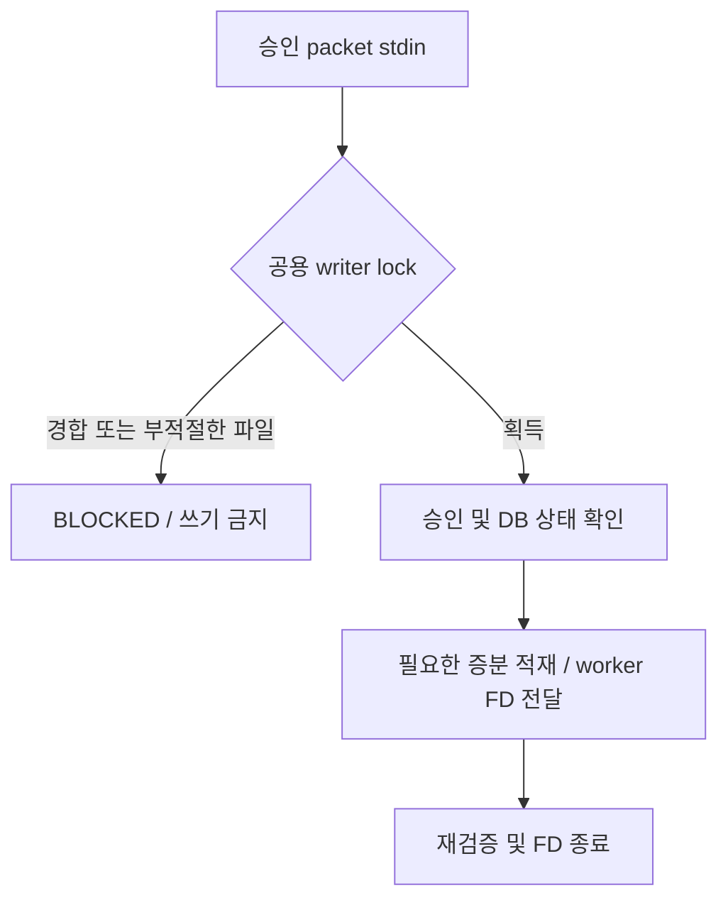

# MVP-03 — 승인 적재 CLI 직렬화
2026-11-19 | 개인 MVP | NAS native 35/35, 격리 DB 18/18 PASS. 운영 적용·신규 구매 승인 대기.

## 구현
기존 snapshot → 증분 적재 → 재검증 사이의 writer 경쟁을 방지하기 위해 고정 공용 inode의 비대기 배타적 advisory lock을 도입했다. [Linux flock(2)](https://man7.org/linux/man-pages/man2/flock.2.html), [Python fcntl](https://docs.python.org/3.8/library/fcntl.html) 참고.

- [어댑터](../poc/mvp03_ingest_adapter.py): /locks/ingest.lock, owner UID, 디렉터리 0700, 파일 0600, 일반 파일·단일 hardlink 확인. 누락/부적절한 권한/symlink/FIFO/다중 link 차단; 자동 생성/truncate/unlink 없음. 경합은 IngestBusy로 fail-closed. check/apply 각각 전체 실행 범위 잠금.
- subprocess pass_fds로 동일 open file description을 worker에 전달. 명시적 LOCK_UN 없이 FD 종료로 해제하므로 부모가 먼저 종료해도 worker의 FD가 유지되는 동안 잠금이 생존한다.
- [native 잠금 시험](../poc/test_mvp03_writer_lock.py), [실제 DB 시험](../poc/test_mvp03_real_backend.py), [실행 스크립트](../poc/mvp03_isolated_backend_test.sh).

## 실측
Gateway job `job_01M7SJBSQV0076SP1WTD2D9BXN` 종료 0. Python compile, 셸 문법 PASS.

| 항목 | 결과 |
|---|---|
| 기존 승인/중복/부분 실패 unit tests | 23/23 |
| 새로운 잠금 테스트 | 12/12 |
| 기존 PostgreSQL/E5 격리 회귀 | 17/17 |
| 잠금 중 실제 별도 CLI apply 거부·DB 0건 | 1/1 |
| 합계 (일부 중복 검증 포함) | 53/53 |
| 최종 합성 DB | 2건/4섹션/10청크/384D |
| 운영 DB 전체 fingerprint 및 기존 컨테이너 ID/StartedAt/Running | 전후 동일 |
| 임시 시험 컨테이너 정리 | PASS |

기존 모델/wheels read-only, schema-only DB 복제, 격리 네트워크, 시험 전용 승인 및 SCRAM 계정, 동일 시험 lock 디렉터리 read-only mount. 실제 자료 추가·운영 배포·재기동·권한 변경 없음.

## 운영 적용 전제 (미배포)
- 운영자가 로컬 NAS 파일시스템에 writer UID 소유 전용 0700 디렉터리와 0600 일반 파일을 미리 준비한다. 모든 지원 CLI 컨테이너에 **동일 inode** 디렉터리를 /locks:ro로 연결. 파일 복사/재생성/실행 중 교체, NFS/SMB·다른 호스트 금지. 교차 컨테이너 운영 mount 시험은 미실행.
- advisory lock이므로 직접 worker·별도 DB writer·LocalBackend 직접 import는 잠금을 우회할 수 있다. 지원 CLI만 허용하고 운영에서 legacy/direct 경로를 배제해야 한다. DB atomicity/권한을 대체하지 않는다.
- 실제 구매 문헌 권리·운영 승인, private transport 및 백업 확인 후 check→apply→재조회. 두 CLI 호출 사이 lock은 해제되며 apply가 재검증. BUSY/부분 실패 시 자동 우회·무한 retry 금지.
- [승인 절차](26-mvp03-approved-ingest-adapter.md), [중앙 #30](https://github.com/son1004007/ai-agent-workflow-playbook/issues/30), [사용자 평가 #31](https://github.com/son1004007/ai-agent-workflow-playbook/issues/31). 독립 AI 검토 NOT RUN(owner-approved optional).

## 후속 교차 컨테이너 실측
[로컬 transport](34-mvp03-local-transport.md) 시험에서 동일 로컬 lock 디렉터리를 RO mount한 서로 다른 두 시험 컨테이너 간 lock 경합 차단 PASS. 실제 운영 mount 배치는 별도 승인 대기.
