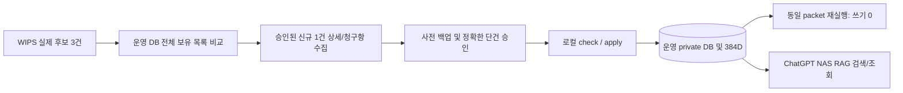

# MVP-03/05 — 실제 승인 자료 단건 운영 인수
2026-11-19 | 개인 MVP | 실제 WIPS 단건 → NAS 운영 적재 → 실제 ChatGPT 조회 및 재사용 PASS.

## 승인 및 범위
사용자는 실제 구매 자료 1건에 대한 수집, 개인 NAS 보관, 로컬 임베딩 및 운영 적용을 명시 승인하고 합성 시험이 아닌 실제 자료를 요청했다. AI가 기존 연구 범위의 한국 공개문헌 후보 중 한 건을 선택했다. 기존 사용자 구매/사용권 진술과 이번 승인에 의존하며 개별 구매 증빙·공급 계약은 독립 검증하지 못했다. WIPS 검색/상세 조회 성공만으로 구매 증명이 되는 것은 아니다. 별도의 신규 구매·결제/대량 수집/재배포는 하지 않았다.
운영자 지시에 따른 이번 단건 승인 파일은 연결된 소유자 계정의 NAS에서 정확한 검증된 packet으로 SHA-256을 계산하여 0600으로 생성했다. 사용자가 별도로 해시를 육안 확인한 것은 아니다. 모델이 임의·자동으로 승인하는 정책으로 확대하지 않으며 실제 실행과 재사용 검증 이후 이번 승인 파일과 복제 writer secret 및 임시 packet 삭제. 실제 자료 및 식별자/개별 해시/장비 경로/credential은 공개 저장소에 미기록.

## 실행 흐름

[로컬 transport](34-mvp03-local-transport.md) 및 [적재 adapter](26-mvp03-approved-ingest-adapter.md) GitHub 정본 사용. 기존 읽기 MCP와 합성 writer 권한 유지. 공개 또는 상시 쓰기 MCP, JS submitApprovedPacket 자동 wiring은 구축하지 않았다. 이번 E2E는 ChatGPT 직접 도구 호출 + 승인된 NAS 일회성 로컬 실행을 조합했다.

## 실행 증거
| 검사 | 실측 |
|---|---|
| 후보 보유 여부 | WIPS 3건 / 운영 전체 카탈로그 대조, 모두 미보유; 한 건만 선택 |
| 상세 수집 및 검증 | 정확한 문헌/국가/종류/언어 일치, 상세설명 5,386자(제공된 HTML 포함)·전체 청구항 2개(직렬화 215자), 검증 packet 12,971 bytes |
| 사전 백업 | 1,037,393 bytes, 0600, pg_restore 목록 및 SHA-256 PASS |
| 운영 check | DRY_RUN, 쓰기 0, 미보유, 섹션 0 |
| 운영 apply | PASS, 문헌 +1, 섹션 +2, 청크 +16 |
| DB | 5/8/401 → 6/10/417 (문헌/섹션/청크), min/max 384D |
| 기존 데이터/서비스 | 기존 모든 행 fingerprint 및 기존 컨테이너 ID/StartedAt/Running 동일 |
| 운영 재사용 | REUSED_VERIFIED, writes=0, 모든 행 및 서비스 불변 |
| 최종 백업 | 1,078,506 bytes, 0600, pg_restore 목록 및 SHA-256 PASS (신규 dump 격리 복원 NOT RUN) |
| ChatGPT 실제 NAS RAG | 검색 3건 중 신규 문헌 1위, 동일 질의 반복 순위 일치, get_patent found=true, 실제 근거 3개(요약 300자/대표청구항 79자/상세설명 300자) |
| 정리 | 시험 worker 정리, 일회성 승인과 duplicate secret/packet 제거 |

Gateway 증거: 실제 packet 검증 job_01M7SRWPSR000P2KDY3WCFJKYY, 사전 백업 job_01M7SRYHJQ00E53E2J7VNYJCT2, check job_01M7SS0H2K00ZTRRGZBEN33KKG, apply job_01M7SS39SE000FQ61JR3DM8TAB, reuse/최종 backup job_01M7SS6CVE00123PZY3CSRTWJG 모두 succeeded exit=0. NAS/DB/API/relay/tunnel 등 기존 서비스 재시작·권한 확대 없음. 외부 독립 리뷰 NOT RUN(owner-approved optional).

## 응답 형태와 한계
- 저장: JSON 원문 필드, 발명의 설명 및 전체 청구항 텍스트, 출처/섹션/hash/offset과 벡터. WIPS의 HTML 태그를 포함한 본문 보존. 별도의 PDF/도면 파일 저장은 미구현.
- 검색: JSON results 배열, 문헌 정보·유사도 거리와 제한된 원문 근거. get_patent: document_id, publication, country, kind, title, provider, source_sha256, found, evidence. 각 evidence의 section, start_offset, end_offset, excerpt, chunk_sha256. 최대 3개 근거·각 300자. 사용자 답변에서는 제목/문헌번호/출처·섹션 및 실제 발췌를 읽기 쉬운 Markdown으로 표시. HTML 태그는 표시 시 제거 가능하되 인용문 자체를 재작성하지 않고 생략을 구분한다. 전체 명세서 파일이나 모든 청구항 반환 API가 아니다.
- 실제 단건 운영 인수 및 5개 시나리오 중 신규 적재 항목 PASS; [기존 4개 시나리오 실측](28-mvp05-rollback-acceptance.md)과 함께 범위 한정 5/5. 실제 신규 자료는 운영 transport/reader로 재사용 실증, 자동 상시 WIPS→MCP write 서비스 미구현. 실제 운영 rollback/재시작, 새 backup 격리 복원, 다른 계정 시험은 NOT RUN.
- [사용자 평가 #31](https://github.com/son1004007/ai-agent-workflow-playbook/issues/31)은 실제 사용자의 평가 회신 대기. 추가 문헌 자동 승인/무제한 수집 권한 없음.
