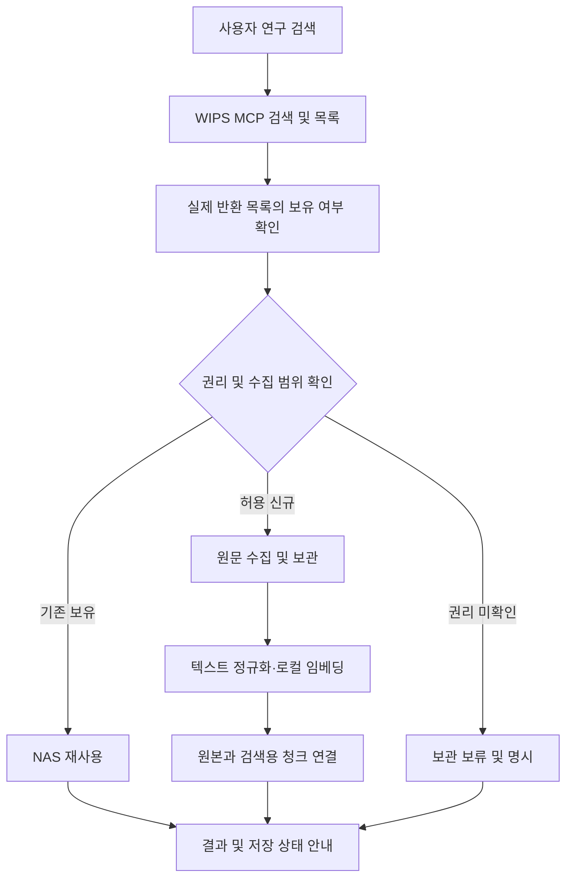

# MVP — 검색 연동 자동 보관 및 원문 조회
2026-11-19 | 사용자 피드백 반영 | 요구사항 확정, 구현·운영 E2E 미실행

## 사용자 요구
WIPS MCP 검색 시 사용자에게 보여주는 목록뿐 아니라 NAS에 자동으로 저장되어야 하며, 사람이 읽을 수 있는 원문도 보관/조회 가능한지 요구했다. 기존 [실제 단건 운영 인수](35-mvp03-actual-ingest-acceptance.md)는 승인된 로컬 CLI 실행으로 PASS했지만 상시 자동 저장은 연결되지 않았다. 해당 개선은 P0 인수의 잔여 기능으로 우선한다. 공급자 이용권 및 실제 자료별 허용 범위는 유지하며 단건 승인을 무제한 수집 권한으로 확대하지 않는다.

## 목표 흐름

| 항목 | 저장 목표 / 현재 한계 |
|---|---|
| 검색 목록 | 실제 반환된 문헌의 번호·종류·국가·제목·출원인·일자·검색 출처; 기존 기본 서지 범위 확장 필요 |
| 원문 텍스트 | 제공된 원본 JSON 및 상세설명·전체 청구항·요약 보존(기존 단건 검증), normalize는 별도 파생 데이터 |
| 벡터 | 기존 pgvector 로컬 E5, 원본 섹션 및 offset 연결 |
| 원본 PDF | 현재 연결된 WIPS MCP에 직접 PDF 내려받기 도구 확인되지 않음; 허가된 공급 경로나 공식 공개문헌 출처를 별도로 검증한 후 파일 저장·hash·출처 연결 |
| 도면 | WIPS MCP draw/indv_draw 제공 범위 확인. 실제 이미지 파일 수집 및 보관은 미검증 |
| 인간용 전체 원문 조회 | 저장된 텍스트 전체를 인증된 로컬 읽기 화면 또는 안전한 페이지 단위 조회로 제공; 현행 get_patent 최대 3개/각 300자 발췌와 구분 |

## 구현 우선순위 및 조건
1. 조회 결과의 실제 반환 목록과 총 검색 건수를 구분하고, 목록 보관/본문 확보/벡터 적재 상태를 문헌 단위로 분리. 전체 검색 건수만 보고 자동 전수 요청하지 않는다.
2. 기존 문헌 전체 카탈로그 exact identity(SKEY 및 국가/번호/종류) 대조, 미보유/부분 보유/완료 구분. 승인된 범위만 증분 적재. 계약·호출량/비용·저장/임베딩 권한 확인 전 확대 금지. 사용자 매번 별도 저장 지시 없이 실행되는 목표이나 운영자가 설정한 권리·상한·승인 정책 필요.
3. 기존 reader 토큰을 writer로 재사용하거나 임의 SQL/SSH 실행 도구를 노출하지 않는다. 권한을 분리한 bounded ingest 전송을 설계하고 기존 단건 승인/직렬화/검증을 재사용. 실패·보류 시 실제 저장 성공으로 표시하지 않는다. 상시 writer/재시작/외부 노출은 별도 배포 안전 점검.
4. 실제 조회 목록 및 권리 확인 자료로 저장/재검색/중복 방지/권한 거부/원문 대조 E2E 검증. 검색 결과 응답에 총 검색 건수와 실제 조회·신규 저장·재사용·실패/보류 건수를 독립 표기.
5. 본문 조회 기능 추가 및 PDF/도면 경로 검증. 전체 파일은 허용된 비공개 NAS 공간 및 접근 권한 유지, 원본과 파생 파일 구분, 원문/실제 식별자/인증정보 공개 GitHub 금지.

설계 항목과 현재 실제 운영 상태는 구분한다. 이번 변경은 요구사항 기록만 수행, 추가 수집/원문·벡터 적재/운영 배포/재기동 없음. 독립 AI 검토 NOT RUN(owner-approved optional).

## 2026-11-19 보완 — 원문 텍스트와 공식 원본 파일의 분리 수집

사용자 확인 요청: 원본 파일은 별도 API 등의 경로에서 다운로드할 필요가 있는지 검토하고 GitHub에 정리한다.

| 구분 | 확보 경로 | 현재 판정 |
|---|---|---|
| 발명의 명칭·요약·전체 청구항·상세설명 | 기존 WIPS MCP `get_patent_search_onlyengine`, `get_patent_spec_text` | 텍스트 실측 및 NAS 저장 PASS. 언어 및 번역 여부 구분 필요 |
| 도면 | WIPS MCP `get_patent_section`의 draw/indv_draw | 도구 정의 확인; 실제 바이너리 다운로드 미검증 |
| 공식 원본 PDF | 별도 공식 공보 다운로드 API 또는 계약상 허용된 공급자 파일 제공 경로 | 미연동. 현재 연결된 WIPS MCP 도구 목록에는 PDF 직접 다운로드 도구를 확인하지 못함. WIPS의 다른 API 전체에 PDF 기능이 없다는 뜻은 아님 |

### 공식 후보 및 적용 순서

- 국내: [KIPRIS Plus 특허·실용 공개·등록공보 API](https://plus.kipris.or.kr/portal/data/service/DBII_000000000000001/view.do). 공식 소개에서 공보 전문 및 대표도면의 다운로드 경로를 XML로 반환한다고 명시. KR 파일 수집의 우선 검증 후보.
- 유럽: [EPO European Publication Server REST API](https://www.epo.org/en/searching-for-patents/data/web-services/publication-server). EP 공개·등록공보의 PDF/A, XML, HTML, TIFF 제공.
- 해외 범위 확대 후보: [EPO OPS](https://www.epo.org/en/searching-for-patents/data/web-services/ops), [PDF 조회 안내](https://www.epo.org/en/service-support/faq/searching-patents/open-patent-services/search-queries-tips-and-tricks/what-do-0). 국가·문헌별 이미지 범위와 페이지 결합 여부 차이를 검증해야 한다. [OPS 이용조건](https://www.epo.org/en/service-support/ordering/terms-and-conditions/ops-terms-and-conditions) 확인 필요.
- [WIPSCLIP 공식 서비스 안내](https://www.wipsclip.co.kr/service/serviceInfo/view.wips) 및 별도 계약 API/파일 제공 여부는 공급자 문의 대상으로 유지.

### 설계 및 완료 조건
1. WIPS 검색 결과를 문헌 ID(국가+공개/등록번호+종류코드; SKEY는 공급자 식별자)로 매칭한다. 같은 특허 패밀리의 다른 국가 문헌을 동일 원본으로 취급하지 않는다.
2. 공식 제공자가 허용한 다운로드 경로를 통해 NAS에 원본 파일을 저장한다. 원본과 생성한 HTML/PDF 보기용 파생물은 구분한다. PDF의 문헌번호/종류 일치, 파일 형식, 크기, SHA-256, 취득 시각, 출처, 권리 정책 및 파일 경로를 DB에 기록한다.
3. 본문 JSON/정규화 텍스트 및 pgvector는 기존 구조를 활용하고, PDF 파일 경로와 문헌 ID로 연결한다. 인증된 사람용 조회에서 원본 열람/다운로드를 제공하는 목표이며 기존 300자 근거 조회와 분리한다.
4. 원본 미확보/실패 시 텍스트 보관 성공과 파일 보관 성공은 분리 표기. 중복 다운로드 방지, 저장 제한 및 권한 거부, 실제 국내 문헌 한 건의 원본 열람과 대응 검증 후 적용 범위를 확대한다.

공식 안내 및 연결 도구 범위는 확인했으나 API 인증·요금·호출량·저장/재사용 권리·실제 파일 다운로드는 아직 검증하지 않았다. 이번 변경은 문서화이며 신규 API 호출/유료 구매/자료 수집/NAS 운영 변경은 하지 않았다.

## P0-1 구현 착수
[목록 저장 모듈 및 시험 상태](37-mvp-search-list-archive.md). JS/실제 WIPS 읽기 callback 확인, DB 시험 및 운영 자동 연결 미완료. 신규 구매나 원문 수집 없이 목록 전용 저장 단계로 분리.
