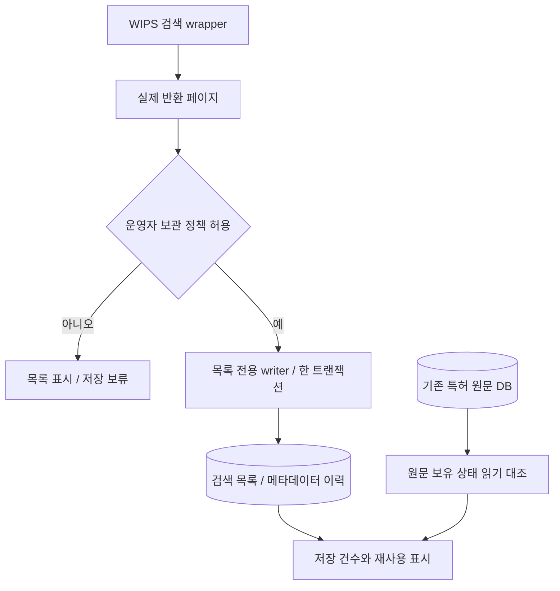

# MVP P0-1 — WIPS 검색 목록 자동 보관 기반
2026-11-20 | 1순위 착수 | 코드 작성, JS 9/9 및 실제 WIPS 읽기 연계 확인. NAS 실제 PostgreSQL 격리 통합 시험 및 새 DB 복원 PASS. 운영 적용 미완료.

## 구현 범위
- [검색 wrapper](../poc/mvp37_search_archive.mjs): 명시 설정한 adapter에서 WIPS 성공 응답의 실제 반환 페이지를 자동으로 보관 callback에 전달하고 승인 보류/실패/verified 저장을 구분한다. 외부 검색 정책 선확인. 전체 검색 건수를 자동 페이지 순회하지 않으며 1회 최대 50행. 기존 WIPS 플러그인 자체의 호출을 감시하는 기능이나 실제 새 ChatGPT writer 연결은 아니다.
- [목록 저장 모듈](../poc/mvp37_archive.py) / [PostgreSQL 스키마](../poc/mvp37_archive.sql): 독립 patent_archive 스키마. 문헌 identity와 공급자 SKEY unique, metadata revision SHA-256, 검색 페이지 hash 및 실제 반환 순위의 relation. 본문/청구항/원시 전체 응답·원시 질의는 저장하지 않는다. 질의 hash는 비밀 보호를 보장하지 않으므로 NAS 비공개 데이터로 유지.
- [로컬 CLI](../poc/mvp37_archive_cli.py): 신뢰 운영자의 고정 0600 정책 파일에 명시 승인된 정확한 배치 digest 및 행 상한이 있어야 한다. 승인 생성 기능 없음. 별도 writer secret/DB role 사용. 현 단계에서는 배치별 승인 방식만 존재하며 권리 확인 후 운영자가 설정하는 지속 승인 정책은 아직 구현하지 않았다. 모델에 writer credential/임의 SQL/SSH 권한을 주지 않는다.
- 목록 저장과 원문 보유 상태를 구분(complete/partial/missing). 기존 reader view의 국가·문헌번호·종류코드로 대조하며 해당 기존 view에는 SKEY가 없으므로 기존 원문 SKEY까지 대조했다고 간주하지 않는다. 신규 목록 내부는 두 키 충돌 검사. complete는 상세설명/전체청구항의 evidence 존재 표시일 뿐, 원본 PDF나 전체 본문 무결성 보증은 아니다.
- 한 트랜잭션 범위 목록/페이지/순위 및 metadata 검증, append-only, advisory transaction lock. 중복 재실행과 변경된 서지정보 revision을 분리. 본문/벡터 쓰기 0. 기존 특허 reader와 ACL 미변경.

## 이번 검증
| 검증 | 상태 |
|---|---|
| JS wrapper의 실제 반환 페이지 전달, 정책 거부, 제공자 오류, 본문 제외, 저장 건수 검증, 재사용, 원문 상태 합계, 상한 등 | PASS 9/9 — [테스트](../poc/mvp37_search_archive.test.mjs), 격리 V8 평가; native Node 실행은 하지 않음 |
| 실제 WIPS MCP, 기존 승인 문헌의 메타데이터만 1건 조회 | PASS, 검색 결과 1/1 및 callback 입력 1행; 7개 지정 서지 필드, 저장 정책 BLOCKED_POLICY (실제 DB 쓰기 0; 의도적으로 저장 모듈 대신 보류 응답 연결) |
| [격리 PostgreSQL 통합 시험](../poc/test_mvp37_archive.py), [실행 스크립트](../poc/mvp37_archive_test.sh) | NOT RUN/UNCONFIRMED. 첫 job job_01M7TG7KGX008VA3RM34AJW4JJ EXECUTOR_LOST(출력 및 exit 없음). 재실행 job_01M7TGC6ES00C6VCYKXC64EF28 queued 지속, 취소 확인 |
| NAS read-only preflight | job_01M7TGB1KH003YM4BPGQW5MQC0 succeeded: 원문 문헌 6 / 섹션 10 / 청크 417, 신규 스키마 0, 시험 컨테이너 0 |
| 운영 스키마/role/권한 생성, 실제 저장, 전체 자동 연동 | NOT RUN |

실제 구매 자료의 식별자/텍스트·질의·개별 digest·credential을 공개 repo에 기록하지 않았다. 이번 변경은 원격 테스트 시도와 실제 WIPS 읽기만; NAS 운영 DB 쓰기/배포/재시작 없음. 독립 AI 리뷰 NOT RUN(owner-approved optional).

## 재개 순서
1. Gateway 실행 복구 후 격리 DB 통합 시험 10개 및 CLI 최초/반복 적재 검증 완료(아래 재검증). 실제 운영 schema-only 복제 및 권한과 복원 확인 완료. 실제 승인 자료를 운영에 저장하는 검증은 별도.
2. 적용 전 전용 schema/NOLOGIN role migration, 기존 private DB의 CONNECT 권한(기존 PUBLIC 제한 유지)과 별도 운영 인증 provisioning 검토. 기존 백업/복원 스크립트는 신규 schema/role을 포함할 때 복원 호환 검증 필요. 운영 백업·보안·재시작 제한 유지.
3. [중앙 #34](https://github.com/son1004007/ai-agent-workflow-playbook/issues/34) 실제 목록의 지속 저장 권리 및 한도 확인. 지속 승인 정책/보관 transport/ChatGPT 자동 wrapper 연결은 미구현. 사용자가 검색만 수행하면 허용 범위의 목록만 일반 흐름에서 자동 보관되는 E2E가 완료 기준. 기존 단건 승인을 무제한으로 확대하지 않는다.
4. 실제 허가된 소량 목록에서 저장·재사용·원문 보유 상태·권한·보류/실패 반환 검증 후 1순위 완료. 이후 원문 수집 및 벡터 적재/공식 PDF/원문 조회 단계 진행.

## 2026-11-20 재검증 — NAS 실 DB 통합 및 migration/restore
- 이전 실행기 장애 해소. read-only preflight job_01M7TTN9EE00JZF806G8F3EYGJ succeeded, 운영 DB 문헌/섹션/청크 6/10/417, archive schema 0, 기존 archive 시험 컨테이너 0.
- 기존 모사 view 기반 통합 시험 job_01M7TTPGD700DEHTHMYS0VKWKJ succeeded exit=0: Python/SQL 시험 10/10 및 실제 CLI 최초 적재/재실행 2/2, SOURCE_FINGERPRINT_UNCHANGED, PATENT_CONTAINERS_UNCHANGED, ALL_EXISTING_CONTAINERS_UNCHANGED, ISOLATED_ARCHIVE_CLEANUP_PASS.
- 운영 DB ACL 읽기 확인: private DB 및 demo DB의 PUBLIC CONNECT 없음, reader views 소유 postgres. 기본 postgres/template1의 PUBLIC CONNECT는 기존 상태 유지. 새 계정이 클러스터 모든 DB에 접속 불가하다고 주장하지 않는다. [migration](../poc/mvp37_archive.sql)에 정확한 DB 이름·기존 PUBLIC CONNECT 차단 전제 검사, lock/statement timeout 및 새 NOLOGIN 전용 role의 명시 CONNECT 추가. 모사 시험 스크립트는 해당 전제에 맞게 수정(수정본 자체 재실행하지 않음).
- [실제 스키마 복제 및 백업 복원 시험](../poc/mvp37_archive_schema_restore_test.sh). 운영 DB의 schema-only pg_dump로 실제 기존 테이블/제약/reader view/ACL 복제, 신규 임시 역할·임의 시험 credential 및 합성 문헌/청크만 사용. 운영 rows/secret 미복사. 첫 시행 job_01M7TTX6SE00V3B48VJSWCE2MZ은 schema restore PASS 후 새 SQL dollar quote 작성 오류 exit=3; 수정 후 재시험 job_01M7TTZKRY000P8FKRSR3VWPH1 succeeded exit=0.

| 재검증 항목 | 결과 |
|---|---|
| Python compile 및 sh syntax | PASS |
| 운영 실제 schema-only 독립 복원 | PASS |
| PostgreSQL 통합 시험 (동일 페이지 및 다른 페이지 중복, 변경 이력, 충돌 rollback, 유효성, 승인 거부, 원문 보유 상태, 접근 차단, 빈 결과) | 10/10 PASS |
| 실제 제한된 writer SCRAM 연결 및 CLI 신규/재실행 | 2/2 PASS, 재실행 신규 0 |
| migration 적용된 DB CONNECT, writer SELECT/INSERT만, 원문 schema 직접 접근 차단, 이전 reader/writer의 archive schema 접근 차단 | PASS |
| 새 별도 격리 DB로 migration 후 전체 논리 dump 복원 (role NOLOGIN 사전 생성) | archive 4개 테이블 row fingerprint/권한/원문 보유 상태 1 complete·1 partial 일치 PASS |
| 운영 원문 전 행 fingerprint 및 모든 기존 실행 컨테이너 상태 | 불변 PASS |
| 시험 전용 컨테이너 정리 | PASS |

최종 markers: STATIC_PASS, ACTUAL_SCHEMA_ONLY_RESTORE_PASS, OK(10 tests), CLI_ARCHIVE_PASS, CLI_REUSE_PASS, MIGRATION_EXPLICIT_CONNECT_AND_ROLE_ISOLATION_PASS, MIGRATED_ARCHIVE_RESTORE_DATA_ACL_VIEW_PASS, SOURCE_FINGERPRINT_UNCHANGED, PATENT_CONTAINERS_UNCHANGED, ALL_EXISTING_CONTAINERS_UNCHANGED, ISOLATED_ARCHIVE_CLEANUP_PASS. 운영 변경/권한 변경 및 재시작 없음. 외부 독립 AI 검토 NOT RUN(owner-approved optional).

### 남은 적용 전 작업
- 기존 운영 backup/rollback 스크립트는 archive role/테이블 검사 포함 버전으로 갱신 필요. 이번에는 격리 복원 호환성을 실증했을 뿐 기존 운영 백업 스크립트를 업데이트하거나 실제 운영 롤백하지 않았다.
- [#34 상시 목록 보관 권리 및 한도](https://github.com/son1004007/ai-agent-workflow-playbook/issues/34) 대기. 기존 문헌 1건 승인을 지속 자동 수집 정책으로 확대하지 않는다. 운영 migration, 지속 승인 정책 및 전용 인증, ChatGPT 실제 자동 연결/운영 E2E 모두 미실행. 다음은 복구 도구 보완과 제한된 운영 연동 준비.

## 후속 운영 적용
[운영 목록 스키마 및 복원 실측](38-mvp-archive-production-migration.md) 완료. 실제 운영 archive schema와 NOLOGIN 역할 적용, 실제 백업 복원 및 ChatGPT 기존 읽기 검증 PASS. 지속 보관 권리와 자동 쓰기 연결 잔여, 새 API rollback drill 실행 NOT RUN.
