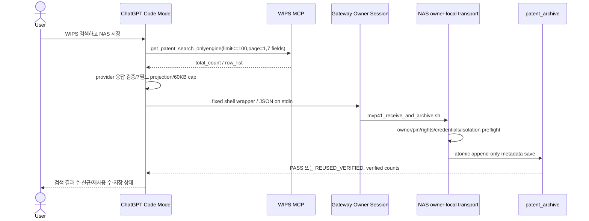

# MVP41 P0-1 — ChatGPT WIPS 검색 → NAS 서지 자동 보관 실행기

- **날짜:** 2026-11-20
- **대상:** ChatGPT 개발 Agent, 개인 NAS 운영자
- **상태:** A안(현재 ChatGPT MCP 두 도구의 명시적 순차 합성) **실제 WIPS 83건 검색→운영 NAS 재사용 검증 PASS**. B안(NAS backend의 WIPS 직접 호출) **NOT_VERIFIED**. 독립 WIPS 호출을 자동 가로채는 기능 **NOT_IMPLEMENTED**.
- **권리/한도:** 사용자 명시 승인 — WIPS 검색 결과 서지정보만, **검색당 첫 페이지 최대100건**. 청구항/상세설명/PDF/벡터 파일 수집 또는 대량/후속 페이지 자동 조회는 범위 밖.
- **관련 설계·계획:** [P0-1 설계](mvp-implementation/P0-1-design.md), [계획](mvp-implementation/P0-1-plan.md), [기존 83건 보관](39-mvp-archive-100-live-acceptance.md), [전역 진입점](../AGENTS.md).

## 1. 아키텍처 및 재사용 코드



| 위치 | 역할 | 현재 상태 |
|---|---|---|
| [`poc/mvp41_orchestrate.mjs`](../poc/mvp41_orchestrate.mjs) | WIPS와 Gateway 의존성을 주입받아 첫 페이지 검색·검증·저장 및 상태 결과를 합성하는 JS 참조 구현 | Node 테스트 PASS. ChatGPT Code Mode에는 **imports 불가능**하므로 소스 로직을 해당 도구 실행기에 인라인해서 사용 |
| [`poc/mvp41_orchestrate.test.mjs`](../poc/mvp41_orchestrate.test.mjs) | 정상·재사용·실패·경계 17 시나리오 검증 | `node poc/mvp41_orchestrate.test.mjs` PASS |
| [`poc/mvp41_receive_and_archive.sh`](../poc/mvp41_receive_and_archive.sh) | owner NAS 한정 고정 stdin 명령. 실행 파일 자신의 상대 경로에서 기존 private archive root 찾고 인증과 DB 컨테이너 ID/정규화 wheel 경로 지정. 공개 listener 없음 | NAS private mode700 설치, source SHA256·`sh -n` 검증, 실제 실행 PASS |
| [`poc/mvp37_local_transport.py`](../poc/mvp37_local_transport.py) | 이전부터 실증된 restricted Docker worker/권한 검증 | 변경·재시작 없음 |
| `patent_archive` | 기존 4개 table·독립 최소권한 role, 원문/벡터 read-only | 기존 83건, 중복0 실측 PASS |

**원격 실행:** 전역 Control 및 [device-control](https://github.com/son1004007/device-control)의 승인된 Synology Gateway 대상에서만 owner-authorized shell 실행. 공개 GitHub에는 NAS 개인 경로·키·실문헌 식별자·원문을 게시하지 않는다. 구현 예시는 owner private archive root의 `bin/mvp41_receive_and_archive.sh`를 **고정 명령으로 호출**하며 `query`나 반환 `row`에서 셸 명령어를 구성하지 않는다.

## 2. 실제 Code Mode 통합 방법 — 다른 채팅/AI의 실행 지침

ChatGPT Code Mode의 `functions.exec` 안에서 WIPS 및 Gateway를 순차 호출한다. 별도 외부 WIPS 키 이동/ChatGPT 도구 재등록 없이 **현재 이미 설치된 WIPS MCP와 Gateway**를 사용한다.

1. 먼저 GitHub 최신 AGENTS/TASKS/P0-1 계획과 이 문서를 읽고 해당 채팅의 `ALL_TOOLS`에 `mcp__wipsclip__get_patent_search_onlyengine` 및 `mcp__Gateway__execute_command`가 실제 노출되어 있는지 확인한다. 누락 시 무작정 다른 상품 API/브라우저 크롤러로 대체하지 않는다.
2. 사용자 **실제 검색 의도**에 해당하는 WINTELIPS 검색식은 입력에서 명확히 받고 `pgrow <=100`, `pgnum=1`, `outitem="SKEY,XN_D,CC,KC_D,TIK,APSTH,XD"`만 요청한다.
3. WIPS 응답 `success=true`, 정수 `total_count`, 배열 `row_list.length<=pgrow`를 검증한다. 텍스트 `ABK/CLK` 또는 전체 응답 객체를 NAS에 전달하지 말고 **정확한 7개 필드만 새 객체로 복사**한다.
4. `{query,page:1,page_size:pgrow,response:{success:true,data:{total_count,row_list:projected}}}`를 JSON 직렬화한다. **UTF-8 60,000 bytes 초과는 저장을 거절**(Gateway stdin 제한 약64KB)하며 값 잘라내기/자동 페이지 추가 요청/다른 URL 전송 금지. `PAYLOAD_TOO_LARGE`와 검색 성공을 구분한다.
5. 신뢰 운영자에게 연결된 Gateway NAS target의 고정 명령 **`/bin/sh <private archive root>/bin/mvp41_receive_and_archive.sh`**를 `privilege=none`, `shell=/bin/sh`, stdin에 JSON 패킷으로 실행한다. 기존 DB·API·relay·tunnel/컨테이너 재시작 없음.
6. Gateway job이 `queued/running`이면 **동일 job_id에 `wait_for_job`**을 호출한다(같은 패킷을 새 job으로 blind 재실행하지 않는다). job output의 `stdout`에서 최대4096자 단일 JSON만 파싱하고 ``status,verified,total_count,returned_count,unique_count,saved,reused,fulltext_complete,fulltext_partial,fulltext_missing,body_writes`를 검증한다. `job=failed`+`BLOCKED_POLICY`가 명시된 경우만 승인 차단으로 처리, 기타 실패는 `FAILED_OR_UNCONFIRMED`.
7. 사용자에게 **검색 성공과 NAS 저장 결과를 각각 출력**한다. 검색 결과를 채팅에 보여줄지 여부는 사용자 요청/공급자 권리 범위에 따른다. 실제 SKEY 목록이나 원문·비밀은 로그/GitHub에 남기지 않는다.

**실행 참고(의존성 주입 Node):**

```js
import {runWipsArchive} from "./poc/mvp41_orchestrate.mjs";
const result = await runWipsArchive({query: ownerApprovedSearch, limit: 100}, {
  allowSearch: async context => /* 실제 사용자 검색 범위 및 비용 정책 */,
  searchWips: args => /* 현재 ChatGPT WIPS MCP 도구 직접 호출 */,
  executeArchive: rawPacket => /* Gateway 고정 명령에 stdin만 전달 */,
  waitArchive: jobId => /* Gateway 동일 job_id 완료 결과만 회수 */
});
```

주의: 위 주입식 코드는 Node 사용 예시로 **ChatGPT Code Mode에서 직접 import 실행되는 코드는 아님**. Code Mode는 소스의 동일 검증·고정 명령 로직을 툴 오케스트레이터 JS에 인라인한다. 별도 서버 MCP의 등록/자동 인터셉트 기능이 없다.

## 3. 검증/실제 운영 결과

| 검사 | 결과 |
|---|---|
| Gateway stdin 직접 전송(가상 입력) | `STDIN_BYTES=15` PASS |
| NAS private source pin/`sh -n`/owner mode700 | PASS |
| 비정상 `{}` 입력 | wrapper 종료 code1 + `FAILED_OR_UNCONFIRMED`, DB 쓰기 없음 |
| JS 합성 통합 계약 | Node v22, 17/17 PASS: first100/page1, 7필드 projection, 본문 필드 제거, auth/search failure, saved count/metadata 불일치, failed/queued, 101 limit, oversized payload, reuse |
| WIPS 실제 검색 | 1회, `pgrow=100,pgnum=1`, 반환 **총83건/페이지83건**, 전달 JSON UTF-8 **19,303 bytes** |
| 신규 Gateway wrapper로 실데이터 저장 | `REUSED_VERIFIED, saved=0,reused=83`. **기존 83건 이미 저장된 상태**라 새 INSERT 시험은 이번 단계에서 재수행하지 않음. 최초 83건 INSERT 자체는 [이전 운영 인수](39-mvp-archive-100-live-acceptance.md)에 PASS |
| 같은 검색 패킷 즉시 재실행 | `REUSED_VERIFIED, saved=0,reused=83`, WIPS 공급자 재호출 없이 NAS만 재검증 |
| 최종 운영 DB | archive `documents=83, revisions=83, pages=1, hits=83` / 기존 private_docs `documents=6,section_sources=10,chunks=417`. worker 잔재0, wrapper sha pin PASS |
| 신규 도구/API/플러그인 등록 | **NOT RUN** — 기존 reader/MCP 불변, 서버 재시작/공개 새 port/새 인증 범위 없음 |

이 작업에서 **WIPS 1회→Gateway owner 실행→기존 DB 재사용 검증을 하나의 Code Mode 함수 호출로 연결한 경로**가 실제로 동작했다. "새 특허 1건 INSERT" 또는 "임의 WIPS 도구 호출 감지/상시 등록된 MCP 도구"를 새로 완료했다고 말하지 않는다.

## 4. 남은 P0-1 범위와 다음 변경

- **A 운영 사용자 경험:** 사용자 채팅/다른 AI가 서지 저장을 요청하면 이 합성 흐름을 사용하도록 기존 프롬프트·운영 가이드에 연결한다. WIPS 검색만 독립 호출하면 NAS 저장이 발생하지 않음을 사용자에게 고지한다.
- **고정 API 도구화(B):** WIPS MCP 공급자 연결이 ChatGPT 외 서버에서 **실제 인증/대리 호출 가능한지 공식 경로/조건**이 검증될 때만 별도 `search_wips_and_archive` 엔드포인트를 구현한다. [WIPS 공식 베타 안내](https://www.wipscorp.com/news-view?id=265)는 연결할 AI 앱에 별도 MCP 키를 발급하는 방식을 소개하지만, 현재 NAS에 그 키·권한을 복제한 증거는 없다.
- **대형 패킷:** 현재 Gateway 입력 경계 60KB를 넘는 최대100건 응답은 fail-closed 처리. 임의 자르기 금지. 추후 실제 대형 목록이 발생하면 사전에 검토한 스트리밍/분할 전송 계약이나 사용자가 지정한 작은 `pgrow`로 별도 재검색(공급자 호출 추가 비용 가능)을 설계한다.
- **장애/복구:** Gateway queue·timeout/commit 미확인 시 **동일 job_id 추적**, 즉시 두 번째 NAS 쓰기 작업 생성 금지. 기존 archive idempotency로 확인한 다음 안전한 재실행만. 장시간 운영 daemon을 새로 만들지 않는다.
- **권리/보안:** 기존 서지 최대100 승인만, PDF/본문/추가 임베딩은 P0-2/P0-3 별도. 개인 WIPS 데이터를 공개 저장소에 남기지 않음.

**다음 P0-1 완료 게이트:** 실제 새 채팅에서 위 A 흐름을 사용해 최소 한 번의 WIPS 검색→NAS verified 보관과 오류 상태까지 재현하거나, 서버측 B 도구 등록/개별 승인 운영 인수를 수행해 어떤 호출 경로에서 보장이 되는지 확정. 현재 임의의 WIPS 호출 전체 후킹은 미구현으로 계속 OPEN.
