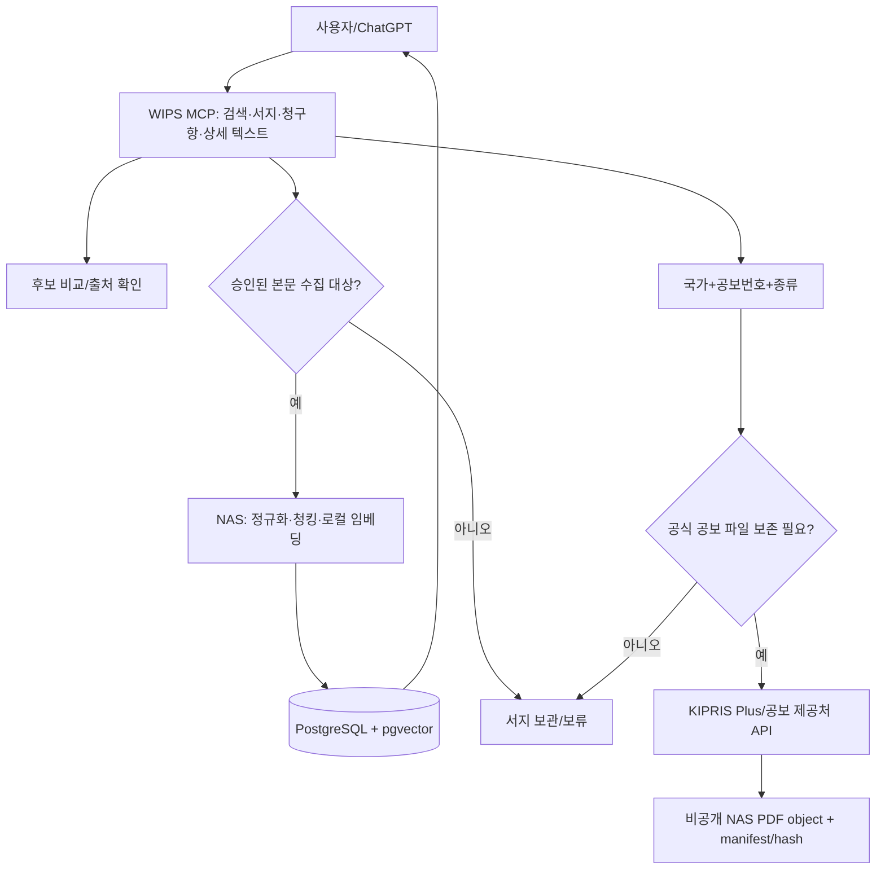

# MVP 1차 완료 범위 재정리 및 WIPS MCP vs API 기술 선택

- 기준일: **2026-11-20**
- 범위: 사용자 개인 ChatGPT + WIPS 검색 MCP + NAS PostgreSQL/pgvector. MyFolder는 사용자 지시로 HOLD.
- **판정:** **MVP 핵심 기능의 실제 운영 실증 완료** / **사용자 직접 인수(#31) 대기** / **전 과정 상시 자동화는 미완료**. 다른 대화·임의 WIPS 도구 호출이 모두 NAS에 자동 반영되는 것은 아니다.
- 정본: [TASKS](../TASKS.md), [CURRENT_STATE](../CURRENT_STATE.md), [실제 운영 인수](35-mvp03-actual-ingest-acceptance.md), [비교](25-mvp04-candidate-comparison.md), [서지 83건](39-mvp-archive-100-live-acceptance.md), [WIPS→NAS A안](42-mvp41-code-mode-gateway-archive.md).
- 이 문서는 **현황 재분류 및 권고**이며 새 기능을 구현·배포했다는 기록이 아니다. 기존 미완료 P0 단위별 상세 설계/계획은 [별도 인덱스](mvp-implementation/INDEX.md)에 보존한다.

## 1. 진행 완료 — 핵심 MVP의 실증 기능

| 기능 | 운영 및 시험 근거 | 완료 범위 |
|---|---|---|
| WIPS MCP 특허 검색 | 실제 첫 페이지 83건·7개 서지 필드, 전문/청구항 및 도면 필드 응답 확인 | **검색/본문 조회 호출 PASS** |
| WIPS와 NAS 비교 | 실제 NAS3 + WIPS3 → 고유5, 근거18, HOLD/EXCLUDE 판정 및 합성27/27 | **제한된 기본 비교 PASS**, 기술 성능/추천 정확도 검증은 별도 |
| 실제 WIPS 문헌→NAS 적재 | 허용된 신규 한 건의 상세설명/청구항 조회 후 승인된 writer 적용; 재실행 신규0 | **선택한 실제 단건 적재 PASS**, 무제한/전건 적재 아님 |
| 로컬 청크·임베딩 | multilingual-e5-small 384차원, PostgreSQL+pgvector | 운영 총 **문헌6/섹션10/벡터청크417** |
| NAS RAG 검색·근거 확인 | ChatGPT search_patents/get_patent, 근거 원문 발췌, 중복 검색 | **실제 운영 PASS**, 전체 원문 뷰어와 구별 |
| 서지 저장 | WIPS 검색 첫 페이지 최대100 허용, 실제 83건 영속 저장/동일 페이지 재사용0 INSERT | **서지83건**, 83건 전체 원문·벡터화라고 표시하지 않음 |
| 검색→서지 자동보관 A안 | ChatGPT 명시적 오케스트레이션 WIPS→Gateway→NAS, 실제 83건 REUSED_VERIFIED | **지정된 호출 경로 PASS**; 독립 WIPS 호출 후킹 없음 |
| 권한·백업·복원 | archive 및 원문 DB 격리 복원, 최소권한, 기존 컨테이너/원문 fingerprint | **운영 DB 영역 PASS**, PDF 파일 백업은 해당 파일 미확보 |

## 2. 앞으로 할 것 — MVP 필수 검증과 확장 기능을 분리

### A. MVP 종료 판정에서 남은 필수 확인

1. **사용자 직접 평가(#31):** 실제 질문 1~3개에서 결과 관련성·출처/근거·보류 판단·재사용의 실효성을 확인. 기능상 MVP 통과와 사용자 인수 서명을 혼동하지 않음.
2. **품질 기준선:** WIPS 단독 결과 / NAS 검색 단독 / WIPS+NAS 근거 비교를 **동일 연구 질문 5~10개**에서 비교. 예: 상위 5개 중 적절한 문헌 수, 근거 일치, 보류·오추천, 실행 호출수/응답시간. 수치 측정 전 **MCP가 API보다 정확/빠름** 주장 금지.

### B. MVP 완료 후 선택 개발 (기존 설계 P0-1~P0-5는 보존)

| 후속 작업 | 지금 필수? | 우선순위 권고 |
|---|---|---|
| 허용된 **신규 본문** 수집→기존 청크·E5 자동 적재 연결 | 반복 사용 시 유용, 현재는 승인 단건 수동 연계 | **P1: 사용자 활용 빈도가 높아질 때 최우선** |
| 공식 **특허 공보 PDF** 다운로드·원본 보존 | 원본 페이지/도면·법적 검증/감사용 보존에 필요 | **P1 선택**. 문헌 번호로 별도 KIPRIS Plus API 경로, 파일 무결성 확인 |
| **전체 명세서** 사람용 열람 | 현재 get_patent은 발췌 중심 | P1 선택. PDF 확보 없어도 텍스트 페이징 독립 구현 가능 |
| ChatGPT 외부 호출 무조건 후킹/백엔드 독립 WIPS 호출 MCP | 기존 A안으로 대화 내 지정 검색·저장 동작 | **P2/HOLD**. 정식 서버-서버 인증/API/운영 요구가 생길 때 |
| 고급 Hybrid/RRF/reranker, 웹 Agent, 기업 배포 | 기본 근거 비교는 동작 | **P2/HOLD**. 평가 데이터로 효용 확인 후 |
| WIPS MyFolder | 사용자 중지 지시 | **HOLD** (별도 재요청 전 수행 금지) |

**정리:** 공보 PDF 획득은 개인 채팅 기반 *기본 검색·비교·벡터 RAG* 기능 완료에 **필수 게이트가 아니다**. 다만 사용자 목표에 "공식 공보 PDF 보존/열람"이 포함되면 해당 기능은 아직 미완료임을 분리 표시한다.

## 3. API vs MCP: 실제로 제거되는 개발과 남는 개발

| 항목 | WIPS MCP, 현재 연결 기준 | 일반적인 특허 REST API |
|---|---|---|
| 데이터 접근 | ChatGPT가 검색식 구성·도구 발견·호출, WIPS JSON 결과 수신 | 백엔드 HTTP 호출, 인증/쿼리/paging/retry 코드 작성 |
| 자연어 대화와 다중 도구 | **장점**: ChatGPT에서 바로 조회·검토·후속 필드 호출 | LLM tool wrapper 또는 별도 오케스트레이터 필요 |
| 명세서 취득 | WIPS `get_patent_spec_text`로 상세설명·청구항 **텍스트** 반환 가능 → PDF OCR/텍스트 추출 생략 | **공급자/API별로 다름**: XML/JSON 텍스트 API라면 추출 간단, PDF만 제공한다면 별도 PDF 파서/필요시 OCR |
| 청크 분할 | **NAS에서 필수** (MCP가 청크 제공하지 않음) | 원문 임베딩 시 필수 |
| 로컬 벡터 임베딩 | **NAS에서 필수** (MCP가 벡터 제공하지 않음) | 자체 모델 선택 시 동일 |
| 공식 공보 PDF 바이트 | 현재 연결 WIPS MCP 28개 도구에 전용 다운로드 기능 **없음** | 공급자에 따라 제공. KIPRIS Plus는 공보 PDF 다운로드 **경로**를 XML로 제공; 인증/실제 파일 취득은 별도 검증 |
| 백엔드 대량/예약 처리 | ChatGPT 호출/도구 세션 의존, 별도 서버 MCP auth 검증 없으면 번거로움 | 일반적으로 정해진 API 계약으로 서버-서버/배치 구현 용이 |
| 배포/보안 | ChatGPT plugin 인증·도구 권한 + NAS 별도 writer 경계 | API 자격증명 관리/네트워크/약관·사용량/DB 경계 |
| 비용·성능·정확도 | **측정 전 우열 불명**, 토큰/LLM 오케스트레이션 추가 가능 | API 호출 비용/처리량·가공 비용은 상품별 별도 측정 |

**중요한 기술 구분:** MCP는 도구를 AI에 노출하는 **연동 프로토콜**이지 PDF 파서, 청커, 임베딩 모델, 벡터 DB를 대체하는 엔진이 아니다. 현재의 이점은 **WIPS가 구조화된 상세 텍스트를 이미 반환**하는 데서 나온다. 같은 내용을 API가 XML/JSON으로 제공한다면 API에서도 PDF를 파싱할 필요가 없다.

### 권장 구조 — 개인 MVP 유지, PDF는 별도 취득

**API로 전면 교체할 이유는 현재 없다.** 사용 목적이 ChatGPT 대화형 특허 비교·소수 선별 문헌 RAG라면 WIPS MCP를 유지한다. **백엔드 자동 대량 처리·재현성·스케줄링**이 주요 목적이 된 경우에는 계약/제공 범위가 확인된 **텍스트 제공 API**를 주 수집원으로 평가한다. 공보 PDF가 원본 증빙용일 뿐이면 API를 **원본 PDF 확보 보조 채널**로만 사용한다. 한 문헌을 PDF→OCR→청킹하고 WIPS 텍스트로 또 청킹하는 **중복 파이프라인은 만들지 않는다**.

## 4. 외부 공식 근거

- WIPS 공식 소개: [WIPS MCP](https://docs.channel.io/wips-lounge/ko/articles/wintelips-mcp-7f649324) — 대화창에서 검색/필드·청구항/권리 조회 및 AI 연결, WIPS MCP는 공보 PDF·벡터 생성 보증이 아님.
- [OpenAI MCP 문서](https://developers.openai.com/api/docs/mcp) — AI 도구/외부 데이터 연동 프로토콜, 원천 데이터 처리 파이프라인을 대체하지 않음.
- [KIPRIS Plus 특허·실용 공개·등록공보](https://plus.kipris.or.kr/portal/data/service/DBII_000000000000001/view.do) — REST, XML 서지·초록·청구항 정보 및 **공보 PDF 다운로드 경로** 제공, 실제 API 자격·파일 다운로드 가능 여부·저장 권한 검증 필요.

## 5. 향후 작업 우선 판단

**결정 제안**: 이제 신규 코드를 우선 추가하기보다 사용자가 실제 질문 결과를 평가하고, 비교 품질·반복 활용 가치를 측정한다. 통과하면 **“개인 대화형 특허 RAG MVP 1차 기능 실증 완료”**로 기록하고 PDF/상시 수집/전체 뷰어를 후속 개선으로 이관한다. 사용자가 공식 공보 PDF를 개인 RAG의 **필수 자산**으로 정하면 P0-2를 계속 핵심 범위로 유지한다. 현재 파일 0건, 원문 자동 적재 미완료를 완료라고 부르지 않는다.
