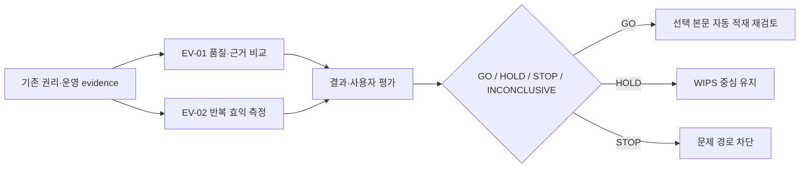

# DEC-RAG-01 — WIPS MCP/API 및 NAS RAG 후속 투자 판단 기준

- 기준일: 2026-11-20 / 상태: **결정 기준 확정, 실험 미실행**
- 소유: patent-rag-agent / 대상: 사용자, 개발자, 다른 AI
- 상태 정본: [TASKS](../TASKS.md), [CURRENT_STATE](../CURRENT_STATE.md); 선행 MVP 사실: [43번 문서](43-mvp-milestone-mcp-api-tradeoff.md)
- 상세 실행: [EV-01·EV-02 인덱스](validation/INDEX.md)

## 1. 이미 실증한 범위 / 완료가 아닌 범위

WIPS 검색, 한정된 WIPS+NAS 후보 중복제거·근거 비교, 승인된 문헌 텍스트 수집·NAS E5 384차원 임베딩, pgvector 재검색, 서지 보관·백업복원은 실제 운영 증거가 있다. 수량은 **서지 83건 / 원문 보유 문헌 6건(섹션 10) / 벡터 청크 417개 / 공식 공보 PDF 0건**. 서지 83건이 전부 임베딩되었다는 뜻은 아니다. 지정된 ChatGPT Code Mode→WIPS+Gateway→NAS 저장 경로만 확인되었고 임의의 WIPS 플러그인 호출 후킹, 전체 본문 자동 적재, 사용자 품질 인수는 미완료다.

MCP는 대화형 연동 표준이며 PDF 파싱·청킹·임베딩 엔진이 아니다. WIPS MCP가 상세 텍스트를 주기 때문에 PDF 텍스트 추출을 생략한 것이지, 구조화된 XML/JSON 텍스트를 제공하는 API보다 본질적으로 정확한 것은 아니다. 현 시점 기본 아키텍처는 **ChatGPT+WIPS MCP 검색/비교, NAS는 선택 문헌의 재검색, 공보 PDF는 필요시에만 공식 API로 확보**한다.

## 2. 투자 검증 우선순위

1. **정확한 근거와 보류:** 문헌 텍스트/청구항이 뒷받침하지 않는 효능·법적 상태를 확정 추천하지 않는다. 오류 발견 시 해당 추천 HOLD.
2. **검색 품질의 증가분:** 동일 질문에서 WIPS-only, NAS-only, 통합을 비교하고 직접 관련 특허의 상위 K개 수·근거·잘못된 보류/오추천을 채점한다. 서지83 vs 원문6의 커버리지 격차를 따로 보고한다.
3. **반복 사용 절감:** 동일/유사 질문 재탐색에서 확인 가능한 로컬 원문을 재활용하여 WIPS 검색·상세 호출 및 검토 시간이 줄어드는지, 정확도가 악화되지 않는지 확인한다.
4. **운영 경제성:** 호출 가격·권리·인증·복구·개발 유지비·사용량. 공식 요금 증거 없으면 비용은 UNKNOWN. 절감 건수만으로 수익률 계산 금지.
5. **신규 기능은 결과 기반:** 전건 적재·PDF·전체 뷰어·고급 RAG·새 통합 MCP·웹은 평가 결과나 별도 필수 요구가 있어야 착수.

## 3. 파일럿 종료 의사결정

| 판정 | 근거와 실행 |
|---|---|
| GO | 통합 검색 근거 품질이 WIPS-only보다 저하되지 않고 관련 후보/검토 효율이 향상 → 허용된 선택 본문 자동 적재 우선 검토 |
| CONDITIONAL GO | 검색 품질 변화가 작아도 **warm** 검색 시 실제 WIPS 호출 또는 사람 검토 시간이 20% 이상 감소하고 품질 유지 → NAS 재사용 중심 유지 |
| HOLD | 추가 품질·반복 효익 미입증 → WIPS MCP 단독 우선, NAS 신규 투자 유보(기존 데이터·백업은 유지) |
| STOP | 허위 단정·근거 오류·계약 위반·권한 침해 → 문제 경로 중단·수정 |
| INCONCLUSIVE | 실제 비교 불가/표본 부족·6문헌 편향·출처 변동 → 동일 corpus 또는 추가 질의로 제한적으로 재평가 |

**사전 가설 기준:** EV-01은 5~10개 질문에서 질문별 P@5/nDCG@5와 관련 후보 수를 비교한다. 근거 확인 가능 주장 중 근거 일치율 목표 95% 이상, 고위험 근거 없는 확정 추천 0. 개선 예시는 질문당 직접 관련 후보 +1건이나 품질 유지+근거 보강이며 **측정값은 아직 없다**. EV-02는 warm 조건에서 호출 또는 검토시간 20% 감소를 임시 GO 기준으로 사용하고 0/10/20/30% 감도 분석을 병기한다. 5~10개의 작은 파일럿은 통계적 유의성 증명이 아닌 투자 우선순위 판단이다. 사용자 인수 [#31](https://github.com/son1004007/ai-agent-workflow-playbook/issues/31)은 별도 필요.

## 4. 실행 순서

- [EV-01 설계](validation/EV-01-design.md) / [계획](validation/EV-01-plan.md)
- [EV-02 설계](validation/EV-02-design.md) / [계획](validation/EV-02-plan.md)

**경계 유지:** WIPS 서지 첫 페이지 최대100건 저장 승인 ≠ 임의 본문·벡터·PDF 저장 승인. MyFolder 작업 HOLD, 다른 NAS/DB/기술사/기업 서비스 재시작·권한 확대·신규 유료 호출 승인 없음. 공개 GitHub에 실제 고객 연구 질문·특허 원문·식별자·접속정보·토큰·원본 응답을 올리지 않는다. 각 실험의 지표·오류·사용자 평가 확인 후 TASKS/CURRENT_STATE/WORKS에 최종 의사결정 및 증거만 갱신한다.
