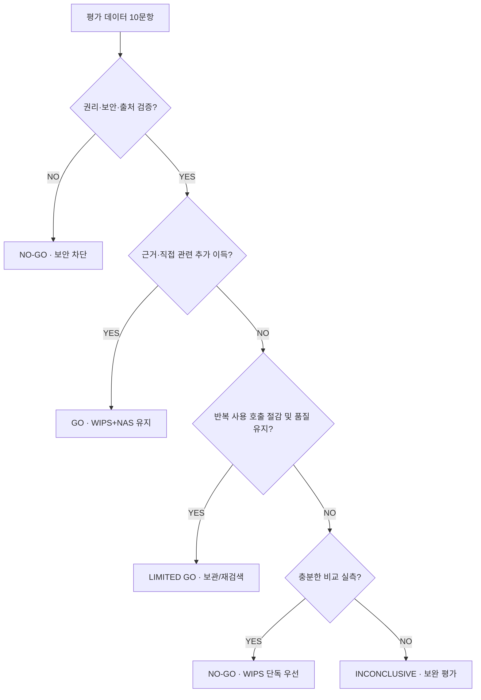

# MVP 후속 개발 의사결정 기준 — WIPS MCP / NAS RAG / API

- 문서 ID: PATENT-EVAL-DECISION-01
- 기준일: 2026-11-20
- 상태: **판정 규칙·평가 목표 확정(초기 권고 임계값); 실측 결과 및 사용자 인수는 NOT RUN**
- 대상: 사용자/개발자/다른 AI; 전역 [Control](https://github.com/son1004007/ai-agent-workflow-playbook/blob/main/CONTROL.md) → [저장소 AGENTS](../AGENTS.md) → [평가 실행 인덱스](evaluation/INDEX.md)
- 전제: [기능 MVP 실증 완료/잔여 구분](43-mvp-milestone-mcp-api-tradeoff.md), [기존 품질 초안](04-evaluation.md), [기존 후보 비교](25-mvp04-candidate-comparison.md)
- **이 문서는 계획과 판정 기준**이다. 지표 임계값은 *프로젝트 초기 제안 기준*이며 측정 결과/통계적 유의성/사용자 합격을 의미하지 않는다.

## 1. 현재 검증 사실과 판단 질문

- 현재 ChatGPT↔WIPS 특허 검색/명세서 응답, 기본 후보 비교, 제한된 승인 원문→E5 384D→pgvector 검색 및 재사용이 동작한다.
- NAS에 **서지83건 / 원문 문헌6건 / 섹션10 / 벡터청크417 / 공식 공보 PDF0건**. 83건 전수 원문 임베딩은 아님.
- WIPS 검색+NAS 서지보관은 명시적으로 호출한 경로에서 동작; 독립 WIPS MCP 모든 호출의 자동 후킹은 없음.
- **의사결정의 질문:** "같은 사용자 질문에서 NAS RAG를 추가하면 WIPS MCP 단독 대비 *검증 가능한 좋은 결과* 또는 *반복 사용 비용/시간 감소*가 있는가?"
- WIPS 자체와 **동일 제공 원문·동일 corpus의 API**를 실제 비교하지 않는 한 **MCP vs API 정확도/가격/속도 우열은 판정하지 않는다**. 프로토콜이 아닌 제공 데이터 품질·계약·호출 방식에 따라 달라진다.

## 2. 판단 원칙 및 우선순위

| 순위 | 기준 | 목적/측정 | 하드 안전 게이트 |
|---|---|---|---|
| 0 | **출처·권리·보안** | 원문/구독/저장·질의 외부 전송 허용범위, 고객자료/실제 ID 보호, 비인가 저장 차단 | 위반 발생 시 다른 지표와 무관하게 **NO-GO** |
| 1 | **근거 정확성·판정 신뢰성** | 사람이 문헌과 인용을 확인한 관련성, 근거의 일치, 근거 없는 추천 0 | 근거 부족 시 **HOLD** 유지, 성능·유효특허를 추정하지 않음 |
| 2 | **검색 범위/추가 관련 문헌** | WIPS 단독 대비 NAS+WIPS가 추가로 확보한 유효 문헌의 개수와 중복 | 원문 보유6건 vs WIPS 광범위 검색의 **corpus 차이**를 반드시 분리 |
| 3 | **반복 사용 경제성** | 관측된 WIPS 호출수, 추정 회피 호출수, 사용자 확인 완료 시간, 오염/오답 비용 | 호출 절감만으로 품질 하락 합리화 금지 |
| 4 | **개발·운영 복잡도** | 신규 키/서버/모델 유지보수·장애 경로, 지연 및 증분 비용 | 외부 포트·기존 컨테이너 재시작·무승인 데이터 적재 금지 |
| 5 | **공보 PDF 필요성** | 원본 공보의 페이지/도면·증빙/보존 요건 여부 | 필요할 때만 별도 공식 PDF API 검토; 벡터 입력용 강제 다운로드 아님 |

## 3. 비교 시험 단위 및 공정성

- 동일한 연구 질문 **10개를 목표**(초기 스모크 5개), 질문/필수 속성/제외 조건을 **조회 전 고정**. 가능하면 **현재 NAS corpus가 다루는 범위 5개 + 아직 미보유 범위 5개**로 나눈다. 실제 원문/질문이 비공개이면 코드·공개 repo에 적지 않고 승인된 NAS 비공개 저장으로만 유지한다.
- **WIPS 단독(W)**: 동일 검색식, 상위 3개, 가능한 요약/청구항 발췌. **NAS 단독(N)**: 동일 자연어 질문, 상위 3개 + `get_patent` 근거. **WIPS+NAS 통합(C)**: 각 최대3개 수집, 국가+문헌번호+종류 동일 키 중복 제거 후 **최대6개 후보 집합**. [기존 모듈](../poc/mvp04_candidate_compare.mjs) `HOLD/EXCLUDE/REVIEW_CANDIDATE` 판정(어휘 일치만) 재사용.
- **중요:** C의 6개 후보를 W 또는 N의 3개와 단순 `Precision@3`로 직접 비교하지 않는다. **같은 3개 상위 랭킹**이 확정된 W/N끼리 P@3, C에 대해서는 *동일 후보 검토 예산이었는지 별도 표시하면서* 새로 확보한 직접 관련 문헌 수/출처·근거 유효성을 측정한다. C의 별도 top3 랭킹 구현 전에는 "통합 P@3 향상" 주장 금지.
- 사람이 합의/확인한 라벨(문헌별 **0=무관, 1=간접, 2=직접 관련**, **evidence_verified=true/false**, 사용자 목적 충족 여부)을 정답으로 사용. WIPS/NAS의 거리 점수·자체 판정을 정답으로 취급하지 않는다. 가능하면 소스 표시를 가리고 동일 후보 평가, 비교 후 결과를 밝혀서 provenance 확인한다.
- **정답 전체 집합이 없는 경우 Recall@k나 실제 특허 검색 재현율을 보고하지 않는다**. Precision@3, 직접 관련 Hit@3, 증거 인용 검증률, false positive, 추가 유효후보 발견 수만 사용한다. 5~10 질문은 **탐색적 결정**이며 업계 일반화/통계적 유의성 주장 불가.
- 공급자 오류/지원하지 않는 질문/언어 fallback/원문 없는 서지83건은 **NOT_RUN / FAILED / METADATA_ONLY**로 표시, WIPS 또는 NAS 성공으로 포장하지 않는다.
- 원문·벡터를 추가로 적재해 비교의 기준선을 바꾸지 않고 **현행 snapshot 고정**. 데이터셋/문헌 추가 시 다른 실험 run으로 분리.

## 4. 평가 지표와 산식

| 지표 | 계산·정의 | 판정 용도 |
|---|---|---|
| W/N P@3 | 각 질의의 **첫3순위에서 직접 관련(label=2) 수 / 3**. 부족한 결과는 0으로 처리하고 조회성공률 별도 | 동일 K에서 후보 적합도 |
| W/N Hit@3 | 첫3개에 직접 관련 문헌 1개 이상이면 1, 아니면 0 | 실무 활용 여부 |
| C 신규 직접 관련 | `C` 고유 후보 중 W 상위3과 겹치지 않는 **label=2** 문헌 수 (국가/번호/종류 exact 기준) | NAS 추가 가치, 후보 열람 예산 증가 표시 |
| 근거 검증률 | **실제 확인한 인용 근거 중** 문헌/섹션/주장에 일치한 개수 ÷ 실제 확인한 총 인용 근거 개수. 근거0은 N/A | 검증 가능한 답변 품질 |
| 잘못된 추천 | `REVIEW_CANDIDATE`/추천으로 표시했으나 출처 근거가 없거나 필수 조건을 충족하지 않는 사례 수 | **0건 목표**. 단순 키워드 등장만으로 성능 검증 처리 금지 |
| 보류 적절성 | HOLD인 문헌 중 실제 전문 검토 후에도 근거가 부족한 수 / 검토한 HOLD 총수; 검토 불가 시 UNKNOWN | 보수적 판정의 실효성 |
| 실사용 완료 시간 | 최초 질문 → 사용자가 판정 가능한 근거/문헌을 얻은 시점, 실제 측정 가능할 때만 | 사용자 가치 |
| 외부 WIPS 호출수 | 회차별 WIPS 도구 호출 실제 count; 검색/상세 구분 | 호출 절감의 **실측** |
| 회피 WIPS 호출수 | 반복질문에서 baseline *가정상* 필요한 호출수 − 실제 WIPS 호출수 | **추정**으로 별도 표시(실측과 혼용 금지) |
| 비용 | 실제 확인 가능한 사용량/과금만 금액 표기. LLM 토큰, DB/CPU/모델 로딩 시간은 확인 가능할 때 분리 | 비용 우위 검증 |

## 5. 실행 이후에만 적용할 초기 결정 게이트

아래 수치는 **가설 검정용 내부 목표치**(사용자 확정 KPI 아님). 데이터 10질문에 대한 raw 분모/불확실성도 함께 남긴다.

| 결과 | 실무 판단 기준 | 권고 조치 |
|---|---|---|
| **GO — NAS 유지·개선** | 허용된 10문항 중 **3문항 이상**에서 WIPS 첫3에 없는 **직접 관련·근거 검증 후보**를 NAS가 ≥1개 추가 발견, 근거 없는 추천 **0건**. **또는** 아래 반복효율 게이트를 만족하고 품질 저하가 없음 | 현행 WIPS MCP + NAS 유지, 승인된 선별 문헌의 자동 증분 적재만 필요 시 P1 |
| **LIMITED GO — 재사용/아카이브만** | 검색 신규 근거 이득은 불명확하나 반복 질문에서 WIPS 도구 호출 **실제 또는 명시된 counterfactual 대비 ≥50% 감소**, 직접 관련 문헌·인용 품질 저하 없음 | NAS는 보관/재검색에 집중, 고급 랭킹/PDF는 보류 |
| **NO-GO — 현재 범위 확대 중단** | 추가 유효 후보가 없고 호출/완료시간 절감도 충분하지 않거나, 근거 없는 추천/품질 저하가 반복됨 | WIPS MCP 단독 우선, NAS 신규 인제스트/고급 기능 개발 보류. 기존 안전한 서비스·데이터 임의 삭제 금지 |
| **INCONCLUSIVE** | 유효 질문 <10, 평가자가 증거를 확인하지 못했거나 corpus/권리/호출 제한 차이 때문에 비교 불가능 | 데이터 보강/실험 범위 축소, **완료/승자 선언 금지** |
| **별도 API 평가 필요** | 공보 PDF 보존이 필수 또는 예약 배치·서버 직접 호출이 핵심 요구가 됨 | KIPRIS Plus/WIPS 공식 API의 **문서/키/요금/파일 실제 취득권리**를 별도 검증. 이 두 실험의 결과만으로 API 우월 주장 금지 |

### 판단 우선순위

## 6. 두 실행 계획과 개발 게이트

1. [**EVAL-01: 검색·근거 품질 비교 실행 계획서**](45-search-quality-comparison-plan.md) — WIPS 단독/NAS 단독/통합, 동일 질의·증거 라벨·실제 후보 추가 가치.
2. [**EVAL-02: 저장 자료 반복 사용 가치 실행 계획서**](46-reuse-value-verification-plan.md) — 저장된 원문/서지 상태와 cold/warm 검색·호출수/지연·판정 품질, 중복/갱신 위험.

상세 진입점: [평가 계획 인덱스](evaluation/INDEX.md). 작업 상태와 판정 결과는 [TASKS](../TASKS.md)/[CURRENT_STATE](../CURRENT_STATE.md)가 정본. 사용자가 직접 결과를 평가하기 전 [중앙 #31](https://github.com/son1004007/ai-agent-workflow-playbook/issues/31) 완료 금지.

**권한/개인정보:** MyFolder는 사용자 지시로 HOLD. 공개 GitHub에는 특허 제목·SKEY·검색어·실제 문헌/근거 본문·사용자 비공개 질문/DB 연결·credential 저장 금지. 계약 불명확 원문/추가 외부 전송/과금 자동 수행 금지. 평가 계획 작성만으로 운영 WIPS 추가 검색/본인 원문 수집/새 서버 배포 승인 발생하지 않는다.

## 최신 사용자 결정 — AI 평가로 내부 PoC 판단(2026-11-20)

이 문서의 '사람 라벨 필수'와 중앙 사용자 평가 #31은 2026-11-20 현재 사용자의 **'사람 검증 안해. 니가 다해.'** 지시로 대체한다. **ChatGPT의 직접 요약/청구항/기존 NAS 근거 검토 + 실제 MCP 읽기 실측**을 내부 PoC 결정을 위한 자료로 사용하며 `AI_REVIEWED`와 `HUMAN_GOLD_NOT_RUN`을 분리 기록한다. 권리 유효/법률 검토, 고객 정보의 외부 전송, 신규 원문 수집, 배포 승인 등 보안·계약상 필수 사람 승인은 이 선택으로 면제되지 않는다.

[새로운 WIPS AI 질의 개선](evaluation/2026-11-20-eval01-targeted-query-rewrite.md)과 [EVAL-02 NAS warm 리플레이](evaluation/2026-11-20-eval02-warm-nas-replay.md)를 근거로 **기존6문헌의 역사적 재사용 한정 `AI_REVIEWED_LIMITED_GO`**, 관련 없는 분야 자동 추천 **HOLD**, NAS 본문 확대·실제 절감률/지연ROI **INCONCLUSIVE** 판정. 이는 기존 ≥50% 절감 게이트를 충족했다는 주장이 아님. 질문·문헌·AI 자체 판정이라는 표본 제한과 WIPS AI 단문/장문 사후 튜닝 편향을 기록한다.
