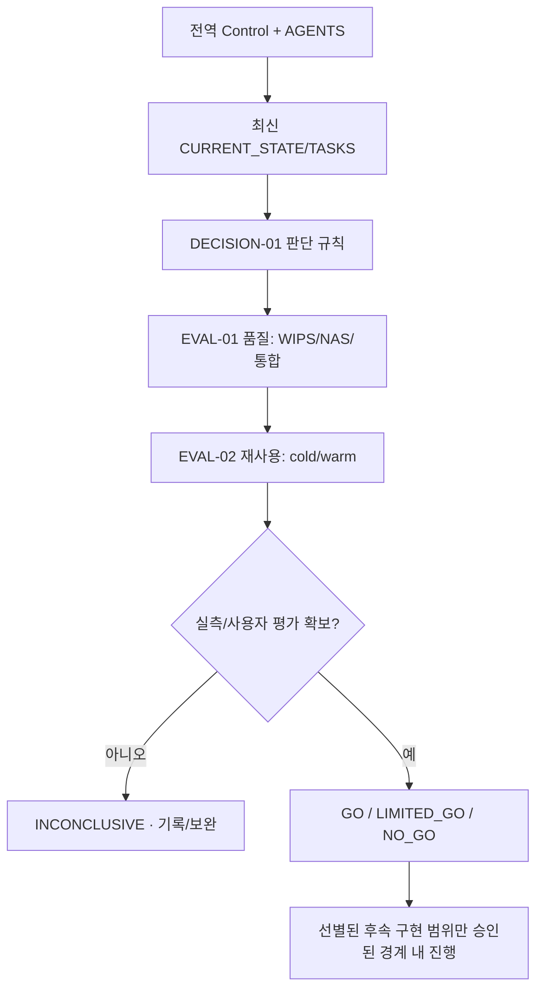

# 개인 특허 RAG — MVP 가치 검증·기술 선택 문서 인덱스

- 인덱스 ID: PATENT-EVALUATION-INDEX
- 기준일: 2026-11-20 / 목적: 다른 ChatGPT·Codex·개발자가 **MVP 이후 무슨 기능을 만들지** 동일 판단 기준에서 진행.
- **실제 상태:** 검색·비교·선택 문헌 로컬 벡터화 등 **MVP 기본 기능 실증 완료**. EVAL-01의 10문항 WIPS/NAS 검색·근거 반환 **실측 완료**. 사용자 별도 채점은 2026-11-20 최신 지시로 **불필요**. AI 직접 관련성 채점과 [EVAL-02 NAS warm 리플레이](2026-11-20-eval02-warm-nas-replay.md)는 실측, COLD 대비 비용/지연 ROI는 **NOT MEASURED**. 사용자 직접 채점 게이트 [중앙 #31](https://github.com/son1004007/ai-agent-workflow-playbook/issues/31)은 최신 지시로 종료(not_planned).
- 신규 문서는 **결정/실행 계획**이지 실행 결과 기록이 아니다. 결과는 기존 [CURRENT_STATE](../../CURRENT_STATE.md), [TASKS](../../TASKS.md), [WORKS](../../WORKS.md)가 정본.
- **읽기 순서:** [전역 Control](https://github.com/son1004007/ai-agent-workflow-playbook/blob/main/CONTROL.md) → [repository AGENTS](../../AGENTS.md) → [CURRENT_STATE](../../CURRENT_STATE.md)/[TASKS](../../TASKS.md) → **이 인덱스** → 판단 기준 → EVAL-01 실행 계획 → EVAL-02 실행 계획 → 기존 도구/코드/실측.

## 1. 평가 문서 및 작업 구분

| ID | 우선순위 | 파일 | 현재 상태 / 목표 |
|---|---|---|---|
| DECISION-01 | **P0 의사결정 기준** | [MVP 유지·MCP/API·NAS 선택 기준](../44-mvp-evaluation-decision-criteria.md) | **문서 작성 완료**, 실측 판정 전. 관련성·근거 정확도 우선, 추가 후보, 호출비용/시간·복잡도·공보 PDF 필요성 순서 |
| EVAL-01 | **P0 1순위** | [검색 정확도·근거 비교 실행 계획](../45-search-quality-comparison-plan.md) / [10문항 검색 실측](2026-11-20-eval01-live-retrieval-baseline.md) | **검색 실측10/10 PASS · [AI 예비 채점10/10](2026-11-20-eval01-ai-provisional-score.md) · 공식 gold-label 0/10, AI 예비 품질 확인(독립 human-gold 없음), 최종 범용 정확도는 INCONCLUSIVE**. WIPS 단독 / NAS 단독 / 양쪽 통합, 실제 연구질문 10개 목표(1차5+추가5), AI 근거 검토 라벨과 중복 후보 |
| EVAL-02 | **P0 2순위** | [저장 자료 재사용 가치 검증 실행 계획](../46-reuse-value-verification-plan.md) / [NAS warm 10문항×2 실측](2026-11-20-eval02-warm-nas-replay.md) | **WARM PASS / AI 근거4·HOLD6 / COLD 비교·ROI INCONCLUSIVE**. 실제 WIPS warm0, NAS reader28회, WIPS 호출 절감 추정과 실측 구분 |

**전제 설명:** [MVP 완료 범위·API vs MCP 비교](../43-mvp-milestone-mcp-api-tradeoff.md), [기존 양 소스 후보 비교](../25-mvp04-candidate-comparison.md), [실제 본문 적재](../35-mvp03-actual-ingest-acceptance.md), [서지83건](../39-mvp-archive-100-live-acceptance.md), [실사용 시험](../31-mvp06-user-trial.md). P0-1~P0-5의 미구현 기능별 원래 상세 설계는 [기존 구현 인덱스](../mvp-implementation/INDEX.md)에서 찾는다.

## 2. 진입·평가 흐름

- **실행 1:** EVAL-01 질문/근거 평가. 기본 문헌6/청크417과 WIPS 광범위 corpus 차이를 분리. ChatGPT가 요약·청구항·NAS 근거를 직접 읽고 AI 레이블로 채점한다. 공급자 유사점수 자체를 정답으로 취급하지 않는다.
- **실행 2:** EVAL-02는 같은 질문·라벨·corpus snapshot을 사용해 NAS warm-only가 WIPS 호출 없이 유효 근거를 반환하는지 본다. **이전 83건 REUSED_VERIFIED는 DB 재삽입0일 뿐 WIPS 검색 호출 절감 실증이 아니다.**
- **공통 종료 조건:** 실측과 가정을 구분하고 AI 자체 근거 평가 반영(사용자 #31 필수 아님), 결론을 근거와 함께 `GO/LIMITED_GO/NO_GO/INCONCLUSIVE`로 기록. **설계/계획만으로 MVP의 사업 효용 입증 주장 금지**.
- **코드/결과 저장 규칙:** 실제 질문·SKEY·문헌·근거·계약·비밀은 권한 확인된 **개인 NAS 비공개 경로**만. 공개 repo에는 합성 schema, 코드, 익명 집계와 계획만 허용.

## 3. 후속 개발 판단 분기

| 평가 결과 | 권장 다음 조치 |
|---|---|
| 근거 검증된 직접 관련 특허 추가 이득이 명확 | WIPS MCP + NAS 유지, **선별한 승인 문헌만** 자동 증분 적재 개선 |
| 신규 후보 이득은 적으나 반복 WIPS 호출 절감·동등 품질 | NAS를 **저장·반복 검색층**으로 제한, 과도한 Hybrid/벡터 튜닝 보류 |
| 정확성·재사용 모두 뚜렷한 이점 없음 | WIPS MCP 단독 우선, NAS 신규 개발 투자 보류. 이미 확보한 데이터를 임의 폐기하지 않음 |
| **공보 PDF를 반드시 파일로 보존해야 함** | 비교 결과와 **별도 업무 필수 요건**으로 P0-2 공보 PDF 공식 API 1건 검증. PDF 수집 ≠ RAG 처리 자체의 대체 |
| 대량/예약 수집·서버 직접 호출이 필요해짐 | 공급자 텍스트/API 제공·계약·운영비 비교 후 백엔드 API 채택 검토, 지금은 일괄 전환하지 않음 |

**MyFolder 관련 작업은 사용자 지시로 HOLD**. 승인된 서지100건 범위를 모든 원문/벡터/PDF 수집 허가로 확대하지 않으며, 기존 reader DB·NAS/DB/relay/tunnel 재시작 제한 유지. 기존 실측은 변경하지 않았고 이 인덱스 및 두 계획은 평가 **착수 기준만 확정**한다.

## 4. 다른 AI를 위한 최소 요청문

"`son1004007/ai-agent-workflow-playbook/CONTROL.md`와 repository registry를 먼저 확인하고 `son1004007/patent-rag-agent/docs/evaluation/INDEX.md`를 읽으세요. `DECISION-01` 판단 규칙을 적용해 `EVAL-01`(근거 정확도 비교) → `EVAL-02`(반복 재사용 가치)를 순서대로 실행하세요. 사용자 데이터·권리·비용·운영 정책을 유지하고 실제 결과 PASS/FAIL/NOT_RUN을 기록하세요. MyFolder는 HOLD입니다."

## 5. 중복 문서 통합(2026-11-20)

동일한 평가를 별도 `EV-01/02`와 `EVAL-01/02`로 기록했던 중복을 제거했다. **이 `docs/evaluation/INDEX.md`와 DECISION-01/EVAL-01/EVAL-02가 유일한 정본**이다. 추가 설계·예외 체크리스트는 해당 EVAL 계획에 통합했으며 이전 문서는 Git history에서만 조회한다. 기준은 **각 source K=3**, 통합 후보 **최대6개**, corpus 내 5개/외 5개, 사용자 직접 라벨 필수다. 이전 EV 문서의 K=5 P@5 또는 20% 조건부 GO 기준은 **적용하지 않는다**. 이로써 인덱스·점수 기준 충돌을 방지한다.

## 6. EVAL-01 첫 실제 검색·근거 필드 확인 (2026-11-20)

[10개 비식별 문항 WIPS/NAS/통합 결과 및 실패 원장](2026-11-20-eval01-live-retrieval-baseline.md) — 두 소스 10/10, 3+3×10, 동일 문헌 중복2/통합 고유58, WIPS 요약·대표청구항 및 NAS 발췌30/30. **후속 AI 관련성 채점을 수행했지만 독립 human-gold는 없다. 검색 정답률의 외부 일반화·사업 ROI는 미판정.** 다른 AI는 이 보고서와 비공개 원응답 존재 범위를 먼저 확인하고 평가를 이어간다.

## 7. 2026-11-20 AI 직접 채점(사람 정답과 구분)

[AI 예비 채점 결과](2026-11-20-eval01-ai-provisional-score.md): 총 WIPS 1/30(3.3%), NAS 5/30(16.7%)의 직접 관련 판정. 두 출처 Top3 검색식 및 corpus가 동등하지 않고 IN 분야에 NAS가 편향되어 있으며 일부 같은 발명 패밀리가 중복될 가능성이 있으므로 이 수치를 업체 또는 제품의 공인 성능으로 인용하지 않는다. `AI_PRELIMINARY`는 사용자/전문가 0/1/2 gold-label을 대체하지 못하며 실측 최종 GO/NO-GO는 INCONCLUSIVE.

## 8. WIPS AI 유사검색 300자 이상 입력 A/B 실측(2026-11-20)

[단문23~29자 vs 장문413~520자 동일 WIPS AI 검색·10문항 60개 상세 조회](2026-11-20-eval01-wips-ai-300char-ab.md): 직접 관련 잠정 6/30→8/30, 무관 실용신안13/30→0/30, 장문 개선3/악화2/동일5. 이는 사용자 제시 300자 조건의 **탐색적 근거**이지 API 필수값이나 정확도 보증은 아니다. 키워드 Boolean 검색식은 별도이고 사용자/고객 비밀·원문 신규 적재는 제한. 인간 gold 평가와 EVAL-02는 아직 미실행.

## 9. 최신 사용자 지시 및 EVAL-02 실측(2026-11-20)

- **사람 채점 필수 아님:** 사용자 최신 지시 '사람 검증 안해. 니가 다해'. ChatGPT가 요약·청구항·NAS 근거를 직접 검토해 0/1/2 레이블과 재사용을 결정. 과거의 '사용자 #31 피드백·human-gold 필수'는 대체됨. 독립 사람 검토 미수행을 사실대로 기록하고 법/계약의 실제 승인 요구는 유지.
- [EVAL-01 실패 4문항 검색식 개선 실측](2026-11-20-eval01-targeted-query-rewrite.md): 300자 이상 A/B ×4, AI 직접 관련 baseline1/12→A5/12(사후 튜닝·홀드아웃 아님).
- [EVAL-02 NAS 반복 검색 실측](2026-11-20-eval02-warm-nas-replay.md): 동일 10문항×2, 결과/청크 10/10 안정, 직접 근거 4/10만 재사용, 나머지6 HOLD. 0 WIPS(실제), COLD 대비 절감은 **미계측**. 제한적 역사 자료 재사용 `AI_REVIEWED_LIMITED_GO`, 확대 투자 ROI 미판정.
- [순수 read-only 판정 코드](../../poc/eval02_reuse_policy.mjs) / [16 합성 테스트](../../poc/eval02_reuse_policy.test.mjs); 자동 플러그인 연동·DB 변경 미실행.

## 10. 실제 NAS Code Mode 어댑터 E2E (2026-11-20)

[실측 보고](2026-11-20-eval02-live-read-adapter-acceptance.md) / [read-only 어댑터](../../poc/eval02_live_read_adapter.mjs) / [계약 테스트](../../poc/eval02_live_read_adapter.test.mjs): 동일 질문 검색2→상위3개 상세→AI 근거 callback→excerpt/hash/section 실제 대조→재사용/HOLD. 4문항(실제 Q01/Q04 REUSE·Q05/Q08 HOLD), freshness query0, Code Mode V8 합성39 PASS. **NAS 운영 MCP 서버 배포·전역 플러그인 자동 후킹 및 실제 비용·지연 차이 NOT RUN**. 사용자 별도 human-gold는 최신 지시대로 요구하지 않는다.
