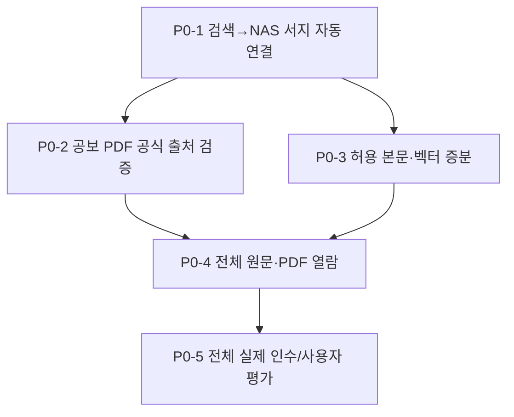

# 개인 특허 RAG — 작업 단위 설계서·실행 계획서 인덱스

> **2026-11-20 최신 순서:** 아래 P0-1~5는 기존 잔여 구현 설계로 보존한다. 즉시 착수할 검증은 [통합 평가 인덱스](../evaluation/INDEX.md)의 **EVAL-01 → EVAL-02**이다. 아래 '다음에 착수' 문구는 과거 기능 계획이며 가치 측정 결과/사용자 별도 필수 요구가 우선한다.

- 문서 ID: `MVP-IMPLEMENTATION-INDEX` / 작성·확인일: 2026-11-20
- 대상: ChatGPT, Codex, 다른 repository-capable AI, 개발자·운영자
- **이 문서를 작업 진입점으로 사용:** [전역 Control](https://github.com/son1004007/ai-agent-workflow-playbook/blob/main/CONTROL.md) → [저장소 AGENTS](../../AGENTS.md) → [CURRENT_STATE](../../CURRENT_STATE.md) / [TASKS](../../TASKS.md) → 이 인덱스 → 해당 작업 **설계서 → 실행 계획서 → 기존 코드/런타임 증거**.
- 문서 성격: **구현 가능한 기술 설계와 단계별 실행 지침**. 미구현 작업에 대한 실제 구현·배포·테스트 PASS 주장이 아니다. 실제 작업 상태/우선순위의 정본은 `TASKS.md`/`CURRENT_STATE.md`, 실측은 `WORKS.md`.
- 범위: 지금 최우선인 **P0-1~P0-5**. 기존 MVP-01~06의 완료된 기능을 새로 재구현하지 않고 잔여 기능만 독립 작업으로 구분했다.

## 1. 개발 단위마다 설계서 1개 + 계획서 1개

| ID | 작업 단위 | 기술 설계서 | 실행 계획서 | 현재 선행 구현과 남은 부분 |
|---|---|---|---|---|
| **P0-1** | WIPS 검색→서지정보 NAS 자동 보관 단일 경로 | [설계](P0-1-design.md) | [계획](P0-1-plan.md) | 운영 83건·검색당 최대100·재실행 신규0 PASS. **ChatGPT 단일 entrypoint/독립 WIPS 호출 자동 연결 미완료** |
| **P0-2** | **공식 특허 공보 PDF** 공식 출처 확인→다운로드→NAS manifest/파일 적재 | [설계](P0-2-design.md) | [계획](P0-2-plan.md) | 연결 WIPS MCP에는 PDF 다운로드 도구 없음, 운영 PDF0. KIPRIS Plus 공식 REST·WIPS 별도 제공경로·EP EPS 선택/접속·권리 확인 및 첫 파일 실증 필요 |
| **P0-3** | 허용 특허 원문 텍스트/청구항→NAS 청크·E5 벡터 증분 | [설계](P0-3-design.md) | [계획](P0-3-plan.md) | 기존 6문헌/10섹션/417청크·384D 운영 PASS. **83건 서지는 ABK/CLK 없음**; 새 문헌 권리·필드 보강·증분 자동 연결 미완료 |
| **P0-4** | 사람용 **전체 명세서·청구항 열람 / 공보 PDF 뷰어** | [설계](P0-4-design.md) | [계획](P0-4-plan.md) | 현 `get_patent` 최대3개×300자 발췌. 새 권한 분리된 fulltext page reader 및 PDF file stream 미구현 |
| **P0-5** | 검색·저장·원문/공보·품질·보안·백업/복원·사용자 인수 | [설계](P0-5-design.md) | [계획](P0-5-plan.md) | 기존 부분 인수 실증. **P0-1~4 완료 뒤 실제 새 채팅/E2E 및 사용자 평가 #31** 필요 |

### 개발 순서

- **권장 우선순위:** P0-1 통합 검색 경로 → P0-2 공보 공식 제공/API 자격 **조기 조사**(P0-3 개발과 병행 가능) → P0-3 본문/벡터 증분 → P0-4 본문 보기/PDF 보기 → P0-5 통합 인수.
- **개별 단계 병렬 가능:** P0-2의 공급자 API/파일 경로 조사는 P0-3의 선택 문헌 텍스트 parser와 독립. **P0-4 전체 텍스트 뷰어는 PDF가 없어도 우선 구현할 수 있지만, PDF 보기 PASS는 P0-2에 의존.**
- **다음에 착수할 실제 작업:** P0-1. [계획](P0-1-plan.md)의 Gate A(백엔드에서 WIPS MCP 인증 호출 가능 여부) 판정부터 수행. 지원이 없으면 ChatGPT 순차 오케스트레이션을 정식화하고 한계 명시.

> **P0-1 A안 실제 운영 검증 (2026-11-20):** [ChatGPT Code Mode WIPS 검색→NAS Gateway 저장·기존83건 재사용 인수](../42-mvp41-code-mode-gateway-archive.md). 이는 신규 백엔드 MCP 도구 등록이나 임의 WIPS 호출 자동 후킹을 뜻하지 않는다. 실제 구현 상태는 CURRENT_STATE/TASKS가 정본이다.

## 2. 현재 운영 근거 (새 설계 문서와 혼동 금지)

| 기존 검증 대상 | 현재 실제 상태 / 근거 |
|---|---|
| WIPS MCP | 현재 연결 **28개 도구** (전부 실제 통합 구현된 것은 아님). [도구·실제 응답 카탈로그](../40-wips-mcp-capability-catalog.md) |
| NAS 검색 서지 | **83문헌**, WIPS 첫 페이지 최대100/사용자 승인, 동일 응답 신규0. [운영 실측](../39-mvp-archive-100-live-acceptance.md) |
| 원문 RAG | **기존 6문헌/10섹션/417청크**, 로컬 E5 384D. [운영 단건](../35-mvp03-actual-ingest-acceptance.md) |
| 공식 공보 PDF | **0건**, 수집·파일 뷰어 미구현. [PDF 기존 결정](../36-mvp-automatic-archive.md) |
| ChatGPT 읽기 MCP | `search_patents`/`get_patent` 실제 검색/근거 반환 PASS. **전체 원문은 아님**. [운영 전환](../24-mvp01-production-cutover.md) |
| 백업/복원 | 실제 archive 포함 PostgreSQL 독립 복원 PASS. 아직 PDF 파일 복원은 해당 파일 자체가 없어 미검증. [이전 운영 실측](../39-mvp-archive-100-live-acceptance.md) |

**파일/본문/임베딩의 권한 경계:** 사용자 확인은 WIPS **서지정보의 NAS 자동 보관 검색당 최대100건**에 대한 것이다. 기존 개별 승인된 일부 문헌 원문과 이를 근거로 새 83건 전부 본문/청크/벡터/PDF를 무제한 수집한다고 해석하지 않는다. WIPS 별도 API/상품·PDF 접근권한 및 신규 비용은 별도 확인.

## 3. 모든 구현 AI가 적용할 동일한 작업 절차

1. 전역 `CONTROL` → registry → 대상 `AGENTS` → 최신 `CURRENT_STATE/TASKS` → 이 INDEX → **대상 설계/계획** → 실제 코드 및 운영 환경 read-only 확인.
2. **계약 먼저:** input/output JSON schema, ID 정규화, 데이터/권한 범위, 실제 제공자 반환과 예상 schema 일치 여부, 오류상태부터 점검.
3. **사전 위험 확인:** 각 설계서의 `예상 장애/원인/예방`과 계획서의 Stop/Go gate를 이번 범위에 적용. 불확실한 공급자 API/OS/인증은 현재 공식 문서 및 live read-only probe로 먼저 확정.
4. 최소 변경 구현, 본문·비밀 미포함 synthetic contract 시험, 실제 운영 사전 백업(영향 있을 때) → 승인 범위 내 작은 변경을 **운영 우선** 반영 → 실제 E2E/회귀/권한·복구 검증 → 필요하면 핫픽스.
5. **증거 기록:** PASS/FAIL/HOLD/NOT_RUN 구분. 실행 성공 시 실제 저장수·재사용·원본 불변·서비스 변경 범위; 실패 원인/수정/재시도 정책. 테스트 없이 구현 완료 주장 금지.
6. 같은 변경 또는 다음 커밋에서 `TASKS/CURRENT_STATE/WORKS`·이 인덱스·`DOC_INDEX`의 링크/완료 증거를 갱신. 독립 AI 품질 리뷰는 선택 사항이지만 테스트/보안은 필수.

## 4. 구현 시작 전 공통 차단 조건 (pre-mortem)

| 우선 차단 조건 | 확인할 것 / 기본 대응 |
|---|---|
| NAS가 별도 WIPS 플러그인을 호출할 수 없는 경우 | P0-1 Gate A. MCP 연결은 ChatGPT 세션에 있어 자동 위임 보장 없음. 가능한 경로 A/B 명시 |
| 메타데이터 7필드와 원문 인제스터 7필드가 다른 경우 | P0-3 `ABK/CLK` 조회·변환 필수. APSTH/XD를 본문 packet에 섞지 않음 |
| 100건 상한과 WIPS provider의 페이지 제한이 다른 경우 | `outitem` 개수/큰 텍스트·국가별 공급자 제한 먼저 확인. 자동 다음 페이지 금지 |
| 공보 PDF URL 미제공/계약 인증 필요 | P0-2 공식 공급자 REST 확인, 임의 URL/유료 호출 추측 금지 |
| 도면 이미지/텍스트를 원본 공보 PDF로 잘못 저장 | `%PDF-`, 공보번호·종류·출처, file SHA 검증 및 분리 상태 |
| 사람이 원문 전체를 보는 권한이 기존 snippet reader에 없음 | P0-4 별도 최소권한 reader/function, 기존 검색 MCP 토큰 범위·300자 동작 불변 |
| 저장 후 일부만 성공 / DB-파일 불일치 | 단계별 상태·idempotency·orphan cleanup·DB dump+file snapshot 독립 복원 |
| 기존 보안 인프라 재시작/권한 완화 유혹 | 기존 NAS/DB/relay/tunnel/다른 서비스 재기동 제한 유지. 허가된 최소 경로만 운영 반영 |
| 공용 GitHub의 고객·특허 식별자 노출 | 디자인은 synthetic/example만, 실제 본문/SKEY/서버 경로/secret/token/hash 출력 금지 |
| 모든 기능이 "개발중"이어서 검증 기준 사라짐 | 계획서마다 **실행/기술 검증/운영 인수** 구분, 상태 정본에서 각 기능 PASS/NOT RUN 기록 |

## 5. 기술 스택/재사용 원칙

**기존 기술을 우선 재사용**: ChatGPT 연결 WIPS MCP 검색·`get_patent_spec_text`, NAS owner-local Python writer·separate PostgreSQL `patent_archive`/`private_docs`, FastMCP `unified_mcp_production.py` 읽기, 로컬 `multilingual-e5-small`(384D)/pgvector, 기존 사설 HTTPS 및 DB 백업 도구. 새 서비스가 필요한 경우 **최소 권한/새 기능 전용**으로 추가; NAS/DB/relay/tunnel을 불필요하게 재구축하지 않는다.

각 문서의 `poc/mvp4x_*.py` 등은 **신규 모듈 제안 경로**일 뿐 현재 GitHub에 실제 존재한다고 주장하지 않는다. 실행자/AI는 해당 파일을 새로 만들기 전 현재 tree를 재확인하여 충돌·중복을 방지한다.

## 6. 범위 밖 backlog

28개 WIPS MCP 도구 전부 앱에 통합, AI 유사검색 고급 랭킹/RRF/reranker, 국가별 모든 법적상태·소송 통합, 공용 DB 운영 전환, 관리자 웹, 기업/SSH 구축은 `TASKS.md`의 P1~P3 (별도 착수). **P0 완료에 28개 도구 전수 구현은 필요 없다.**

---
새 채팅·다른 AI 진입 키워드: **"patent-rag-agent P0 설계서"**, **"WIPS MCP PDF/벡터 구현 계획"**, **"docs/mvp-implementation/INDEX.md"**.
