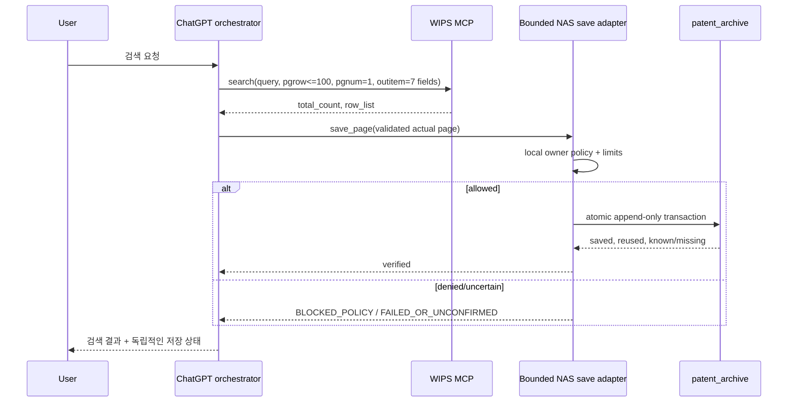

# P0-1 설계서 — WIPS 검색과 NAS 서지 자동 보관 단일 흐름

- ID: P0-1 / 담당: 개인 특허 RAG / 상태: **설계 완료, 남은 자동 연동 미구현**
- 입력 근거: [WIPS 28개 도구 카탈로그](../40-wips-mcp-capability-catalog.md), [83건 운영 인수](../39-mvp-archive-100-live-acceptance.md), [기존 요구](../36-mvp-automatic-archive.md)
- 범위: ChatGPT에서 **통합 검색 경로** 실행 → WIPS 반환 서지 첫 페이지 최대100건 → NAS 기존 보관 엔진 → 결과·보관 상태 반환.
- 제외: 임의의 독립 WIPS 플러그인 모든 호출에 대한 플랫폼 수준 후킹, 무제한 자동 페이지 순회, 요약/원문/PDF·벡터 저장, 기존 reader의 writer 자격증명 변경.

## 1. 실제 재사용 가능한 구성

| 계층 | 소스/DB | 현재 확인 |
|---|---|---|
| WIPS 데이터 공급 | `mcp__wipsclip__get_patent_search_onlyengine` | ChatGPT에서 실제 검색/83건 반환 PASS. 별도 NAS 서버에서 동일 도구를 호출할 수 있는 인증·접속 권한은 **미확인** |
| 호출 래퍼 | [`poc/mvp37_search_archive.mjs`](../../poc/mvp37_search_archive.mjs) | `searchAndArchive({query,page=1,page_size=100}, adapters)` 구현. **서비스에 등록된 도구가 아님** |
| 데이터/중복 | [`mvp37_archive.py`](../../poc/mvp37_archive.py), [`mvp37_archive.sql`](../../poc/mvp37_archive.sql), [`mvp39_archive_100.sql`](../../poc/mvp39_archive_100.sql) | 운영 `patent_archive.documents` / `metadata_revisions` / `search_pages` / `page_hits`, 83건 저장·재실행 신규0 PASS |
| 일회성 writer | [`mvp37_local_transport.py`](../../poc/mvp37_local_transport.py) → [`mvp37_archive_cli.py`](../../poc/mvp37_archive_cli.py) | owner-only NAS 로컬 stdin, 별도 0700/0600 정책·credential, pinned OCI worker, 별도 PostgreSQL role |
| 읽기 | [`unified_mcp_production.py`](../../poc/unified_mcp_production.py) | `search_patents`/`get_patent`는 **기존 원문 기반**, 서지 목록83건을 반환하는 카탈로그 읽기 도구는 아직 없음 |

## 2. 먼저 결정할 연결 형태 (구현 선행 Gate A)

**중요한 플랫폼 제약:** 이미 설치된 독립 WIPS MCP를 NAS 백엔드에서 다른 MCP처럼 호출할 수 있다고 가정하면 안 된다. WIPS 연결의 서버 주소·인증 세션·도구 대리 호출 권한을 실제로 확인해야 한다.

| 선택 | 동작 | 가능성 / 결정 |
|---|---|---|
| A: ChatGPT 도구 순차 오케스트레이션 | ChatGPT에서 WIPS 검색 → 승인된 저장 도구에 결과 전달 → 저장 확인 후 답변 | 현재 **실제 83건 이 흐름으로 검증됨**. 다만 새 대화/모든 독립 WIPS 호출에 대한 무조건 자동 실행은 보장하지 않음 |
| B: 단일 서비스 소유 MCP `search_wips_and_archive` | NAS/전용 오케스트레이터가 **검증된 WIPS 공식 서비스 호출 자격**을 별도로 얻어 검색과 보관을 서버 내부 직렬 수행 | 목표 UX에 적합하나 **별도 WIPS 서버 호출 권한·계약/요금/인증 방식 확인 전 개발 완료 판정 금지** |
| C: 기존 WIPS MCP 호출 후 자동 가로채기 | ChatGPT의 다른 플러그인 호출 이벤트를 NAS가 수신 | **현재 지원/권한 증거 없음. 구현 대상에서 제외** |

**실행 선택:** 우선 A를 사용자용 단일 요청 워크플로로 정착시키고, WIPS 연결이 허용하면 B로 단일 MCP 도구를 제공한다. B가 불가능하면 A만 실제 인수하여 "임의 WIPS 호출 자동 후킹"은 미지원으로 명시한다. ChatGPT 호스트의 호출 순서를 오케스트레이터 코드가 보장한다고 주장하지 않는다.

## 3. 데이터 흐름



NAS writer에 WIPS 호출 credential 또는 ChatGPT reader token을 넣지 않는다. 소스 응답 패킷에는 provider의 모든 필드/원문/임의 credential을 넣지 않고 지정한 7개만 projection한다.

## 4. 입력/출력 계약 (기존 구현 + 향후 API)

실제 WIPS 입력 `{query,pgrow:100,pgnum:1,outitem:"SKEY,XN_D,CC,KC_D,TIK,APSTH,XD"}`. WIPS 결과는 `{success:true,data:{total_count:int,row_list:[...]}}`; 7개 서지 필드 이외의 텍스트/첨부는 보관 안 함.

새로 제공할 사용자-facing 도구(안, 아직 존재하지 않음):

```json
{
  "name": "search_wips_and_archive",
  "input": {"query": "(example).ti.", "limit": 100},
  "result": {
    "search_status": "PASS",
    "archive_status": "PASS",
    "total_count": 251,
    "returned_count": 100,
    "saved": 100,
    "reused": 0,
    "fulltext_complete": 0,
    "fulltext_partial": 0,
    "fulltext_missing": 100
  }
}
```

이것은 **합성 계약 예시**, 실데이터/현재 도구 결과가 아니다. `total_count`는 전체 검색 적중 수, `returned_count`는 이번 WIPS 페이지 길이, `saved`와 `reused`는 *문헌 고유키* 기준이다. 동일 페이지 여러 차례 호출은 `REUSED_VERIFIED`/`saved=0`. `returned_count`=100이라도 실제 유일 문헌수는 100보다 작을 수 있다.

오류 상태: `INVALID_REQUEST`, `SEARCH_FAILED`, `BLOCKED_POLICY`, `FAILED_OR_UNCONFIRMED`, `REUSED_VERIFIED`, `PASS`. WIPS 응답에 실패가 있어도 기존 NAS 검색을 임의 "성공"으로 덮지 않는다.

## 5. DB 및 보안 규칙

- 기존 `patent_archive` 스키마/role 재사용. 식별은 `CC + normalized(XN_D) + KC_D`, 공급자 `SKEY` 별도 unique. 패밀리 다른 국가 문헌은 하나로 합치지 않는다.
- `search_pages`는 검색 문자열 원문 대신 SHA-256 digest 저장. 단순 digest는 검색어의 비밀성을 보장하지 않으므로 공개 log에 출력하지 않는다. page result 순위는 `page_hits`에 1~100.
- 동시 요청 중 같은 문헌 identity/SKEY가 다른 경우 **삽입 거부+트랜잭션 전체 rollback**, 기존 DB 오염 금지. 재호출 변동은 `metadata_revisions`로 기록. 긴 행/필드 누락/날짜 오류/제어문자/101행 이상 모두 거부.
- 저장 소유자 auth은 NAS 0600 정책·writer secret; LLM 제공 도구에 임의 SQL/SSH/파일쓰기/정책 수정 권한을 노출하지 않는다. tool 입력으로 승인 여부 `true` 전달받는 방식 금지.
- 원문 `private_docs`와 서지 `patent_archive` 분리. `fulltext_status`는 두 섹션 존재 표시일 뿐 PDF 또는 전체 원문 완전성을 보증하지 않는다.
- 기존 reader MCP·DB·relay·tunnel 재시작/권한 확대 금지. 새 writer 엔드포인트가 필요하면 **별도 인증된 최소권한 서비스**로 구성하고 기존 reader token 재사용하지 않는다.
- 서버 인증 방식이 HTTPS/tunnel에서 지원되는지는 **구현 전 실제 제품 문서·현재 도구 동작으로 확인**. 임의 public port 생성 금지.

## 6. 예상 장애와 사전 대응

| 증상/위험 | 착수 전에 할 확인 | 설계상 대응 |
|---|---|---|
| NAS가 WIPS MCP 호출 못함 | 별도 공급자 호출 endpoint 및 auth 지원/허용 여부 | A 흐름 유지, B는 HOLD; 비공식 브라우저 자동화 금지 |
| 100건 요청 오류 | WIPS `outitem`=7개, 큰 텍스트 필드 없음, provider 허용 페이지 범위 | provider의 실제 반환 제한 우선, 50/100 역호환 테스트 |
| 검색 성공/보관 실패 | 검색과 DB 쓰기가 독립 서비스임 | 검색 결과 유지, `FAILED_OR_UNCONFIRMED` 명시, idempotent retry만 |
| WIPS 83건이 NAS 6건과 매칭 안 됨 | 정규화·국가·종류·SKEY 대조 | `missing` 또는 `conflict`, 추측 자동 병합 금지 |
| 병렬 검색 중복/충돌 | `pg_advisory_xact_lock` 및 unique constraints | 트랜잭션 단위 검증, 충돌 시 롤백/재수집 보류 |
| NAS 컨테이너 bind 실패 | worker 이미지 내부 `/code`·`/auth` 생성 불가, 실제 directory mount 필요 | 전용 RO directory bind, source blob SHA pin 및 권한 검사; 기존 재현 이력 참조 |
| wheel 경로 링크 | `readlink -f` 및 offline wheel 실제 위치 | canonical path만 mount; 외부 pip/download 금지 |
| 모호한 성공 | commit 후 network/timeout | `FAILED_OR_UNCONFIRMED` 반환; 재실행 전 저장 상태 조회, 중복검증 |
| 로그에 실제 데이터 유출 | stdout/trace/exception 여부 | ID·검색어·원문 출력 금지, 집계·상태·비밀 아닌 배포 식별자만 |

## 7. 완료 기준

1. **단일 사용자 검색 명령**에서 WIPS 실제 첫 페이지와 자동 NAS 보관을 잇는 연결이 동작하고 저장 결과가 응답에 포함된다(선택 A/B 명시).
2. 유효 검색/동일 재실행/변경 메타데이터/중복/비인가/공급자 오류/DB timeout/한쪽 실패를 **실제 운영에서 제한된 범위로 검증**.
3. **검색당 최대100, 자동 후속 페이지 없음, 원문/벡터 쓰기0**, 기존 reader/원문/DB 권한 및 컨테이너 StartedAt 불변.
4. 추가 보관 통합 범위를 넘는 "독립 WIPS 호출의 전체 후킹"은 미지원으로 구분. 독립 WIPS 도구 호출을 보관 성공으로 오표시 금지.
