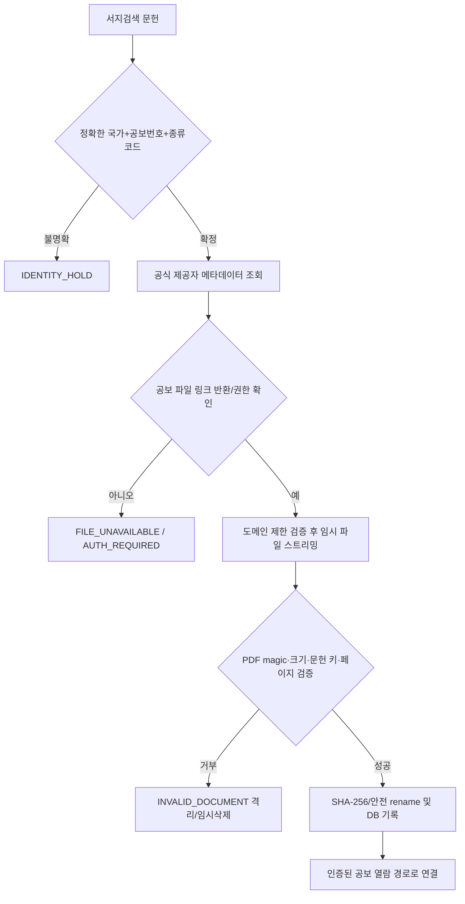

# P0-2 설계서 — 공식 특허 공보 PDF 확보·NAS 보관

- 작업 ID: P0-2 / 상태: **설계, 외부 다운로드 기능 미구현·운영 PDF 0건** / 대상: KR 우선, EP 후속
- 선행 문서: [WIPS 반환 카탈로그](../40-wips-mcp-capability-catalog.md), [기존 PDF 요구](../36-mvp-automatic-archive.md)
- 산출물: **실제 특허청/공보기관이 발행한 공보 PDF 파일**. WIPS 텍스트를 인쇄해 만든 PDF, 대표도면 이미지, 요약 문서와 구분.
- 중요한 사실: 현재 연결된 **WIPS MCP 28도구에는 공보 PDF 다운로드 도구가 없다**. 공급자의 다른 상품/계약 API 또는 공식 공개 공보 제공처는 별개.

## 1. 공급자 선택과 실제 확인 근거

| 후보 | 공식 안내에서 확인된 제공 내용 | 선행 요구·제약 |
|---|---|---|
| WIPS 별도 공보/파일 서비스 | 현 연결 MCP 도구에는 미노출. 별도 WIPS DATA 상품은 PDF/이미지 형식을 취급하나 **현재 MCP에서 무료 파일 다운로드를 보장하지 않음** | 업체에 해당 상품/공보 PDF/재사용·과금/원문 보관 권리 확인. 미확인 호출/우회 크롤링 금지 |
| **KIPRIS Plus 특허·실용 공개·등록공보 REST** | 공보 전문과 대표도면의 **다운로드 경로를 XML**로 제공한다고 공식 소개 | 개발키 발급·서비스 이용조건·국가 문헌번호/공보종류·파일 링크 접근 방식 **실측 후 확정** |
| EPO **European Publication Server REST** | EP-A/EP-B 공보 **PDF/A·XML·HTML·TIFF**. 문헌번호+종류 기반 직접 PDF 경로 공식 안내 | EP만; EPS fair use **IP별 7일 이동창 5 GB**, 속도/접속 운영 정책 준수 |
| EPO OPS 등 | 보조 후보. PDF 이미지/페이지가 출판 공보 전체와 일치하는지 검증 필요 | 별도 등록/약관/호출량 확인 전 연동 보류 |

**공식 근거 (2026-11-20 열람):**
- [KIPRIS Plus 공개·등록공보](https://plus.kipris.or.kr/portal/data/service/DBII_000000000000001/view.do) — REST API, 공개/등록 전문 및 대표도면 다운로드 **경로** XML.
- [EPO Publication Server](https://www.epo.org/en/searching-for-patents/data/web-services/publication-server) / [EPO 검색·PDF 접근 안내](https://www.epo.org/en/searching-for-patents/technical/publication-server/help) — PDF/A A·B 문헌. 예시 `https://data.epo.org/publication-server/pdf-document?cc=EP&pn=1502502&ki=A1`(공식 안내 예시; 테스트 자료 아님).
- [EPO 공정 이용정책](https://www.epo.org/en/service-support/ordering/fair-use) — 자동화는 REST interface 사용, EPS 7일 5GB 한도.
- [WIPS 별도 데이터 상품 안내](https://docs.channel.io/wips-lounge/ko/articles/wips-ip-data-purchase-efd789d7) — PDF 상품 존재 ≠ 연결 MCP PDF 다운로드 권한.

**결정:** KR 1건을 KIPRIS Plus 공식 API로 최소 실측하고 파일 취득이 불가하면 WIPS 별도 권한/경로를 조사한다. EP 필요 시 EPS는 **별도 provider adapter**로 구현. 서지 검색 첫100건에 대해 100개 PDF를 자동 다운로드하지 않는다.

## 2. 처리 흐름



## 3. 코드 구조·입출력 계약 (신규 제안, 현재 파일 없음)

| 모듈 | 책임 |
|---|---|
| `poc/pdf_provider_kipris.py` | 서비스 인증·검색/공보 파일 링크 **XML 파싱**, KR 번호/공보종류 매칭; **실제 endpoint/파라미터 이름은 공식 개발 명세·키 발급 후 기입** |
| `poc/pdf_provider_epo.py` | EP `cc/pn/ki` 공식 PDF/A 매핑, fair use/속도 제한 |
| `poc/pdf_acquire.py` | 외부 URL 신뢰 경계, 다운로드 제한, PDF 구조/번호 확인, 스트림 해시·안전 rename |
| `poc/pdf_manifest.sql` | `patent_files` 독립 schema/table 또는 안전한 기존 DB namespace의 메타데이터. 실제 운영 데이터와 충돌 없는 additive migration |
| `poc/pdf_acquire_test.py` | 합성 XML·정상/차단 URL·절단 파일/위조 PDF/부정 문헌번호/재실행·중단 시험 |

요청/결과 **제안 계약**:
```json
{
  "request": {
    "identity": {"country": "KR", "publication_no": "SYNTHETIC_NO", "kind": "B1"},
    "file_kind": "OFFICIAL_GAZETTE_PDF",
    "approved_provider": "KIPRIS_PLUS"
  },
  "result": {
    "status": "STORED",
    "identity_verified": true,
    "format": "application/pdf",
    "sha256": "server-only-digest",
    "available_for_read": true
  }
}
```

위 JSON은 계약/스키마 예시로 실제 공급자 응답이 아니다. 파일 반환 링크/토큰/실제 식별자·물리 경로는 ChatGPT 응답·로그·공개 GitHub에 공개하지 않는다.

## 4. 저장 모델 (안)

```text
patent_files.publication_documents (
  id PK, country, publication_no_normalized, kind,
  provider, provider_document_ref, source_revision_or_date,
  file_kind CHECK ('OFFICIAL_GAZETTE_PDF'),
  storage_object_key, sha256, byte_size, mime_verified,
  publication_identity_verified, acquired_at, entitlement_policy_id,
  status CHECK ('PENDING','STORED','UNAVAILABLE','FAILED','REJECTED'),
  UNIQUE(country, publication_no_normalized, kind, provider, file_kind, sha256)
)
```

실제 파일은 NAS **비공개 서비스 전용 파일 볼륨**의 불변 content-addressed object에 저장. `storage_object_key`를 사용자 제공 파일명/원격 URL에서 만들지 말고 서버 생성 ID와 해시로 결정. 새 role은 PDF manifest만 접근, 운영 `private_docs` 및 `patent_archive` 직접 UPDATE 권한 없음. PDF 취득 현황은 서지/본문/임베딩 상태와 독립.

DB 기록과 파일 write 사이에는 2-phase commit이 없으므로 `PENDING`→임시파일 완료→fsync/atomic rename→`STORED` 순서, 오류/프로세스 중단 시 orphan 검사·GC를 운영할 것. 파일/DB 어느 한쪽만 성공했으면 사용자에게 `STORED`라고 응답하지 않는다.

## 5. 파일 다운로드·문헌 동일성·보안 사전 설계

- **URL을 WIPS 응답에서 그대로 다운로드하지 않는다.** 사용자가 임의 URL을 PDF downloader에 넣지 못하도록 server-side provider adapter가 만들어 낸 공식 allowlist host만 허용. DNS resolution/private·loopback/link-local IP 거부, TLS 검증, 리다이렉트 기본 차단(허용된 공식 host로만 재검증). NAS 내부 서비스·metadata endpoint로의 SSRF 차단.
- **문헌 식별:** `CC`, `XN_D`, `KC_D`를 WIPS provider SKEY와 구분. 공개(A) vs 등록(B) 종류, 보정/재발행(B2/B9 등), 등록번호/공개번호/출원번호 차이 확인. 같은 패밀리는 별도 공보. 번호·종류 한 항목이라도 불일치하면 파일 **REJECTED**.
- 콘텐츠: HTTPS/HTTP 상태·content-length는 참고값, 실제 스트림 **max bytes/timeout/download budget** (MVP 초기 값 예: 파일당 **20 MiB**로 시작; 실제 문서 크기 보고 조정), `%PDF-` 파일 시그니처 확인 및 안전한 PDF parser로 페이지·암호화·손상 여부 검증. `Content-Type`만 믿지 않고 `text/html` 로그인 페이지/오류 문서 거부.
- **PDF 안전:** 비신뢰 파일을 관리자 브라우저/셸에서 자동 열지 않으며, 비특권 격리 parser로 검증. 임베디드 JS·첨부파일 등 위험 객체의 자동 실행 금지. 인증된 조회에서만 `Content-Disposition`/`X-Content-Type-Options:nosniff`/Content Security Policy 적용.
- **정합성:** PDF 바이트의 `SHA-256`, 길이, 공급자/취득시각·권리정보 저장. 공보 표제의 번호/종류 자동 추출이 불확실하면 실제 1건 사람이 공보 첫 페이지와 공급자 번호를 대조해 결정; 추론한 자동 매칭 PASS 금지.
- **권한/비용:** WIPS 서지 보관 100건 허용은 PDF 자동 대량 다운로드 승인과 다름. 공식 API의 키·호출/유료 상품·저장권리 확인 전 `AUTH_REQUIRED/BLOCKED_POLICY`. 공인 출처라도 제3자 재배포 허용과 동일하지 않음.
- EPO EPS는 **EP만** 파일 범위로, KR 주소와 혼용 금지. EPO 5 GB/7일 + 추가 운영 제한을 owner-configured rate limiter로 적용.

## 6. 사전 위험표

| 위험/예상 오류 | 발견 방법 | 사전 설계 |
|---|---|---|
| KIPRIS XML URL만 있고 직접 PDF 다운로드가 유료/인증 필요 | 서비스 키 발급 후 KR 1건 read-only API 응답 확인 | API 키·이용권·상품 상태를 gate로 기록. 문서 확인 전 파라미터/엔드포인트 추측 금지 |
| WIPS SKEY vs 공보번호 다름 | `CC+XN_D+KC_D` ↔ 제공자 검색 결과 비교 | SKEY를 PDF 파일명/공식 번호로 사용 금지 |
| 링크가 만료되거나 HTML 로그인 페이지 반환 | redirect/status/magic 바이트 검사 | `UNAVAILABLE`/`AUTH_REQUIRED`, 실패 바이트 삭제 |
| PDF/도면 이미지 혼동 | `%PDF-`, 공보 page count 확인 | WIPS `draw` 경로를 PDF로 저장 금지 |
| 변조/부분 다운로드·disk full | streaming hash, byte count, fsync | PENDING/FAILED, atomic rename, orphan cleanup, 용량 상한 |
| PDF 다운로드가 내부 NAS 접근으로 변질 | allowlist host/IP/TLS/redirect 테스트 | SSRF 차단, 인터넷 접근 허용 프로세스의 DB credential 제거 |
| 동시 다운로드·중복 저장 | UNIQUE + content hash + 단건 lock | 같은 identity 재실행 `ALREADY_STORED`, 다른 공보종류는 별개 |
| 백업에는 DB만 있고 PDF 파일 누락 | manifest vs 실제 object 재확인 | DB dump+파일 스냅샷 일관성 검사, 독립 복원과 해시 대조 |

## 7. 완료 정의

- 공식 제공처의 **같은 공보종류 1건** PDF 파일을 실제 취득하고 파일 format, 바이트 해시, 문헌번호·종류/출처/권리 확인 PASS.
- 인증된 NAS에 PDF 파일과 manifest를 불변 저장, 동일 파일 재조회 중복0, 잘못된 번호/권한/무효 파일 차단.
- 원본 텍스트 생성 PDF 및 도면 이미지와 혼동 없이 사용자에게 "공보 PDF"라고 안내. 현재 PDF0건이므로 완료 전 STATUS는 **NOT IMPLEMENTED**.
