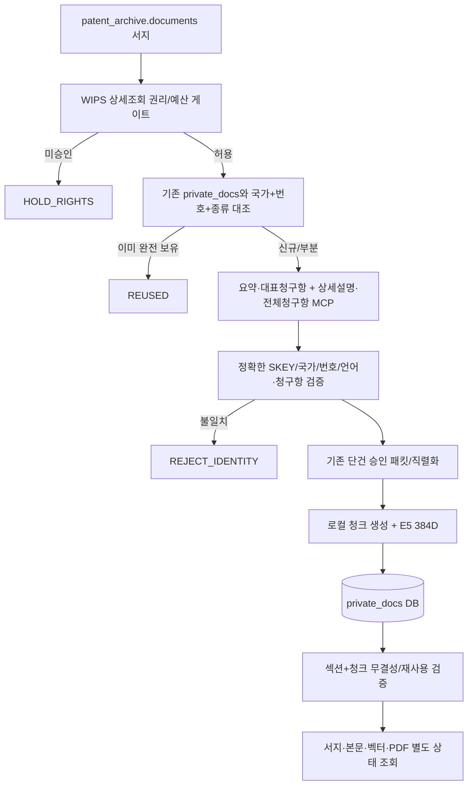

# P0-3 설계서 — 허용된 특허 텍스트→청크→벡터 증분 적재

- 작업 ID: P0-3 / 상태: **기존 단건 적재 엔진 동작, 검색 목록83건 일괄 적재 기능 미구현**
- 선행: [P0-1](P0-1-design.md) 검색·서지 보관 경로, [WIPS 도구 정보](../40-wips-mcp-capability-catalog.md).
- 대상: **권리·비용·범위가 확인된 선택 문헌**의 WIPS 명칭/요약/대표청구항/상세설명/전체청구항. 한 번 검색한 최대100건 전수 임베딩이 기본값이 아니다.
- 배제: 새로운 모델 학습, 외부 임베딩 API, PDF 생성·다운로드, 비인가 83건 본문 수집, 외부 고객 데이터.

## 1. 실제 기존 코드와 인터페이스 불일치 (먼저 확인 필수)

| 계층 | 현재 소스 | 반드시 인식할 제약 |
|---|---|---|
| 서지 목록 | [`mvp37_archive.py`](../../poc/mvp37_archive.py) | 7필드 **SKEY, XN_D, CC, KC_D, TIK, APSTH, XD**만 보관. `ABK`와 `CLK` **없음** |
| 기존 원문 신규 적재 | [`private_patent_ingest.py`](../../poc/private_patent_ingest.py) | `validate`는 **정확히 7필드 `SKEY,XN_D,CC,KC_D,TIK,ABK,CLK`**를 요구. `ABK` 필수·비어 있으면 실패. `APSTH/XD`를 넣으면 거부 |
| 단건 수집/승인 | [`mvp03_ingest_adapter.py`](../../poc/mvp03_ingest_adapter.py) | `packet={row,sections}`, ``approval={policy,packet_sha256,mode}`. `mode=new/enrich` 및 **섹션 2개 모두 필요** |
| 원문 파싱 | [`private_patent_increment.py`](../../poc/private_patent_increment.py) | `sections`는 `dtl_desc`와 `all_claim` 각각 성공 응답만 허용. 최대2 section/packet, 상세설명 총180000자, 단일 문헌 최대600 chunks |
| 본문 원본 | [`private_patent_increment.sql`](../../poc/private_patent_increment.sql) | `private_docs.section_sources`: document_id, section, provider, language, claim_count, body, raw_payload, source_sha256, body_sha256, policy_id |
| 임베딩 | [`private_patent_ingest.py`](../../poc/private_patent_ingest.py) | `intfloat/multilingual-e5-small@614241f622f53c4eeff9890bdc4f31cfecc418b3`, 384D, 로컬 모델; `passage: ` prefix; 검색은 `query: ` |
| 색인/읽기 | [`private_patent_reader.py`](../../poc/private_patent_reader.py), [`unified_mcp_production.py`](../../poc/unified_mcp_production.py) | `private_docs.readable_catalog`/`readable_evidence`를 통해 검색; 원문 전체 반환이 아닌 300자×3 근거 |

**선행 해결책:** 기존 83개 metadata row를 바로 `mvp03_ingest_adapter`에 넣지 말고 `get_patent_by_skey` 또는 검색의 `ABK/CLK` 추가 조회(권리·호출 허용 범위)를 통해 **별도의 `row` 계약을 구성**. 다음 `get_patent_spec_text(section="dtl_desc"/"all_claim")`로 섹션 응답 2개를 확보한다. 실제 data 배열/언어/국가·번호가 모두 일치하는지 검증한다.

## 2. 처리 흐름 및 상태 정의



문헌별 상태 **독립**: `metadata_status (missing/stored)`, `text_status (none/partial/complete)`, `embedding_status (none/partial/ready/error)`, `pdf_status (none/stored/failed)`. 상태가 저장 시점과 안 맞으면 사용자에게 **INCONSISTENT/UNVERIFIED** 반환, 단지 2개 section이 있다는 이유로 벡터/공보완료로 표시 금지.

## 3. 권한·identity·증분 정책

1. 사용자가 **서지정보 검색당100건 NAS 보관**을 허용한 사실을 **본문/청구항/벡터 자동 수집권**으로 확대하지 않는다. 현재 일부 구매/승인 문헌만 실제 적재된 증거가 있다. 선택 문헌별 또는 명시 범위별 entitlement/예산을 운영자 관리 서버 정책으로 기록한다; ChatGPT 요청의 `approved:true`를 신뢰하지 않는다.
2. `patent_archive.documents.identity`(`CC|normalized(XN_D)|KC_D`)와 `private_docs.documents.id`(기존 `PAT-`+SHA256(raw-normalized string))은 **서로 다른 키**다. 불변 권한 확인·국가/문헌번호/종류 exact 매칭으로 교차 조회하고, 새 `archive_private_links` 등 별도 테이블은 검증된 쌍에만 추가. 암묵적 join 또는 fuzzy-number 매칭 금지.
3. WIPS `SKEY`가 목록 row와 `dtl_desc_list`/`cl_list`의 국가·문헌번호와 맞는지 확인. `get_patent_spec_text`의 언어 fallback은 한국어 요청과 다른 언어를 반환할 수 있으므로 **실제 `lang_cd` 저장**; 혼합 언어는 거부.
4. 기존 `mvp03_ingest_adapter.prepare(packet,approval)`는 신규와 enrichment를 구분하고 **2개 섹션을 모두 요구**. 빈/미지원 청구항만 온 문헌은 정상 성공 처리하지 않고 `PARTIAL_NOT_INGESTED`로 보류. 장차 일부 섹션을 허용하려면 별도 전이·정합성·recovery 설계/테스트 후 구현.
5. 기존 저장 방식은 append-only 및 동일 source hash 비교. 기존 stored metadata가 변경된 경우 기본은 **CONFLICT_HOLD**, 무단 UPDATE/DELETE/`ON CONFLICT DO UPDATE` 금지. 변경 이력·정정 공보 반영은 별도 명시적 revision 계획 후.
6. 83개 목록에서 **같은 검색 재호출·모델 재임베딩**하지 않도록 기존 `section_sources`와 `chunks`의 content hash/model_id/offset/dims로 재사용 판단. `readable_evidence`의 300자 snippet만으로 전체 원문 적재 성공 판정하지 않는다.

## 4. 신규 모듈/계약 (안)

| 모듈 | 기능 |
|---|---|
| `poc/mvp43_document_selection.py` | archive identity → private_docs exact lookup → rights/budget 승인 대상 선택. 검색 리스트 자동 전수 처리 금지 |
| `poc/mvp43_wips_enrich.mjs` | SKEY 본문/요약/대표청구항 및 두 section을 **승인 범위 내** MCP 호출, namespace 정규화·실제 lang/필드 검증 |
| `poc/mvp43_ingest_bridge.py` | 기존 `mvp03_ingest_adapter` check/apply/reuse 재사용, 기존 공용 writer lock 유지 |
| `poc/mvp43_collection_state.sql` | 상태 projection 또는 별도 작업 원장(신규·재사용·HOLD·중단); 기존 private_docs/읽기 schema ACL 직접 완화 금지 |
| `poc/test_mvp43_ingest_flow.py` | 실제 기존 DB와 합성 packet에 대한 권한/중복/손상/부분섹션/예산·중단 시험 |

입력 **제안 계약**:

```json
{
  "request": {"archive_identity": "KR|SYNTHETIC_NO|B1", "mode": "enrich"},
  "permission": "owner-configured-policy-not-user-packet",
  "result": {
    "status": "READY",
    "metadata": "STORED",
    "text": "COMPLETE",
    "embedding": "READY",
    "pdf": "NONE",
    "sections": ["detailed_description", "all_claims"],
    "model": "multilingual-e5-small-384",
    "new_chunks": 16
  }
}
```

예시만 사용, 현행 운영 응답 도구는 **없음**.

## 5. 자원·성능·동시성

- RAG 모델과 version/dimension 변경 시 기존 모델 `model_id` 필터를 우회하면 안 된다. 384D vector, tokenizer 실제 패키지/모델 hash 검증.
- 입력 본문 최대180000자, 총600 chunks/선택 문헌, 2 sections; 섹션/packet 크기 제한이 따로 있으므로 입력 직렬화 byte cap도 확인한다.
- CPU/RAM·NAS 모델 동시 실행은 제한된 한 번의 적재 작업과 DB writer lock으로 직렬화. 모델 로딩 실패/실제 token length oversize는 원문 무결성에 영향을 주지 않도록 DB commit 전 검증.
- 임베딩 함수 `passage: `와 `query: ` prefix, tokenizer 기준 offset/normalized text를 함께 보존. 원문 HTML 태그 제거본을 source canonical과 혼동하지 않는다.
- 외부 WIPS 도구 호출은 임베딩 worker에 추가 네트워크 권한을 주지 않고, ChatGPT/공급자 연결 계층에서 수행 → 승인된 패킷만 NAS 원격 전송.

## 6. 사전에 해결해야 하는 실패 유형

| 증상 | 원인 | 대응 |
|---|---|---|
| 83건 row를 ingest하면 필드오류 | 서지 7필드와 ingest `ABK/CLK` 7필드 **스키마 불일치** | `get_patent_by_skey`/공식 검색 outitem 조회 후 정확한 row 구성 |
| 상세설명/청구항 조회는 성공했는데 ingest 거부 | 본문/청구항 section 길이·개수·언어·문헌번호 다름 | `sections` 사전 검증, raw lang/source 보존, 본문 권리 없으면 HOLD |
| 실제 `dtl_desc`가 빈/보조 언어 | WIPS data 없음/언어 fallback | PARTIAL, 임의 모델 번역/가짜 텍스트 생성 금지 |
| 기존 두 DB의 document ID가 다름 | 서로 다른 정규화+해시 계산 | country/number/kind exact 매칭 후 verified link만 |
| 서지 100건 허용을 임베딩 100건으로 오해 | metadata entitlement만 확인됨 | 개별 본문/임베딩 gate, selection limit·dry-run |
| 큰 문헌으로 OOM/CPU 독점 | 긴 원문·tokenization·E5 모델 로딩 | 180000/600 cap, one worker, timeouts/용량 지표 |
| 모델/토크나이저 업그레이드 | 384차원/embedding distribution 변경 | pinned model/tokenizer 확인, 별도 reindex 계획 |
| 중간 오류 후 본문만 저장 | DB 저장과 외부 호출/임베딩 경계 | staged prep → transaction → body/chunk count check, partial 표기·idempotent resume |
| 기존 구매 자료를 새 83건과 중복 보관 | SKEY/번호 표현 불일치 | identity+provider+kind 충돌 시 HOLD; 원본 fingerprint 보호 |

## 7. 완료 기준

- 명시 허용된 신규 문헌 **최소1건** 선택: `metadata`→`ABK/CLK`→`dtl_desc/all_claim`→단건 승인→NAS 텍스트/청크/E5→read-only MCP 검색·조회.
- 동일 문헌 재실행 `new_documents/new_sections/new_chunks=0`, metadata/text/vector/PDF 상태 별개, 실제 `384D`/model_id/offset SHA/출처 확인.
- 기존 6문헌/10섹션/417청크 변경 전 fingerprint 보호, 83건 메타데이터는 자동 임베딩되지 않음, 복원/권한 차단 실측.
