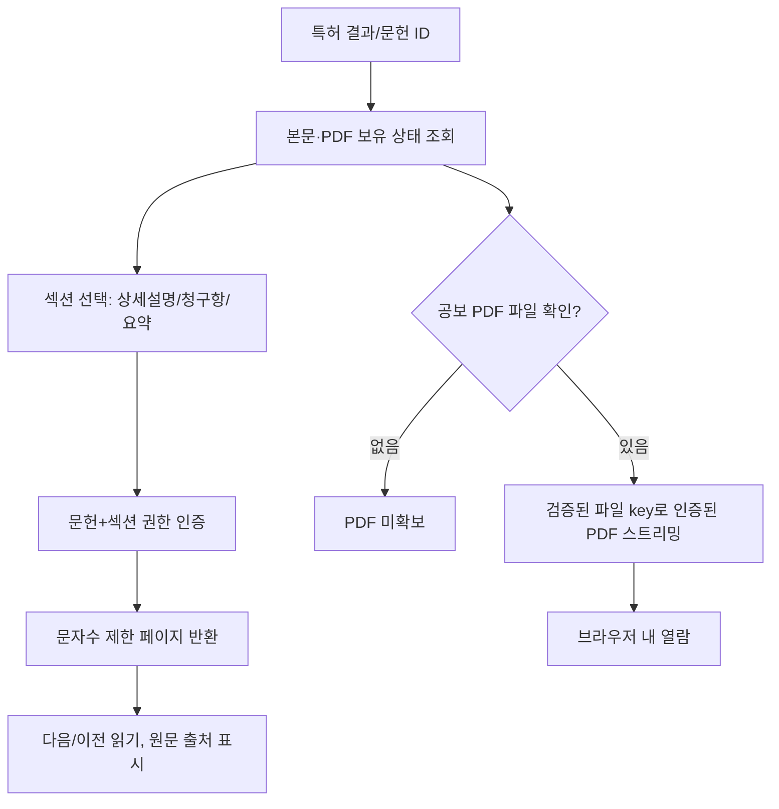

# P0-4 설계서 — 사람이 전체 특허 명세서와 공보 PDF 열람

- 작업 ID: P0-4 / 상태: **기존 근거 발췌 MCP만 운영, 전체 텍스트 페이지·공보 PDF 열람 미구현**
- 의존성: 기존 [원문 일부 실제 적재](../35-mvp03-actual-ingest-acceptance.md), [P0-2 PDF 취득](P0-2-design.md) 성공 시 PDF 보기 활성
- UX 목표: 사용자가 문헌 검색 결과에서 **원문 텍스트 전체**를 원하는 섹션별로 읽고, 공식 특허 공보 PDF가 있으면 **별도 탭/내부 뷰어**로 파일 전체를 볼 수 있도록 한다.
- 이 단계는 **파일 다운로드 수집 기능**을 구현하지 않는다. PDF 취득이 아직 없으면 "PDF 미확보" 상태를 정확히 표시하고 기존 텍스트 열람은 독립 제공한다.

## 1. 현재 구현과 빈틈

| 구성 | 실제 구현 | 부족한 부분 |
|---|---|---|
| [읽기 MCP](../../poc/unified_mcp_production.py) | `search_patents(query,limit=3)`/`get_patent(document_id)` 제공. 최대 evidence 3개, 발췌 300자 | 전체 상세설명 및 모든 청구항을 볼 수 없음 |
| [읽기 제한 View](../../poc/private_patent_reader.sql) | `private_docs.readable_catalog`, `readable_evidence`. `left(c.body,300)` | view를 그대로 재사용하면 전체 문장은 절단됨 |
| 원문 소스 | `private_docs.section_sources.body`, `raw_payload`, `body_sha256`; 일부 메타데이터 `private_docs.documents.source_payload` | 인증된 전체 텍스트 섹션·청구항별 페이지 API 필요 |
| 공식 공보 | P0-2에서 신규 `patent_files` manifest/비공개 object를 만들 예정 | 파일이 실제 확보됐을 때만 서버가 읽기/스트림 제공 |
| 브라우저 | 기존 시안·개인 사설 HTTPS | 새 읽기 화면은 작은 모듈로 제공; 새 로그인/광범위한 웹 포털은 MVP 범위 밖 |

## 2. 사용자 화면·API 흐름



브라우저는 서버가 생성한 **문헌 ID·섹션·페이지 cursor**만 사용하고 실제 NAS 파일 경로/외부 공보 다운로드 URL·DB 키를 표시하지 않는다. PDF 미확보여도 전체 텍스트 조회는 독립 성공 가능해야 한다.

## 3. 새 API 계약 (설계안; 운영 도구 아님)

| Operation | 입력 | 출력·권한 |
|---|---|---|
| `get_patent_fulltext_status` | `document_id` | 텍스트 섹션 목록과 크기, `pdf_status`, 출처, 실제 확인 가능한 권리; 기존 발췌 MCP와 별도 |
| `get_patent_section_page` | `document_id`, `section`, `cursor?`, `max_chars?` | `text` 최대 4000 문자, `start/end`, `next_cursor`, `body_sha256`, 실제 `language`, `source` |
| `GET /private/patents/{id}/pdf` | 내부 허용 id, 인증된 개인 접근 | `application/pdf` 응답/Range. `STORED`된 파일만 허용. 파일이 없는 경우 404/FILE_UNAVAILABLE |
| `GET /private/patents/{id}/read` | 인증된 사설 HTTPS endpoint | 텍스트 read-only HTML viewer. PDF 탭/링크는 manifest STORED에서만 노출 |

```json
{
  "document_id": "PAT-SYNTHETIC",
  "section": "detailed_description",
  "start": 0,
  "end": 4000,
  "text": "실제 전체 본문에서 나온 4000자 이하 조각",
  "language": "KR",
  "source": "WIPS",
  "body_sha256": "server-verified-hash",
  "has_more": true,
  "next_cursor": "opaque-server-signed-cursor"
}
```

예시 계약이다. 실제 `body_sha256`·본문/파일 경로를 공개 repo에 넣지 않는다. 페이지 단위 조회는 내용을 보존하는 **원문 보기**이고 ChatGPT의 짧은 근거 인용은 기존 `get_patent`를 유지한다.

## 4. 서버 구현 방법과 DB 권한

- 신규 `poc/mvp44_fulltext_reader.py`: `document_id` whitelist/pattern·`section` allowlist(`detailed_description`, `all_claims`, 제공 시 `abstract`/`representative_claim`), 인증 principal 및 entitlement 확인 후 4000자 이내 응답. 문자 offset은 Python Unicode codepoint 기준으로 정의; SQL `substring`(1-based)와 교차 시 `offset+1` 처리 및 한글·이모지 경계 시험. `cursor`에는 document_id, section, offset, body_sha256/version, 만료시각, 인증 principal 바인딩 HMAC; 사용자 제출 cursor의 값 무조건 신뢰 금지.
- `poc/mvp44_fulltext_acl.sql`: **별도 읽기 전용 DB role** 또는 감사된 최소범위 `SECURITY DEFINER` 함수(한 번에 ≤4000 chars, doc+section allowlist); 기존 `patent_ingest_reader_v1`에게 `section_sources.body` 무제한 SELECT 권한 부여하지 않는다. 함수 사용 시 고정 `search_path`/완전 qualified table/EXECUTE role 한정/동적 SQL 금지.
- `poc/mvp44_pdf_stream.py`: P0-2 manifest가 `STORED`일 때만 서버 내부 `storage_object_key` → 비공개 PDF 파일 스트림. 사용자 path/URL 매개변수 허용 금지. 파일 `SHA-256`/크기 확인(배포 전/변경 검증), 안전한 Range parser(`bytes=start-end`, 범위 cap) 및 유효한 `Content-Length/Content-Range` 지원.
- `poc/mvp44_reader.html`/JS: 순수 텍스트는 `textContent`로 렌더. WIPS raw HTML의 script/img/onerror를 `innerHTML`에 직접 삽입 금지. 페이지 탐색, PDF 버튼은 상태를 보며 노출. 화면은 개인 private HTTPS만 사용.
- PDF 정책: `Content-Type: application/pdf`, `X-Content-Type-Options: nosniff`, 개인인증/권리, 세션/토큰 만료·no-store, 동일 출처 CSP. 다른 계정 접근·공개 URL·직접 NAS 경로 노출 금지.
- ChatGPT/모델로 **전체 원문을 한 번에 외부 전송**하지 않는다. 사용자 직접 브라우저 열람과 모델 근거 답변의 경계 분리. 인용이 필요할 때 짧은 excerpt·출처 섹션만 사용.
- 내부 서비스 도입 전 현재 개인 HTTPS 터널/인증·장치 별 인증 방식을 확인. 새 공개 포트와 새로운 OAuth 공급자 구축은 범위 밖. 기존 NAS/DB/relay/tunnel 재시작 금지 유지.

## 5. 원문 무결성·성능

- `section_sources`는 중복·수정 충돌이 금지된 append-only row. `body_sha256`/text length가 cursor와 달라지면 `STALE_CURSOR`, 임의의 다른 문헌을 이어붙여 반환하지 않는다.
- 본문 원문 HTML/특수문자/수식·청구항이 긴 경우 **실제 저장된 문장을 손실 없이 페이지 분할**하되, 화면은 기본 text-only 안전 표시. 별도 변환/정제본은 원본과 구분.
- 매 요청 기본 max_chars 2000, 상한 4000. 동일 doc/section 요청에서 offset 증가·마지막 빈 조각·중복 없음. 사용자 무제한 offset/fetch-all 허용 금지.
- 문서가 10만자 이상이어도 API는 페이지 단위로만 응답하고 payload/메모리 상한 유지; DB function/server query가 full column을 조회하더라도 유출 범위를 1페이지로 제한하고 호출량/속도를 제어.
- PDF 파일 대용량은 1회 전체 memory read 금지, streaming / Range, 서버 요청·바이트 상한, timeout/close 처리, 영속 원본/백업 fingerprint 불변.

## 6. 사전 위험표

| 위험 | 왜 발생 | 예방 설계 / 테스트 |
|---|---|---|
| 전체 원문 열람에서 여전히 300자로 절단 | 기존 `readable_evidence` view 사용 | `section_sources`용 별도 통제된 reader; 기존 `get_patent` 불변 |
| 저장된 텍스트는 있는데 PDF 버튼 활성화 | text/vector와 PDF 저장 상태 혼동 | `STORED` manifest 실파일 해시 검증 후만 PDF 제공 |
| 원문 HTML 스크립트/XSS | WIPS 상세설명에 HTML/태그 포함 | HTML 삽입 금지, textContent, CSP, 위험 URL 차단 |
| 문자 offset과 DB byte offset 혼동 | 한글/멀티바이트, PostgreSQL 1-based | Unicode char 기준, 합성 한글·이모지/단일 문장 분할 테스트 |
| cursor 다른 사용자·문헌에 사용 | offset만 전달 | 인증 principal 바인딩 HMAC/만료/version, 정해진 section만 |
| 서지 단독 83건을 전체 원문으로 표시 | metadata 저장과 section_sources 별개 | `text=NONE` 명시, 실제 섹션 count로 판단 |
| DB 읽기 role 과다권한 | 기존 MCP reader에 원문 body SELECT 허용 | 별도 최소권한 함수/role, 타 DB·writer/원문 변경 차단 |
| Range/파일경로 악용 | 외부 path/redirect/HTTP Range 조작 | server-derived key, bounded range, traversal/oversize 거부 |
| PDF URL이 공개 브라우저에 캐시 | 장기 링크/서버 보안헤더 부재 | 개인 인증, no-store, 만료·권한 검사, HTTPS만 |

## 7. 완료 기준

- 기존 실제 저장 문헌 1건의 **상세설명 시작→중간→마지막 페이지**와 모든 청구항이 누락/중복 없이 열람 가능.
- 사용자가 "원문"과 "공보 PDF"를 다른 자산으로 인지. PDF 0건일 때는 없음으로 표시하고 **가짜 PDF 생성 안 함**. P0-2에서 실제 PDF 확보 시 1건 브라우저 열람·mime/range/인증/번호 검증.
- 인증 없는 접근, 다른 scope/role, XSS, path traversal, 임의 cursor, 4001자 요청은 차단, 기존 ChatGPT 검색/300자 근거 회귀 및 운영 백업/복원 PASS.
