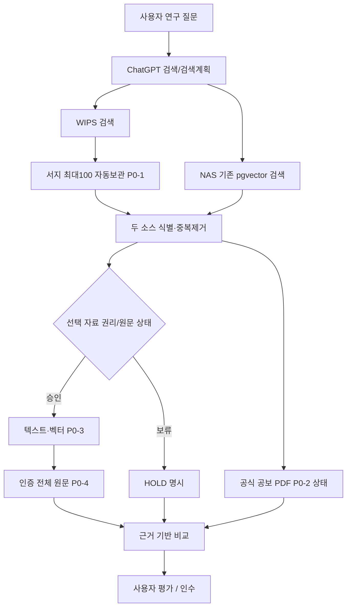

# P0-5 설계서 — 개인 특허 RAG 전체 종단간 인수·복구·관측

- 작업 ID: P0-5 / 상태: **기존 부분 인수 PASS, 신규 자동 검색·공보·전체 원문 결합 인수 미실행**
- 대상: 실제 ChatGPT + WIPS MCP + NAS PostgreSQL/pgvector + 승인된 텍스트/공보 PDF 읽기까지의 최소 사용자 흐름.
- 이전 실측: [MVP-01 운영 도구 56/56](../24-mvp01-production-cutover.md), [MVP-04 후보비교 27/27](../25-mvp04-candidate-comparison.md), [MVP-05 격리 rollback 96/96](../28-mvp05-rollback-acceptance.md), [83건 서지/복원](../39-mvp-archive-100-live-acceptance.md). **완성된 P0-1~4에 대한 통합 PASS가 아님.**
- 사용자 직접 평가: [실사용 확인](../31-mvp06-user-trial.md), [중앙 #31](https://github.com/son1004007/ai-agent-workflow-playbook/issues/31).

## 1. 서비스 책임과 실증 경계



- **P0-1**은 서지 검색/저장 계약이며 본문 취득 성공을 뜻하지 않는다.
- **P0-2**는 *공식 공보 PDF*이고 데이터 출처/파일 해시와 문헌종류가 맞아야 한다.
- **P0-3**은 승인된 텍스트/청크/E5 384D이며 WIPS 벡터 직접 제공이 아니다.
- **P0-4**는 인증된 전체 원문/원본 파일 사람용 열람이며 기존 `get_patent`(최대3개×300자 근거)를 대체하지 않는다.
- 두 소스 통합 [`mvp04_candidate_compare.mjs`](../../poc/mvp04_candidate_compare.mjs)의 비교/보류 기준을 유지. 근거 부족 시 **HOLD**, 무관 후보 **EXCLUDE**, 검증 안 된 물성·수주·권리를 사실처럼 추천하지 않는다.

## 2. 통합 응답 계약 (향후 제안)

```json
{
  "query_status": "PASS",
  "wips": {"total_count": 83, "returned_count": 83, "save_status": "REUSED_VERIFIED", "saved": 0, "reused": 83},
  "nas": {"candidate_count": 3, "evidence_count": 9},
  "documents": [
    {
      "publication_key": "KR|SYNTHETIC|B1",
      "metadata": "STORED",
      "text": "COMPLETE",
      "embedding": "READY",
      "gazette_pdf": "NONE",
      "recommendation": "HOLD",
      "reason": "Required technical evidence not verified"
    }
  ],
  "final_status": "PARTIAL"
}
```

**합성 계약 예시**, 실제 운영 WIPS/특허 ID를 출력한 것이 아니다. `wips.total_count`는 전체 검색 적중 수, `returned_count`는 실제 페이지 수, NAS 유사도는 거리이며 **정확도 확률이 아님**. 성공/실패/누락/권리 보류를 별도 코드로 표현. PDF/본문 없는 문헌의 상태를 `COMPLETE`로 합치지 않는다.

## 3. 검증 단계와 수용 기준

| Group | 테스트 범위 | 합격 조건 |
|---|---|---|
| A. 검색 | 실제 ChatGPT WIPS 질의, 한 페이지 최대100, 반환 개수·식별자 | 첫 페이지 반환수와 total 별도, 101개 보관 불가능, 무한 paging 없음 |
| B. 자동 저장 | 통합 경로 호출, 중복 0, 저장 실패/인증 차단 | 신규/재사용/실패·보류 일치; 직 WIPS 플러그인 호출은 별도 통합 도구의 보장 범위 아님 |
| C. RAG | 기존 NAS E5/pgvector 검색, 기존 문헌·신규 승인 텍스트 | 384D, model ID/section/source/offset/chunk SHA, 기존 검색 근거 일치 |
| D. PDF | 공식 제공처 문헌 1건, 원본 그대로 암호화 접근 | 출처/번호/종류·바이트 SHA, pdf page view, 중복0, 없는 문헌 실패 |
| E. 사람용 원문 | 상세설명/청구항 섹션별 페이지·실제 본문 끝까지 | 300자 snippet과 분리, Unicode/markup/XSS/접근제어 |
| F. 결과 판단 | 동일 후보/근거 부족/양 소스 한쪽 고장 | 근거 확인 불가 시 HOLD, 비관련 EXCLUDE, 출처 누락·모델 임의 추측 금지 |
| G. 운영/장애 | 외부 provider 실패, DB·모델·디스크·권한 실패 | 실패 범위 분리, 이미 조회한 결과는 보존, 불확실 쓰기 완료로 간주 금지 |
| H. 복원 | 전체 DB+실제 PDF 파일 백업, 별도 복구/reader 권한 | data/ACL/index/384D/vector top3/manifest 파일 SHA 일치 및 기존 타 컨테이너 불변 |
| I. 사용자 | 최소 1개 실제 질문, 후보 비교와 파일 보기 | 사용자: 관련성/출처/이해도/열람 조작성 "OK 또는 개선 필요" 확인·기록 |

**완료 표시 원칙:** A~I 중 P0 범위에서 필요한 **실제 운영 E2E 증거가 모두** 있어야 P0-5 PASS. 일부 설계만 작성하거나 단일 synthetic 통과를 MVP 전체 완료로 간주하지 않는다. 사용자의 평가 #31 대기 시 `USER_ACCEPTANCE_PENDING`.

## 4. 권한 경계 및 관측 설계

- 인증: ChatGPT reader token, 서지 writer role, 본문 승인 writer, PDF downloader, 전체 텍스트 reader **서로 별도 권한**. 어느 한 기능을 위해 다른 기능의 권한을 통합하지 않는다.
- 데이터: WIPS 연결으로 수집한 실제 문헌정보/본문·파일을 공개 GitHub/Issue/외부 로그에 노출하지 않는다. 사용자 비공개 NAS의 승인 범위만 처리. 답변의 문헌 근거/발췌는 허가된 채팅 범위를 따른다.
- 관측/트레이스: `operation_id`(서버 생성 불투명 값), 단계별 `PASS/PARTIAL/FAILED/HOLD`, 데이터 **집계**, 소요시간·resource cap, 비밀 아닌 provider 이름/model version 및 배포 commit만 기록. 원문 검색 질의/파일 path/개별 SKEY/token/서버 주소/요금 계정 정보 출력 금지.
- 결과 분리: 서지 저장 `STORED`/본문 `NONE/COMPLETE`/벡터 `NONE/READY`/공보 `NONE/STORED`는 서로 별도. 모든 상태를 "원문 확보"로 환원하지 않는다.
- 실패 처리: 네트워크 timeout 후 DB commit 여부 불확실하면 `FAILED_OR_UNCONFIRMED`, DB에서 batch/identity hash 재조회 후 안전한 idempotent retry. API 재시작/컨테이너 강제 종료·무제한 WIPS 재검색 금지.
- 공급자 장애: WIPS 실패 시 NAS 이미 보유한 자료를 검색하는 것은 가능하지만 **WIPS 검색 성공**으로 표시하면 안 된다. NASA 실패 시 WIPS 목록은 남기되 NAS evidence 없음을 명시한다.
- 품질: 공보 PDF 존재는 물성 성능 검증이 아니다. 인용 섹션·문헌 번호·실제 발췌가 없는 결론은 HOLD. 추천은 근거 신뢰/불확실성 문장과 함께 표시한다.

## 5. 예상 장애 예방 매트릭스

| 위험 | 사전 확인·예방 |
|---|---|
| 운영 데이터/문서 범위가 일치하지 않음 | `patent_archive` 서지83건과 `private_docs` 본문6건, PDF0을 baseline; 새 데이터는 시점별 집계 |
| WIPS MCP 도구가 새 채팅에 없음 | 연결 플러그인 도구 Refresh/권한/현재 도구 노출 조회. 설치·도구 권한 없이 PASS 주장 금지 |
| 백엔드가 WIPS 도구를 직접 호출 못함 | P0-1 A/B 결정; 동일 대화 순차와 단일 MCP entrypoint 구별 |
| 권리 미확인 자료 자동 다운로드 | 서지100건 승인 vs 본문/임베딩/PDF 권리 별개 gate, FAIL-CLOSED |
| PDF가 다운로드됐으나 WIPS 문헌과 다른 파일 | 국가/공보번호/kind·파일 signature/hash·표지 대조, 오매칭 REJECT |
| PDF 파일만 있고 DB backup 누락 | db dump + file snapshot, 복구 후 manifest reconciliation |
| 빈 명세서·언어 fallback/청크 오류 | 상세 parser/언어/claim count·token/384D 검증, partial 상태 유지 |
| 사용자에게 300자 발췌를 전체 원문으로 표시 | 별도 P0-4 page reader / `text_status` 명확히 |
| 문제 재현을 위해 운영 서비스 전체 재시작 | 최소 범위 신규 도구만 disable/롤백, NAS/DB/relay/tunnel 기존 제한 준수 |
| 개인정보/계약 로그 누출 | logging schema allowlist, count/status만 공개, 실제 자료/키 비공개 |

## 6. 인수 문서·서명 책임

- 기록 위치: [TASKS](../../TASKS.md)(실행 원장) / [CURRENT_STATE](../../CURRENT_STATE.md)(상태) / [WORKS](../../WORKS.md)(실측) / [MVP 사용자 평가](../31-mvp06-user-trial.md).
- 결과: 단계별 `PASS/FAIL/NOT_RUN/HOLD`와 실제 commit·배포/복원 시점·환경·실행자·독립 확인 범위 기록. **NOT RUN을 PASS로 바꾸지 않음**.
- 사용자 평가는 #31의 관련성·근거·이해도를 실제 질문으로 확인; 등록된 이슈를 AI가 사용자 대신 "OK" 처리하지 않는다.
- 운영 독립 AI 리뷰는 최신 사용자 지시에 따라 선택 사항 (`NOT_RUN_OPTIONAL`), 실제 안전·기능·권한 검증은 필수.
