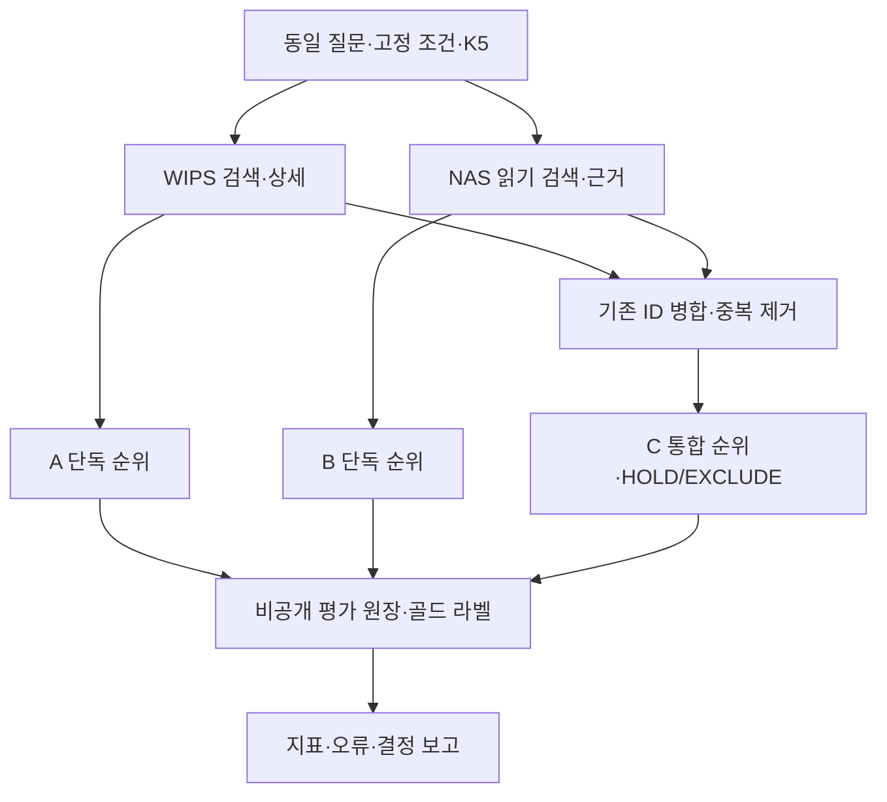

# EV-01 설계 — WIPS/NAS/통합 검색 품질 비교

2026-11-20 / 상태: DESIGN ONLY, NOT RUN / P0
[실행 계획](EV-01-plan.md) · [판단 기준](../44-mcp-rag-investment-decision.md) · [기존 비교 모듈](../../poc/mvp04_candidate_compare.mjs)

## 목적·범위

5~10개의 공개·합성 연구질문을 대상으로 **A WIPS-only(검색+필요한 상세 조회), B NAS-only(기존 search_patents/get_patent), C WIPS+NAS(기존 문헌 ID 정규화·중복 제거·근거 기반 HOLD/EXCLUDE)**를 비교한다. 고급 reranking/Hybrid 신규 서비스는 구현하지 않는다. 검색 조건(국가, 기간, 키워드/확장 질문, K=5), 평가 버전·실행 시각을 고정한다.

**표본의 필수 층화:** NAS 6개 원문에 직접 관련 답이 있는 질문 2개 이상, NAS 밖의 후보가 필요한 질문 2개 이상, 근거 부족/오답 유도 1개 이상. NAS 서지83건과 원문6건은 별개의 corpus다. B의 외부 문헌 미수록은 임베딩 오류로 해석하지 않으며, 원문 보유 문헌만 비교하는 overlap-only 결과와 일반 사용자 질문 전체 결과를 분리한다. 정답 전체 집합 미확인 시 recall을 확정하지 않는다.

## 구성/계약

우선 기존 ChatGPT WIPS MCP/NAS 읽기 도구와 MVP-04 비교 모듈을 재사용한다. **신규 제안 파일(미구현)**: poc/validation/eval_common.mjs (입력 검증, 권리/출처, 정규화), eval_quality.mjs (순위/지표/근거 채점), eval_quality.test.mjs (합성 회귀). API/DB 스키마 변경 불필요.

비공개 case/result 필수 필드: case_id, topic_group, overlap_flag, prompt_version, query_parameters, country, time_scope, corpus_snapshot, source_call_time, method(A/B/C), rank, canonical_doc_id(비공개), returned_n, source, evidence_section, evidence_verified, relevance_grade, decision(REVIEW/HOLD/EXCLUDE), provider_status, call_count, latency_ms, rights_scope. 공개 GitHub에는 비식별 case 번호/통계만.

## 채점·중복·오추천 규칙

연구자/사용자가 출처와 실험군을 가리고 각 고유 문헌 0=무관 / 1=참고 / 2=직접관련으로 평가한다. 문헌 번호·종류가 모호하면 임의 병합 금지. 각 군 상위 5개(부족한 자리는 0)의 **P@5=grade2 문헌수/5**, **nDCG@5=(2^grade-1 gain, 이상순위 대비)**, 직접관련 후보수, MRR(조건 충족 시), 중복률, latency, 호출수 보고. 섹션·청구항에 검증 가능한 주장 중 근거 일치 주장수 / 검사 주장수로 evidence_match_rate를 계산하고 불가분은 UNVERIFIED 분리. 물성/효능/법적 상태를 원문 근거 없이 확정 추천하면 unsupported recommendation으로 실패. 정당한 HOLD도 평가하고 잘못된 EXCLUDE도 별도 검토.

**paired analysis:** 같은 문항 A/C의 delta P@5, nDCG@5, 직접관련 수, 근거 누락, 보류 오류를 나란히 표시; 평균과 각 문항, 실패·missing 결과 함께 보고. 5~10 문항의 결과를 일반화하지 않는다.

## Pre-mortem / Stop-Go

| 원인 | 예방/대응 |
|---|---|
| 서지83건을 fulltext로 오인 | 6문헌 경계/overlap 층화, 불일치는 corpus gap |
| 발행국/공보종류 차이로 잘못된 병합 | canonical ID 검증, 불확실하면 보류 |
| 공급자 필드·도구 실패/타임아웃 | 오류로 기록, 부분 결과 3방식 PASS 금지 |
| WIPS 결과 시점/LLM 프롬프트 변동 | 고정 조건·snapshot·호출 시각 기록, drift 분리 |
| 원문 보관/반복 호출 권리 미확인 | 허가된 읽기만; 원본 공개·영구 복제·전건 적재 중단 |
| 근거 없는 추천 | 해당 후보 HOLD, 안전 기준 실패로 보고 |
| 실제 문헌/고객 정보 공개 | commit 전 비식별 점검 실패 시 commit 금지 |

수용 정의: **유효한 최소5개 질문, 세 경로 실행, 사람 라벨/계산 재현, 질문별 근거·오추천·실패 보고, GO/HOLD/STOP/INCONCLUSIVE 제안**. 설계 작성 자체는 테스트 PASS가 아니다.
