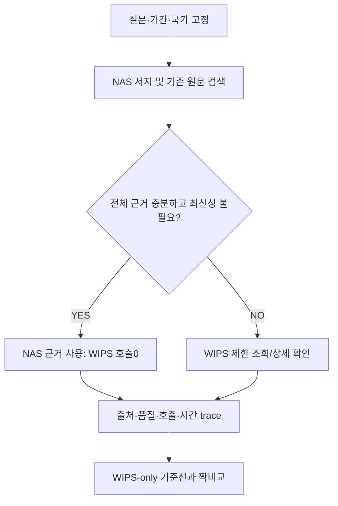

# EV-02 설계 — WIPS 재조회 절감 및 NAS 반복 사용 가치

2026-11-20 / DESIGN ONLY, NOT RUN / P0
[실행 계획](EV-02-plan.md) · [의사결정](../44-mcp-rag-investment-decision.md) · [기존 A안](../42-mvp41-code-mode-gateway-archive.md)

## 목적과 비교 모드

**cold 최초 / warm 동일·유사 질문 반복**을 분리하고, EV-01 질문 5~10개(반복 가능한 3개 이상, cold 2개 이상)를 재사용한다. NAS에는 서지83건만 저장된 결과도 있고 **전체 텍스트/벡터는 6문헌**만 있다. 두 종류 캐시를 구분해야 한다.

- A WIPS-only repeat baseline: 같은 문제에서 WIPS 검색과 필요한 상세/청구항을 반복 호출한 기준선(실제 호출 권한·요금 확인 필요).
- B NAS-first + WIPS fallback: 로컬 원문으로 근거 충분하고 신선도 검사가 불필요한 경우만 NAS 재사용. 부족하면 WIPS에 필요한 필드만 확인.
- C NAS-only diagnostic: 로컬 문헌만으로 답할 수 있는지 한계 측정; 최신 특허·권리 상태를 다루는 공식 대체 수단으로 사용하지 않는다.

**검증된 캐시 히트** ANSWERABLE_CACHE_HIT은 단순 서지 ID 존재가 아니라, 질문에 필요한 허용된 상세/청구항 근거를 NAS에서 확인 가능해야 한다. 기타 cache_status: METADATA_ONLY, FULLTEXT_MISS, FRESHNESS_REQUIRED, NO_PERMISSION, PROVIDER_FAIL. 법적 상태/신규 출원 질문과 근거 300자 발췌가 불충분할 때는 WIPS/원본 검증 또는 HOLD, 강제 생략으로 절감 성적 조작 금지.

## 구현 경로·기록 계약

기존 ChatGPT WIPS MCP + NAS reader 및 Gateway의 승인된 서지 저장 A안을 재사용한다. 제안 파일(아직 없음): poc/validation/eval_reuse.mjs / eval_reuse.test.mjs (trace 검증, paired metric, synthetic). DB/schema/유료 외부 서비스 추가 불필요.

비공개 trace 필드: case_id, run_phase(cold/warm), mode, question_version, corpus_snapshot, cache_status, archive_count, fulltext_count, wips_search_calls, wips_detail_calls, nas_search_calls, nas_detail_calls, wall_time_ms, review_time_seconds, claim_verified, user_quality_grade, provider_error, freshness_required, source_drift, cost_known, cost_basis. 실제 문헌 ID/응답/비공개 연구 내용은 공개 commit 제외.

**지표**
- WIPS 호출 절감률 = (A search+detail − B search+detail) / A, A=0이면 N/A. 검색/상세 호출도 각각 따로 보고.
- 근거 충분 cache hit 비율 = ANSWERABLE_CACHE_HIT / 반복 질의(단순 서지 hit 불포함).
- 사람 검토시간 절감률 = (A 검토 초 − B 검토 초)/A (동일 평가자·측정 규칙, 결측 N/A).
- 실제 wall time p50/p95, 실패/재시도 부담, 품질 비열화 여부(근거·관련 후보·오추천), 비용은 공식 단가 확인 시에만 환산.
- 임시 가설: warm에서 **WIPS 호출 또는 검토시간 20% 감소 + 품질 유지 + 허위 단정0**이면 조건부 GO. 0/10/20/30% 임계치 감도 분석 및 사례별 값 제시. 5~10개는 탐색적 결과.

## 실패 모드

서지만 있는 것을 전체 원문 hit로 처리하면 실패. 공급자 신선도 변화는 SOURCE_DRIFT로 구분. WIPS 비용·추가 호출 권한이 없다면 과거 합법적 증거로 DRY_RUN_ESTIMATE만 계산하고 실제 효과 입증 주장 금지. provider 실패·수동 복구 시간도 기록. 새 WIPS 본문/벡터/PDF 영구 저장과 MyFolder는 승인 범위 밖. 운영 NAS/DB/relay/tunnel 재기동·권한 확대 금지.

**수용 정의**: cold/warm 시점·모드별 trace, 실제/추정 구분, 비용 UNKNOWN 명시, quality 유지와 반례, 20%/감도 표, 사용자 판단. 단순 "재사용했다"는 완료 근거가 아니다.
