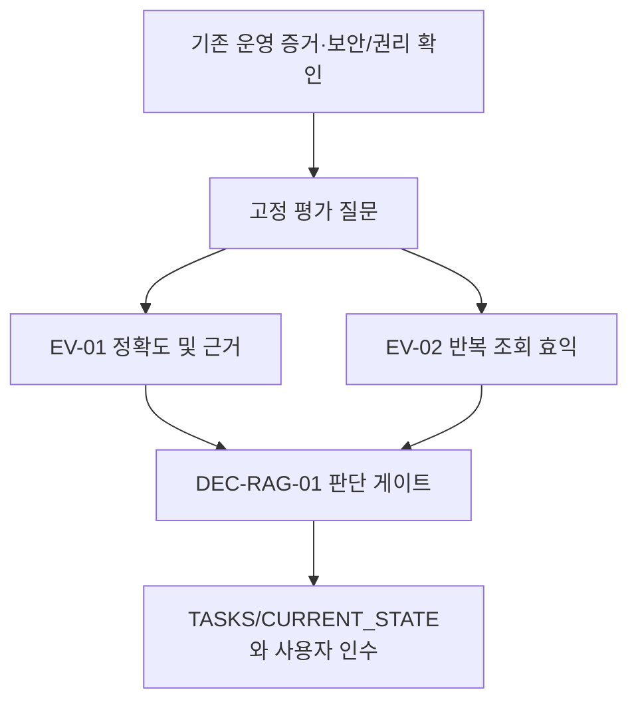

# 특허 RAG 효용 검증 — 설계·실행 계획 인덱스

2026-11-20 / 상태: 두 작업 모두 **PLANNED, 실험 NOT RUN**. 실행자: ChatGPT, Codex, 다른 저장소 접근 AI.

진입: 전역 [CONTROL](https://github.com/son1004007/ai-agent-workflow-playbook/blob/main/CONTROL.md) → [AGENTS](../../AGENTS.md) → [DOC_INDEX](../../DOC_INDEX.md) → [TASKS](../../TASKS.md) / [CURRENT_STATE](../../CURRENT_STATE.md) → [판단 기준](../44-mcp-rag-investment-decision.md) → 아래 설계서·계획서.

| 우선순위/작업 | 설계서 | 단계별 계획서 | 산출물 |
|---|---|---|---|
| P0 **EV-01 검색·추천 품질 비교** | [EV-01-design](EV-01-design.md) | [EV-01-plan](EV-01-plan.md) | 5~10질문, 3모드 평가, P@5/nDCG@5, 근거·HOLD·오추천 |
| P0 **EV-02 반복 재사용 가치 검증** | [EV-02-design](EV-02-design.md) | [EV-02-plan](EV-02-plan.md) | cold/warm WIPS 호출·검토시간·품질·비용/감도 분석 |

기존 [P0-1~5 잔여 기능 설계](../mvp-implementation/INDEX.md)는 폐기하지 않고 보존한다. 새 실험 우선 이후의 조건부 개발이다. 83건 서지/6건 원문/417청크 구분, 신규 원문·PDF 무단 적재/상시 후킹 금지. 실제 소스 자료와 채점 근거는 승인된 비공개 저장소/세션에서만 관리하고 공개 GitHub에는 합성 fixture·비식별 집계만 남긴다. 기존 [품질 평가 초안](../04-evaluation.md)과 혼동하지 않도록 **세 경로 품질 비교/반복 효익**을 구분한다.
